# SISTEMAS OPERATIVOS: GESTIÓN DE ARCHIVOS Y ALMACENAMIENTO

---

## Documentación alternativa:
1. [Comandos Basicos Linux](./SSOO-GNUBash-A03-Comandos-basicos.pdf)
2. [Comandos  Básicos Windows](./WinXP-Consola-de-comandos.pdf)
3. **Listado Comandos Linux**
   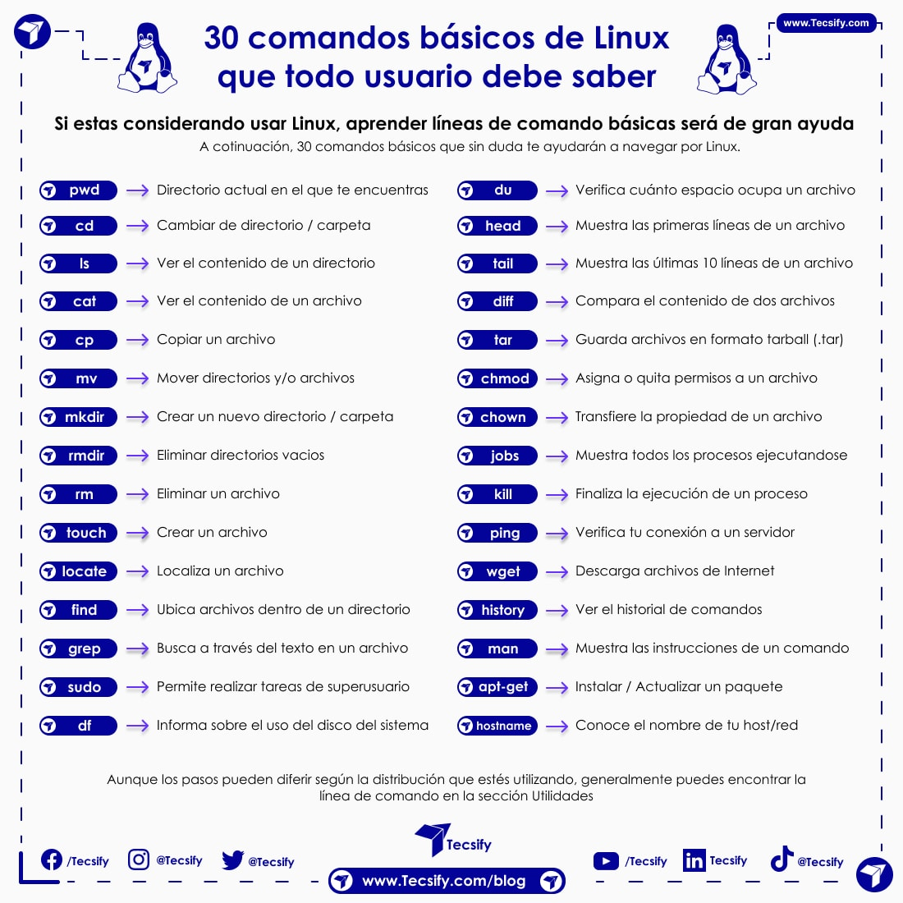

---

## Índice de Contenidos
- [Mapa conceptual del tema](#mapa-conceptual-del-tema)
- [1. Sistemas de Archivos](#1-sistemas-de-archivos)
    - [Tipos de sistemas de archivos](#tipos-de-sistemas-de-archivos)
    - [Estructura de directorios en Linux](#estructura-de-directorios-en-linux)
    - [Estructura de directorios en Windows](#estructura-de-directorios-en-windows)
    - [Gestión de archivos por línea de comandos en Linux](#gestión-de-archivos-por-línea-de-comandos-en-linux)
    - [Operaciones sobre directorios y carpetas (Linux)](#operaciones-sobre-directorios-y-carpetas-linux)
    - [Atributos y Permisos (Linux)](#atributos-y-permisos-linux)
  - [Tipos de archivos en Linux (Detalle)](#tipos-de-archivos-en-linux-detalle)
    - [Operaciones con archivos en Linux](#operaciones-con-archivos-en-linux)
  - [Operaciones sobre directorios y carpetas](#operaciones-sobre-directorios-y-carpetas)
    - [Edición y Visualización de textos](#edición-y-visualización-de-textos)
    - [Búsqueda de patrones (`grep`) y otros](#búsqueda-de-patrones-grep-y-otros)
    - [Entrada y Salida Estándar. Redirecciones en Linux](#entrada-y-salida-estándar-redirecciones-en-linux)
  - [Gestión de archivos en Microsoft Windows](#gestión-de-archivos-en-microsoft-windows)
    - [Entorno Gráfico (Explorador)](#entorno-gráfico-explorador)
    - [Modo Comando (CMD Windows)](#modo-comando-cmd-windows)
- [2. Almacenamiento](#2-almacenamiento)
  - [Gestión de almacenamiento en Linux](#gestión-de-almacenamiento-en-linux)
    - [Montaje (`mount` / `umount`)](#montaje-mount--umount)
    - [Particionamiento, Formateo y Chequeo](#particionamiento-formateo-y-chequeo)
    - [RAID en Linux (Redundant Array of Independent Disks)](#raid-en-linux-redundant-array-of-independent-disks)
  - [Gestión de almacenamiento en Microsoft Windows (Entorno Gráfico)](#gestión-de-almacenamiento-en-microsoft-windows-entorno-gráfico)

### Mapa conceptual del tema

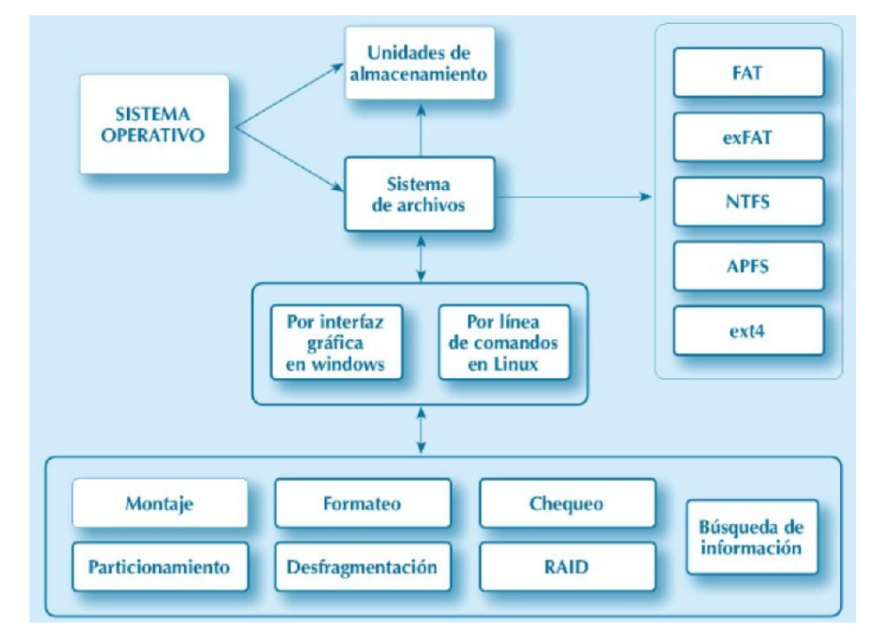
*Diagrama de flujo mostrando la relación entre el Sistema Operativo, las Unidades de almacenamiento, el Sistema de archivos, y las interfaces gráficas y de comandos. Además, se listan los tipos de sistemas de archivos (FAT, exFAT, NTFS, APFS, ext4) y las herramientas de gestión (Montaje, Formateo, Chequeo, Búsqueda de información, Particionamiento, Desfragmentación, RAID).*

---
# <u>1. Sistemas de Archivos</u>

*   El **archivo** (fichero) es la herramienta fundamental de abstracción lógica de la información.
*   Los **directorios** (carpetas) son ficheros que actúan de contendores lógicos de ficheros o directorios.

**Objetivos:**
*   Acceder a la información de los ficheros.
*   Crear, eliminar y modificar ficheros.
*   Acceder a los ficheros mediante diferentes protocolos de comunicación en red u otros ficheros.
*   Facilitar el acceso multiusuario.
*   Facilitar el acceso a multitud de medios de almacenamiento.
*   Realizar copias de seguridad.
*   Utilizar herramientas de recuperación de información.
*   Priorizar la eficiencia y la seguridad de acceso a la información.
*   Maximizar el rendimiento en las operaciones sobre los archivos.
*   Permitir la monitorización y contabilidad sobre ficheros.
*   Administrar el espacio de almacenamiento, gestionar la asignación del espacio libre y el espacio ocupado de los archivos.

Sabemos que todos los sistemas operativos almacenan la información de una forma más o menos parecida en el espacio de almacenamiento, pero es muy importante que entendamos que no lo hacen exactamente igual.
*   Los **sistemas de archivos** estructuran la información guardada en una unidad de almacenamiento (normalmente un disco duro).
*   Cada sistema operativo utiliza su propio sistema de archivos, aunque hay sistemas de archivos que son compatibles en diferentes versiones. El tipo de sistema de archivos se determina en el proceso de dar formato (formateo del disco).
*   El software que ofrece el sistema operativo para gestionar el sistema de archivos es responsable de la organización de los sectores para que en ellos se puedan almacenar archivos y directorios, y es el encargado de mantener un registro de qué sectores pertenecen a qué archivos, cuáles no han sido utilizados o qué sectores no se pueden usar porque están defectuosos.

Para administrar el espacio libre (susceptible de ser asignado) y el espacio ocupado, se han de definir espacios de asignación. Estas son las unidades físicas mínimas de almacenamiento gestionadas por los sistemas de archivos.
*   Los sistemas de archivos definen el tamaño del espacio de asignación (también llamado **unidad de asignación** o **clúster**) durante la instalación del propio sistema de archivos (formateo). Este espacio determina el tamaño mínimo que ocupará un archivo en el medio de almacenamiento.

    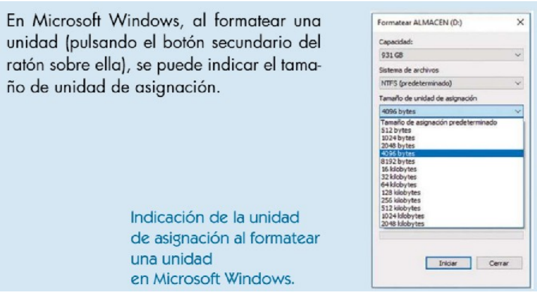

---

### Tipos de sistemas de archivos

**Clasificación de los sistemas de archivos:**

1.  ***Sistemas de archivos de disco.*** Diseñados exclusivamente para almacenar archivos en una unidad de disco conectada directamente al ordenador. Algunos de los sistemas de archivos más usuales de este tipo son:
    *   UNIX/Linux: ext3/4, Reiser, etc.
    *   Microsoft: FAT16, FAT32, NTFS y WINFS.
    *   Sun Microsystems: ZFS.
2.  ***Sistemas de archivos de red.*** Son sistemas que acceden a sus archivos a través de una red. Dentro de esta clasificación encontramos dos tipos de sistemas de archivos:
    *   Sistemas de archivos distribuidos: Los datos y las operaciones están distribuidos entre múltiples nodos de una red.
    *   Sistemas de archivos centralizados: Los archivos residen en un servidor centralizado y se accede a ellos desde clientes remotos. Algunos de los más comunes son AFS, AppleShare, CIFS (también conocido como SMB o Samba, usado en redes Microsoft), NSS (para sistemas Novell Netware 5) y NFS.
3.  ***Sistemas de archivos de propósito especial.*** Son básicamente aquellos que no pueden clasificarse en ninguna de las dos formas anteriores. Algunos de ellos son:
    *   CDFS, utilizado como sistema de archivos de CD-ROM.
    *   DEVFS, un sistema de archivos virtual usado por UNIX, cuyo propósito es controlar los archivos de dispositivos que se hallan almacenados en el directorio `/dev` de la estructura de archivos convencional.
    *   SWAP, utilizado en sistemas UNIX/Linux para la zona de gestión de memoria virtual y de intercambio.

**Sistemas de archivos más comunes:**

*   El sistema de archivos es la estructura lógica más adecuada y eficiente para el manejo de archivos y directorios.
*   El diseño del sistema de archivos tiene una gran influencia en la eficacia (rendimiento), seguridad, flexibilidad y capacidad de crecimiento de los almacenamientos en disco, y, por tanto, en el rendimiento del propio sistema operativo.
*   En general, los sistemas de archivos más utilizados se pueden catalogar en función del sistema operativo que los utilice.

    **Sistemas de archivos en Windows:**
    *   Los sistemas operativos Windows, del fabricante Microsoft, utilizan diferentes sistemas de archivos en función del tipo de sistema operativo. Normalmente utilizan los sistemas FAT, NTFS y WINFS. 
    *   Los sistemas operativos Windows 98 y ME utilizaban el sistema de archivos conocido como FAT. El nombre se debe a una de sus estructuras principales, la tabla de asignación de ficheros FAT (File Allocation Table).
    *   El sistema FAT utiliza una tabla donde se encuentran las direcciones de los archivos en el espacio de almacenamiento (disco duro). Las tablas FAT están ubicadas en el propio disco junto con el resto de datos. Dependiendo del espacio que tengan estas tablas, entre otras cosas, el sistema FAT se clasifica en varios: FAT12, FAT16 y FAT32, que utilizan respectivamente 12, 16 y 32 bits para direccionar el cluster en el que está el archivo completo o un trozo del mismo.
    *   Los productos Windows NT (4.0, 2000, XP, Vista/7 y familia de servidores) se diseñaron originalmente para ser sistemas operativos en red, por lo que se modificaron los sistemas de archivos soportados por estos sistemas. Aparece el NTFS (New Technology File System) para plataformas NT y el nuevo sistema de archivos WINFS diseñado para versiones de Windows 2008 Server y Windows Vista y posteriores. En cualquier caso, todos estos sistemas operativos son susceptibles de trabajar en FAT (16 y 32), aunque el rendimiento y prestaciones del sistema operativo serían muy inferiores.

    **Sistemas de archivos en Unix/Linux:**
    *   Utilizan sistemas de archivos totalmente diferentes a los de Microsoft, aunque la arquitectura de su sistema de archivos sirvió de inspiración para los sistemas de archivos originarios de MS-DOS, los cuales posteriormente se han ido mejorando para los sistemas Windows.
    *   El sistema de archivos de UNIX varía de unas versiones a otras, siendo el más estandarizado el UFS (Unix File System).
    *   En el caso de Linux, el sistema de archivos utilizado también ha evolucionado mucho, debido especialmente a la larga lista de versiones de este sistema operativo. Entre los sistemas de archivos más comunes que Linux puede utilizar se encuentra **ext3/4**.
    *   Otros sistemas de archivos utilizados por Linux son: bfs, minix, xia, xfs, msdos, umsdos, vfat, jfs, reiserfs, nfs, iso9660, hpfs, sysv, smb y ncpfs.

    **OS/2, Apple y Netware:**
    *   El **OS/2**, sistema operativo de IBM, utilizaba un sistema de archivos específico denominado HPFS (High Performance File System) que permitía nombres de ficheros de hasta 254 caracteres y soportaba la coexistencia de varios sistemas de archivos en el mismo, en especial unidades FAT12 y FAT16. HPFS utiliza una estructura más eficiente para organizar sus directorios. Como consecuencia, se consigue un acceso más rápido y un mejor aprovechamiento del espacio que en sistemas FAT.
    *   En lo que respecta a Apple, utiliza un sistema de archivos llamado **APFS** (Apple File System).
    *   Por último, comentar que Novell Netware, sistema operativo en desuso, utiliza un sistema de archivos denominado **NFS** (Netware File System), diseñado específicamente para servidores de red.

**<u>FAT (File Allocation Table):</u>**
Es un sistema de archivos creado para el sistema operativo MS-DOS. La administración del espacio del almacenamiento es sencilla, por lo que se convierte en un sistema de archivos muy extendido en la mayoría de los sistemas operativos. De tal manera, que se suele emplear en dispositivos utilizados para intercambiar datos en computadoras con varios sistemas operativos, videoconsolas, televisores, etc.
Las principales limitaciones de FAT32 son:
*   Imposibilidad de gestionar particiones superiores a 8 TB (32 GB en Microsoft Windows) y archivos de más de 4 GB.
*   Bajo rendimiento.
*   Inseguro: no permite encriptación, sus atributos y permisos son limitados y no permite journaling.
> **Journaling** es un registro o diario del sistema de archivos. Los sistemas de archivos que hacen uso de este sistema se denominan transaccionales. Consiste en registrar una serie de acciones previas a la operación sobre el sistema de archivos que se vaya a realizar. De tal manera, que si se produce un error durante alguna operación (copiado, borrado, creación, etc.), el sistema puede deshacer los cambios y volver a la situación original. Así se evitan muchas situaciones de inconsistencia de ficheros, facilitando la recuperación de datos y chequeos de medios de almacenamiento.

**<u>NTFS:</u>**
Se considera el sistema de archivos estándar de Microsoft Windows. Sus mejoras son considerables con respecto a FAT32, primando la seguridad y la confiabilidad. Sus principales ventajas son:
*   Emplea journaling. Favoreciendo una pronta recuperación ante errores inesperados.
*   Permite cifrado y compresión.
*   Reduce significativamente la fragmentación y aumenta la velocidad de búsqueda de archivos con respecto a FAT32.
*   Puede llegar a gestionar volúmenes de hasta 16 EB y archivos de hasta 16 TB.
*   Emplea Unicode para el nombre de archivos, con hasta 255 caracteres.

**<u>APFS:</u>**
Sistema de archivos empleado por Apple Inc. para sus medios de almacenamiento, que supone una versión mejorada de su predecesora HFS+. Sus características son similares a NTFS y ext4, por lo que permite administrar archivos y volúmenes de hasta 8 EB. Permite encriptación y está optimizado para almacenamiento Flash.
*   SISTEMAS DE ARCHIVOS (Video de YouTube): [https://www.youtube.com/watch?v=RJHDX1zy9sw](https://www.youtube.com/watch?v=RJHDX1zy9sw)

**<u>ext4:</u>**
Sistema de archivos predeterminado para sistemas operativos de tipo Linux en su cuarta versión. Incluye journaling, maneja archivos de hasta 16 TB y volúmenes de hasta 1 EB. Supera a sus antecesores ext2 y ext3, ya que:
*   Mejora el rendimiento.
*   Reduce la fragmentación.
*   Permite trabajar con ficheros de mayor tamaño gracias al uso de extents.

A diferencia de NTFS, ext4 no emplea extensiones como parte del nombre de los archivos.
En Microsoft Windows, un nombre de archivo se divide en `<nombre>.<extensión>`, donde extensión es un conjunto de caracteres (normalmente tres o cuatro) que se asocian con programas para que el sistema operativo reconozca la manera de ejecutar el archivo.
Ejemplos de extensiones muy usadas son:
*   `.c`: fichero fuente en lenguaje de programación C.
*   `.txt`: fichero de texto ASCII.
*   `.tar`: fichero resultado de utilizar el comando tar.
*   `.html`: fichero de lenguaje de marcas de hipertexto.

No obstante, muchos nombres de archivos en Linux incorporan sufijos separados por un punto en el nombre del fichero por convención, pero no como requisito establecido por el sistema de archivos.

El sistema de archivos Linux consta de varias partes importantes:
*   El **bloque de carga** o bloque cero de cada sistema está reservado para almacenar un programa que utiliza el sistema para gestionar el resto de las partes del sistema de archivos.
*   El **superbloque** o bloque uno contiene la información sobre el sistema de archivos.
*   La **tabla de inodos** es el equivalente a las entradas de la FAT. Por cada archivo, Linux tiene asociado un elemento en esta tabla que contiene un número. Este número identifica la ubicación del archivo dentro del área de datos.
*   El **área de datos**, como su nombre indica, ocupa el resto del disco, equivalente a la zona de datos. En esta zona están almacenados los ficheros y directorios de nuestro sistema.
*   Un directorio no es más que un archivo que contiene nombres de archivos (o directorios) con el número del inodo que contiene su información.

    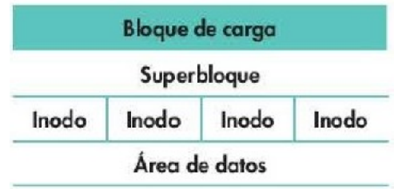
    ```Representación de las partes en sistema de archivos Linux```

**Características del sistema de archivos en Linux (Inodos):**
Cada inodo contiene información de un fichero o directorio. En concreto, en un inodo se guarda la siguiente información:
*   El identificador de dispositivo del dispositivo que alberga al sistema de archivos.
*   El número de inodo que identifica al archivo dentro del sistema de archivos.
*   La longitud del archivo en bytes.
*   El identificador de usuario del creador o un propietario del archivo con derechos diferenciados.
*   El identificador de grupo de un grupo de usuarios con derechos diferenciados.
*   El modo de acceso: capacidad de leer, escribir, y ejecutar el archivo por parte del propietario, del grupo y de otros usuarios.
*   Las marcas de tiempo con las fechas de última modificación (`mtime`), acceso (`atime`) y de alteración del propio inodo (`ctime`).
*   El número de enlaces (hard links), esto es, el número de nombres (entradas de directorio) asociados con este inodo. Si múltiples nombres están enlazados, o sea, asociados a un mismo inodo (lo que se denomina enlaces duros o simplemente enlaces) entonces todos los nombres son equivalentes entre sí. El que fue creado en primer lugar no tiene ningún estatus especial, al contrario de lo que ocurre con los enlaces simbólicos o con los denominados accesos directos de Windows, donde todos dependen del nombre original. El número de enlaces se emplea por el sistema operativo para eliminar el archivo del sistema de ficheros, tanto el inodo como el contenido, cuando se han borrado todos los enlaces y el contador queda a cero.

---
<h2 id="estructura-dir"><u>2. Estructura de Directorios</u></h2>

La información que se almacena en el sistema de archivos (directorios, subdirectorios y archivos regulares) suele ser jerárquica, ramificada o «en árbol», siguiendo el estándar FHS (Filesystem Hierarchy Standard).

*Ejemplo de estructura de árbol:*
*   Directorio raíz (`/` o `C:\`)
    *   `Princip`
        *   `Docs`
            *   `Word`
            *   `Excel`
        *   `Programa`
        *   `Apuntes`
            *   `Sistemas`


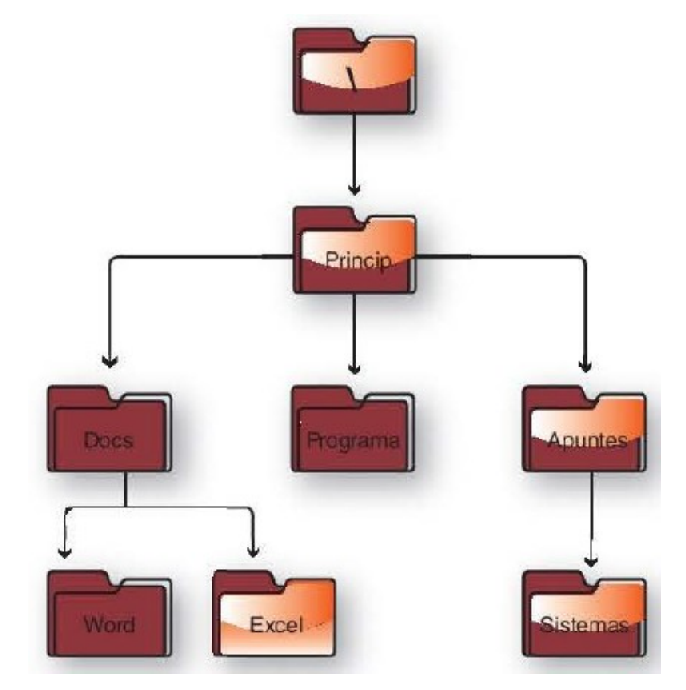

**Trayectorias o caminos en un estructura de archivos:**
Existen distintas formas de hacer referencia a un fichero o directorio dentro de la estructura jerárquica del sistema de archivos, dependiendo de en qué parte de la estructura jerárquica se encuentre el archivo o directorio y dónde estemos ubicados nosotros dentro del sistema de archivos.
*   En los sistemas de archivos jerárquicos se declara normalmente la ubicación precisa de un archivo con una cadena de texto llamada **ruta** (path en inglés). La nomenclatura de las rutas varía de un tipo a otro de sistema operativo, pero por lo general utilizan una misma estructura.
*   Una ruta viene dada por una sucesión de nombres de directorios y subdirectorios, ordenados jerárquicamente de izquierda a derecha, separados por algún carácter especial que suele ser una barra `/` (UNIX/Linux) o una barra invertida `\` (MS-DOS, Windows) y que puede terminar en el nombre de un archivo presente en la última rama de directorios especificada.
*   Windows: `D:\Sistemas Operativos\Temario`
*   Linux: `/home/Vicent/Sistemas/Temario`

**Aspectos previos:**
Para empezar a explicar cómo se accede a los ficheros y directorios, hemos de tener en cuenta dos conceptos:
*   **Unidad activa:** Se llama unidad activa a la unidad lógica que corresponde a la unidad física sobre la que el sistema operativo tiene el control o está situado. Para poder acceder a un fichero o directorio concreto hay que saber en qué unidad estamos situados; es decir, cuál es la unidad activa.
*   **Directorio activo:** Para poder movernos por la estructura de directorios y subdirectorios de la misma unidad o de otra, es necesario saber en qué subdirectorio nos encontramos; es decir, necesitamos conocer el directorio activo.

**Trayectorias en modo comando:**
En Windows en modo comando y UNIX/Linux en modo comando existen dos tipos de trayectorias para referenciar los ficheros y directorios que se encuentran dentro de la estructura del sistema de archivos.
*   **Trayectorias absolutas:** Con este tipo de trayectorias se pueden identificar ficheros y directorios sin tener en cuenta ni la unidad ni el directorio activo.
*   **Trayectorias relativas:** Para utilizar estas trayectorias es importante tener en cuenta tanto el directorio activo como la unidad activa.

Cada directorio o carpeta una vez creado, está vacío; es decir, no tiene ni subdirectorios ni archivos o ficheros que cuelguen de él. Pero al crear un directorio, el sistema operativo genera dentro de él dos subdirectorios automáticamente. Son los siguientes:
*   `.` (punto): Este subdirectorio hace referencia al contenido del propio directorio.
*   `..` (punto, punto): Este subdirectorio hace referencia al directorio padre.

El directorio padre es aquel que se encuentra jerárquicamente por encima del directorio en el que estamos situados. Por eso el directorio raíz no contendrá este fichero, porque encima de él no hay ningún otro directorio en la jerarquía.
Una trayectoria es la que se construye partiendo desde donde estamos y que baja por la estructura jerárquica hasta llegar al directorio o fichero que deseamos.

**Actividad (Windows) - Ejemplo de Trayectoria Absoluta 1:**

*  Partamos del fichero docl.txt de la imagen

    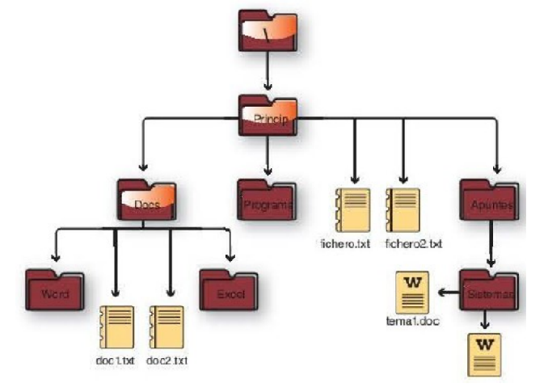

    Suponiendo que la unidad activa es la referente al disco duro, es decir, `C:`, la trayectoria en la que se encuentra el archivo es: `C:\Princip\Docs\doc1.txt`.
    Vemos que una trayectoria se construye indicando en primer lugar la unidad seguida de `:\` para continuar con una cadena de subdirectorios, cada uno de ellos separados por `\` hasta llegar a indicar exactamente dónde se encuentra el archivo.

    **Supongamos que queremos indicar la trayectoria en la que se encuentra el fichero temal.doc y fichero.txt.**
    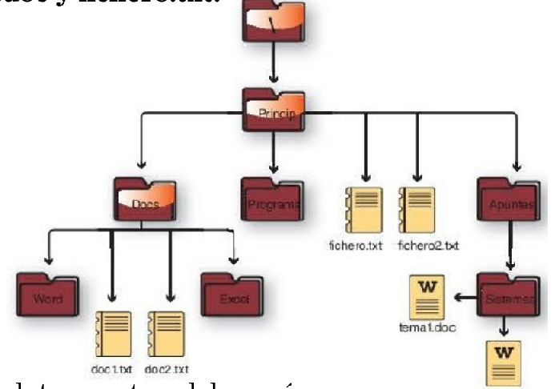

    La trayectoria absoluta para `tema1.doc` sería:
    `C:\Princip\Apuntes\Sistemas\tema1.doc`, donde
    *   `C:\` representa el directorio raíz del sistema de archivos.
    *   `Princip\Apuntes\Sistemas\` es la ruta del archivo.
    *   `tema1.doc` es el nombre del archivo.
    De forma análoga, la trayectoria absoluta para `fichero.txt` sería: `C:\Princip\fichero.txt`

**Actividad (Windows) - Ejemplo de Trayectoria Relativa:**
*  **Supongamos que estamos en el directorio Docs y queremos indicar la trayectoria en la que se encuentra el fichero temal.doc.**
    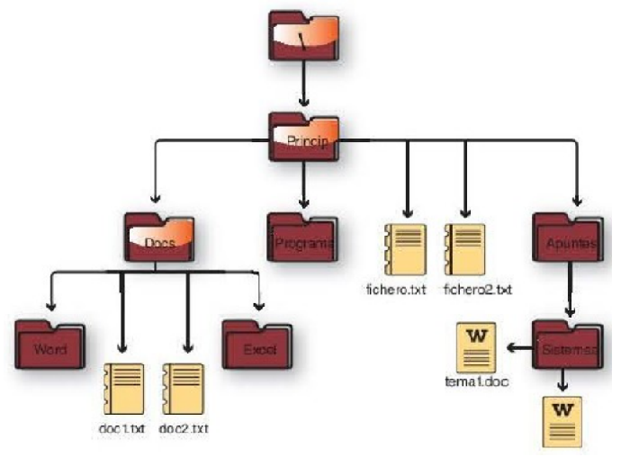

    Habría que escribir: `..\Apuntes\Sistemas\tema1.doc`
    A continuación, y partiendo desde `Sistemas`, vamos a indicar la ruta o trayectoria relativa en la que se encuentra el directorio `Excel`. Habría que teclear: `..\..\Docs\Excel`
    Como se puede ver, hemos ascendido por el árbol hasta `Princip` para, a continuación, bajar hasta `Excel`.

---

### Estructura de directorios en Linux

**Directorios más importantes en Linux:**
El directorio raíz es `/`: de aquí cuelgan todos los directorios del sistema. Dentro del directorio raíz encontramos varios subdirectorios importantes:
*   `/bin`: Contiene ficheros de comandos ejecutables utilizables por todos los usuarios. Aquí tenemos los programas que pueden lanzar todos los usuarios del sistema.
*   `/sbin`: Aquí encontramos los archivos de configuración del sistema (Nota: generalmente son binarios de administración del sistema).
*   `/home`: Es un directorio donde tenemos los directorios personales de todos los miembros del sistema.
*   `/usr`: Contiene utilidades y programas generales de usuario. Este directorio contiene los programas de uso general para todos los usuarios.
*   `/dev`: Contiene archivos especiales de bloques y caracteres asociados a dispositivos hardware. Aquí encontramos todos los dispositivos físicos del sistema (todo nuestro hardware).
*   `/lib`: Contiene librerías y compiladores del sistema. Contiene las bibliotecas necesarias para que se ejecuten los programas que tenemos en `/bin` y `/sbin` únicamente.
*   `/etc`: Directorio con ficheros de configuración y utilidades para la administración. Aquí encontramos los archivos de configuración del sistema.
*   `/media`: Contiene todas las unidades físicas que tenemos montadas: discos duros, unidades de DVD, pendrive, etc.

*Estructura jerárquica de archivos y directorios (Linux)*
*   `/`
    *   `usr`
        *   `sbin`
        *   `bin`
        *   `lib`
    *   `dev`
        *   `net`
        *   `pts`
    *   `home`
        *   `frances`
            *   `datos`
            *   `public_html`
        *   `gema`
        *   `miguel`

---

### Estructura de directorios en Windows

**Directorios más importantes en Windows:**
*   `\Archivos de programa (Program Files)`: En sistemas de 32 bits, se encuentran todos los programas instalados. Sin embargo, en sistemas de 64 bits se almacenarán las aplicaciones de 64 bits.
*   `\Archivos de programa (x86)`: Esta carpeta se encuentra en sistemas de 64 bits y contiene las aplicaciones instaladas de 32 bits.
*   `\PerfLogs`: Por defecto, está vacía, pero puede contener registros de rendimiento del sistema.
*   `\ProgramData`: Carpeta oculta que contiene datos de programas genéricos para todos los usuarios del sistema.
*   `\Usuarios (Users)`: Carpeta que contiene subcarpetas por cada usuario del sistema, así como la carpeta `\Acceso público (\Public)` y `\Default` (carpeta oculta):
    *   `\Acceso público`: Carpeta compartida por todos los usuarios del sistema donde se definen aspectos comunes a ellos. Por defecto, está compartida en red.
    *   `\Default`: Contiene el perfil base sobre el que se crean nuevos perfiles en el sistema. Así, al crear un nuevo usuario, su carpeta situada en `C:\Usuarios`, contendrá el perfil y la estructura definida en `\Default`.
    *   `\[nombre Usuario]`: Contiene un conjunto de carpetas que definen el perfil del usuario (conjunto de valores de configuración del entorno: escritorio, aplicaciones, impresoras, conexiones de red, etc.), así como la carpeta oculta `AppData`. Esta última carpeta contiene los datos de las aplicaciones asociadas al usuario en sí (a diferencia de `\ProgramData`). En ella se encuentran tres subcarpetas: `Roaming`, que aloja perfiles de configuración de aplicaciones que puedan sincronizarse entre equipos; `Local` y `LocalLow`, que almacenan el resto de archivos empleados por las aplicaciones.
*   `\Windows`: Contiene el grueso de la instalación del sistema operativo. En esta carpeta destacan las subcarpetas:
    *   `\System32`: Contiene archivos DLL de 32 bits o 64 bits, dependiendo de si la versión de Microsoft Windows es de 32 bits o 64 bits respectivamente.
    *   `\SysWOW64`: Solo en las versiones de 64 bits para almacenar archivos DLL de 32 bits.
    *   `\WinSxS`: Conocido como el almacén de componentes de Microsoft Windows, que contiene archivos utilizados para la instalación, las actualizaciones del sistema, los Service Packs o las características de Microsoft Windows.

---

### Gestión de archivos por línea de comandos en Linux

Hasta no hace demasiado tiempo, toda la gestión del sistema operativo Linux se basaba en la ejecución de órdenes en entorno comando o a través de la introducción de las mismas en los terminales de trabajo.
En general, el formato de las órdenes en Linux en entorno comando es:
    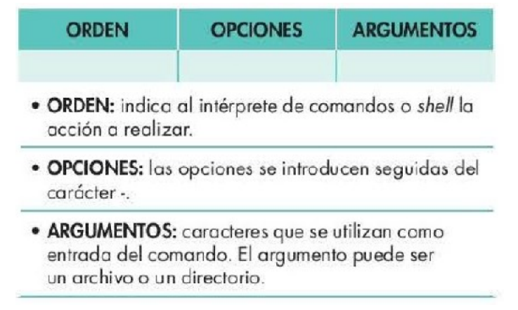

Para analizar la sintaxis de estos comandos podemos utilizar la ayuda en línea de Linux, como `man` seguido del nombre del comando o introducir el nombre del comando seguido de `--help`.

**Directorios y carpetas en Linux:**
*   Los directorios en Linux tienen esencialmente las mismas características que los directorios en Windows. Se trata de un conjunto de archivos y/u otros directorios agrupados en función de su contenido, su propósito o cualquier otro criterio de agrupación. Un directorio no es ni más ni menos que un tipo de archivo, que almacena información acerca de los archivos y directorios que contiene.
*   Al igual que los archivos, los directorios o carpetas en Linux tienen características que los clasifican, catalogan y ubican dentro del sistema de archivos. Respecto del nombre de las carpetas, indicar que se puede utilizar cualquier carácter (al igual que para los ficheros), a excepción del carácter `/`, ya que tiene un significado especial. Es conveniente no utilizar caracteres especiales, acentos, etc. No es conveniente incluir caracteres como los siguientes en los nombres de archivo/directorio:
    `! # & ( ) " ; | > < \ $ { } * ? \Tab \Espacio + -`

*  **Estructura jerárquica de archivos y directorios**
    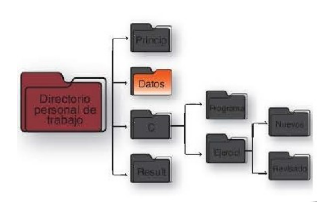

**Metacaracteres en Linux:**
En entorno comando, en muchas expresiones y órdenes de Linux se utiliza un conjunto de caracteres con significado especial para búsquedas o para operaciones sobre archivos o directorios. En Linux a los caracteres comodín se les llama metacaracteres y son los que se recogen en la tabla:

| Metacaracter | Función |
| :--- | :--- |
| `*` | Coincide con cualquier número de caracteres (incluye 0). |
| `?` | Coincide con un solo carácter. |
| `[]` | Coincide con uno de los caracteres dentro de los corchetes. Ej.: `[abc]`. |
| `[a-z]` | Coincide con un rango de caracteres. |
| `[!...]` | Coincide con cualquier carácter que NO esté dentro de los corchetes. Ej.: `[!a-z]`. |
| `[^...]` | Igual que `[!...]` negación. Coincide con cualquier carácter excepto los listados. |
| `{a, b, c}` | Expansión de llaves: genera varias cadenas. |

*Ejemplos del uso de metacaracteres con la orden `ls` (equivalente a `dir` en Windows):*

| Orden con la expresión: | Referencia los archivos y directorios que: |
| :--- | :--- |
| `*[ab]*` | Contengan el carácter a y el b. |
| `archi[A-P]*` | Empiecen por archi y que a continuación tengan cualquier carácter comprendido entre A mayúscula y P mayúscula. |
| `texto1[1-4]` | Se llamen texto1 y el siguiente carácter sea un número comprendido entre 1 y 4, ambos inclusive. |
| `[1-3]??t*` | Su nombre empiece por un número comprendido entre 1 y 3, seguido de tres caracteres cualesquiera, una t y el resto sea cualquier cosa. |
| `[123]???t*` | Igual que el anterior. |
| `[dD]ocs` | Empiecen por D mayúscula o d minúscula y el resto del nombre sea ocs. |
| `[^0-9]*` o `[!0-9]*` | No tengan un número como primer carácter. Solamente se visualizarán los archivos que empiecen por una letra. |
| `texto[^123]` o `texto[!123]` | Se llamen texto y que el siguiente carácter no sea un 1, un 2 o un 3. |
| `le[ae]me` | Se llamen leame o leeme. |
| `[a-z]asa.txt` | Empiecen por cualquier letra en minúscula y las tres siguientes sean asa y la extensión sea .txt.: casa.txt, tasa.txt, rasa.txt, etc. |
| `[A-Z]asa.txt` | Igual que el ejemplo anterior, pero la primera letra en mayúsculas: Casa.txt, Tasa.txt, Rasa.txt, etc. |
| `[a-zA-Z]asa.txt` | Los dos ejemplos anteriores en conjunto: Casa.txt, Tasa.txt, Rasa.txt, casa.txt, tasa.txt, rasa.txt, etc. |

**Operaciones sobre directorios y carpetas:**

*   **Crear directorios o carpetas (Interfaz texto):**
    Para crear una estructura de directorios en tu carpeta personal `/home/nombre_usuario`:
    
```bash
    mkdir Princip Datos C Result
    mkdir C/Programa C/Ejercici
    mkdir C/Ejercici/Nuevos C/Ejercici/Revisado
```


### Operaciones sobre directorios y carpetas (Linux)
*   **Crear directorios:** `mkdir directorio`
    Ej: `mkdir Princip Datos C Result`
*   **Moverse y listar:**
    `cd directorio` (Entrar), `cd ..` (Subir un nivel)
    `ls -la` (Listar todo con detalles)
*   **Eliminar directorios:**
    `rmdir directorio` (Solo si está vacío)
    `rm -r directorio` (Para borrar con contenido)
*   **Renombrar/Mover directorios:** `mv Datos Textos`

### Atributos y Permisos (Linux)
En Linux, cuando visualizamos la estructura de directorios comprobamos que cada archivo queda identificado por diez caracteres. De estos diez caracteres, el primero empezando por la izquierda hace referencia al tipo de archivo que es. El resto, es decir, los nueve siguientes de izquierda a derecha y en bloques de tres, hacen referencia a los permisos que se le conceden respectivamente al propietario, al grupo y al resto de usuarios del equipo.

Los archivos se identifican por 10 caracteres (ej. `drwxr-xr-x`).

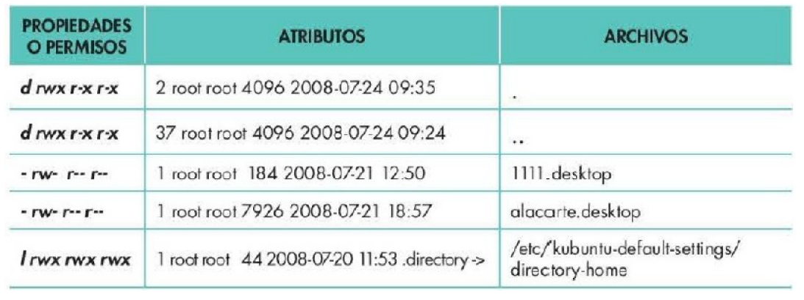

*   **1º Carácter (Tipo):** 
    *   `-` (Ordinario)
    *   `d` (Directorio)
    *   `l` (Enlace).

*   **Permisos (Grupos de 3 para Usuario, Grupo, Otros):**
    *   `r` (Lectura)
    *   `w` (Escritura)
    *   `x` (Ejecución)
    *   `-` (Sin permiso)

| Permiso | Significado en Directorios |
| :--- | :--- |
| `r` (Lectura) | Permite listar (`ls`) el contenido. |
| `w` (Escritura) | Permite crear, borrar y renombrar ficheros dentro de él. |
| `x` (Ejecución) | Permite "entrar" (`cd`) al directorio. |

**Modificación de permisos (`chmod`):**
Símbolos: `+` (añade), `-` (quita), `=` (asigna exactamente).
Usuarios: `u` (user), `g` (group), `o` (other), `a` (all).

| Orden | Resultado |
| :--- | :--- |
| `$ chmod g+x doc1` | Otorga ejecución al grupo. |
| `$ chmod a=rwx doc1` | Da todos los permisos a todos. |
| `$ chmod go-wx doc1` | Quita escritura y ejecución a grupo y otros. |
| `$ chmod 755 doc1` | Asigna `rwxr-xr-x` mediante valores octales. |

**Valores Octales:**
| rwx (Binario) | Octal |
| :---: | :---: |
| `--x` (001) | 1 |
| `-w-` (010) | 2 |
| `-wx` (011) | 3 |
| `r--` (100) | 4 |
| `r-x` (101) | 5 |
| `rw-` (110) | 6 |
| `rwx` (111) | 7 |

---

## Tipos de archivos en Linux (Detalle)

1.  **Regulares u ordinarios:** Texto, programas, ejecutables.
2.  **Directorios:** Contienen referencias a otros archivos.
3.  **Archivos especiales:** Dispositivos físicos (en `/dev`).
4.  **Enlaces (Links):**
    *   **Enlaces duros (Hard links):** Apunta directamente al mismo inodo que el archivo original. Idéntico al original. Si se borra el original, el contenido no se pierde. No se puede crear a directorios.
        Comando: `ln archivo.txt enlace_duro.txt`
    *   **Enlaces simbólicos (Symlinks):** Equivalente a un acceso directo. Apunta a la ruta del original. Si se borra el original, el enlace se rompe (dangling link).
        Comando: `ln -s archivo.txt enlace_simbolico.txt`

### Operaciones con archivos en Linux

*   **Copiar:** `cp [opciones] origen destino` (usar `-R` para directorios).
*   **Mover/Renombrar:** `mv origen destino`.
*   **Eliminar:** `rm [-irf] lista_ficheros`.
*   **Buscar:** Hay veces en las que es conveniente localizar un archivo dentro de una estructura de datos. Si sabemos la ubicación exacta del archivo y su nombre, no hay problema.
    `find [ruta] [parámetros] [valores]`
    Ejemplo: `$ find /home/user -name nombrefichero.txt`

## Operaciones sobre directorios y carpetas

*   **Mover y copiar directorios o carpetas (Interfaz texto)**
    Elimina completa y definitivamente de la estructura el directorio `C` y todo lo que dependa de él.
    ```bash
    rmdir C/Ejercici/Nuevos C/Ejercici/Revisado
    rmdir C/Ejercici C/Programa
    rmdir C
    ```

*   **Atributos de los directorios o carpetas.**
    Sitúate en una carpeta `xxx` y cambia el nombre de la carpeta. Para realizar esta operación en modo texto, primero nos tendremos que situar en dicha carpeta
    Ejemplo:
    ```bash
    cd Princip/Ejercici
    mv Ejercici Textos
    ```

### Edición y Visualización de textos

*   **Editores:** `vi` (clásico), `nano` (sencillo en terminal), `gedit` (gráfico).
*   **Visualizar:**
    *   `cat`: Muestra todo el archivo.
    *   `more` / `less`: Muestra paginado (`less` es más avanzado).
    *   `head -n`: Muestra las primeras líneas.
    *   `tail -n`: Muestra las últimas líneas.

### Búsqueda de patrones (`grep`) y otros

*   **`grep`**: Busca palabras o patrones en ficheros.
    Sintaxis: `$ grep [opciones] patrón [fichero]`
    Ejemplo: `$ grep -i manzana frutas.txt` (ignora mayúsculas/minúsculas).
*   **Expresiones Regulares (`grep`):**
    *   `^` : Inicio de línea.
    *   `$` : Fin de línea.
    *   `[a-z]` : Rango de caracteres.
    *   `[^a]` : Que no sea el carácter 'a'.
    *   `*` : 0 a infinitas veces.
    *   `+` : 1 a infinitas veces.

    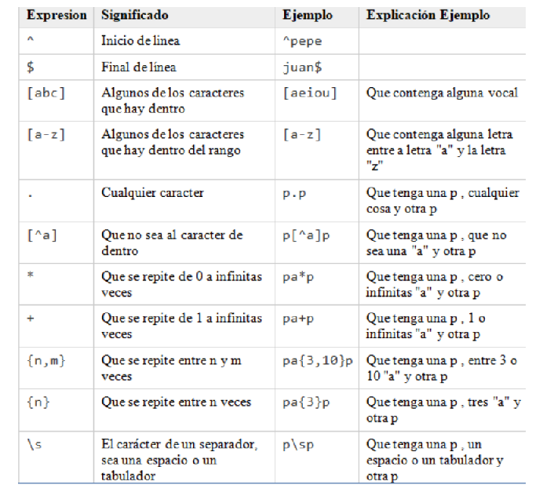

*   **`wc`**: Cuenta líneas, palabras y caracteres.
*   **`sort`**: Ordena el contenido de archivos.
*   **`cut`**: Corta columnas o campos seleccionados.

    ```bash
    $ wc [opción] [archivo]
    $ sort [opción] [archivo]
    $ cut [opción] [archivo]
    ```

### Entrada y Salida Estándar. Redirecciones en Linux

Descriptores: Entrada estándar (0, `stdin`), Salida estándar (1, `stdout`), Error estándar (2, `stderr`).

*   **Redirección Salida:**
    `>` : Sobrescribe (`orden > fichero`).
    `>>` : Añade al final (`orden >> fichero`).
*   **Redirección Entrada:**
    `<` : Toma entrada desde fichero (`orden < fichero`).
*   **Redirección Error:**
    `2>` : Sobrescribe errores al fichero.
    `2>>` : Añade errores al fichero.
*   **Redirección Todo (Salida + Error):**
    `&>` o `&>>`
*   **Tubería (Pipe `|`):** Conecta la salida de una orden con la entrada de la siguiente. (`orden A | orden B`).

---

## Gestión de archivos en Microsoft Windows

### Entorno Gráfico (Explorador)
    
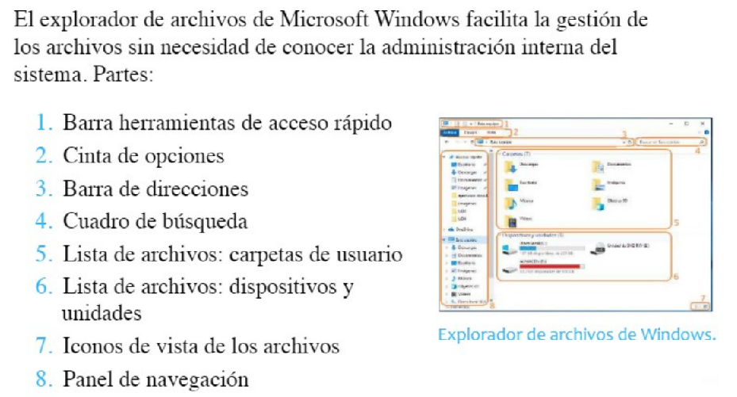
*Explorador de archivos numerado.*

### Modo Comando (CMD Windows)

**Navegación y búsqueda por directorios**
| Comando | Función |
| :--- | :--- |
| `dir` | Lista archivos y carpetas (`dir /s archivo.txt` busca en subdirectorios y `dir *.txt` busca por extensión). |
| `cd carpeta` | Entra en carpeta. `cd ..` sube un nivel. `cd \` va a la raíz. |
| `cls` | Limpia pantalla. |

**Crear y manipular archivos**
| Comando | Función |
| :--- | :--- |
| `type nul > archivo.txt` | Crear archivo vacio |
| `copy origen.txt copia.txt` | Copiar archivo |
| `move origen.txt carpeta\` | Mover archivo |
| `del archivo.txt` | Borrar archivo |
| `ren viejo.txt nuevo.txt` | Renombrar archivo |

**Gestión de carpetas**

**Atributos de archivos (`attrib`):**
| Comando / Atributo | Función |
| :--- | :--- |
| `+r / -r` | Read-only (Solo lectura). |
| `+h / -h` | Hidden (Oculto). |
| `+s / -s` | System (Sistema). |
| `+a / -a` | Archive (Archivo). |
| `attrib +r +h file.txt` | Añade solo lectura y oculto. |
| `attrib /s` | Aplica a todos los archivos y subdirectorios. |

**Manejo de archivos y carpetas:**
| Comando | Función |
| :--- | :--- |
| `mkdir` o `md` | Crea carpeta. |
| `rmdir` o `rd` | Elimina carpeta (usar `/s` si tiene contenido). |
| `type nul > file.txt` | Crea archivo vacío. |
| `copy` | Copia archivos. |
| `xcopy` | Copia árboles de directorios (ej. `xcopy origen dest /T/E/H/C/I`). |
| `move` | Mueve archivos / Renombra carpetas. |
| `del` | Borra archivos. |
| `ren` | Renombra archivos. |

*(Las actividades de esta sección del documento implicaban usar `md`, `rd /s`, `move`, `copy`, `del` y `attrib` para crear y destruir árboles de directorios idénticos a los ejemplos previos).*

***ACTIVIDAD***
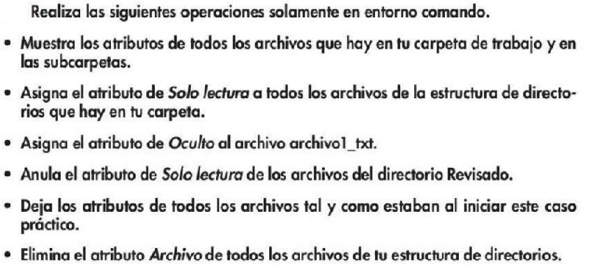

***Solución***
<details>

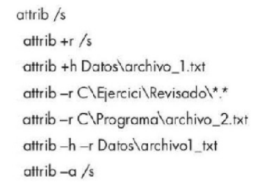

</details>

---

# <u>2. Almacenamiento</u>

## Gestión de almacenamiento en Linux

Linux anexa los sistemas de archivos al árbol de directorios mediante un **punto de montaje**.
Nomenclatura en `/dev`:
*   `/dev/sd*`: Discos SATA, SCSI, USB (ej. `sda`, `sdb`).
*   `/dev/hd*`: Discos IDE antiguos.
Las particiones añaden números: `/dev/sda1` (1ª partición del 1er disco).

### Montaje (`mount` / `umount`)
*   **Montar:** `mount [-avwrt] tipo dispositivo punto_de_montaje`
    Ej: `sudo mount -t vfat /dev/sdb1 /home/Luis/pendrive`
    Opciones **mount**:
    * -v: muestra información del proceso de montaje
    * -w: monta el sistema de archivos con permisos de lectura y escritura
    * -r: monta el sistema de archivos con permisos de solo lectura
    * -t: indica el tipo de sistema de archivos para montar (ext, ect2, ext3, ext4, ntfs,vfat, hfs, ...)

*   **Desmontar:** `umount /dev/sdb1`
*   **Automatización:** Archivo `/etc/fstab`. Establece qué dispositivos se montan en el arranque usando UUIDs o rutas, indicando el punto de montaje y el tipo de sistema de archivos.

### Particionamiento, Formateo y Chequeo
*   **Particionar:**
    *   *Herramientas gráficas:* **GParted**, GNOME-disks. Permiten crear, eliminar y redimensionar. *Imagen: GParted mostrando `/dev/sda` dividido en particiones, y el menú "Formatear como" (ext4, ntfs, fat32, etc.).*
    *   *Herramientas texto:* `fdisk`, `parted`. En `fdisk`, menú interactivo (`n` nueva, `d` borrar, `w` guardar).
    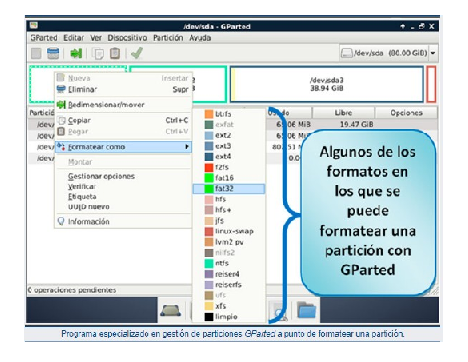
    *  Ejemplo gestión particiones: ***GPARTED***
       * En la siguiente imagen, se ve un disco duro SATA particionado en cuatro trozos o particiones lógicas desde GParted.
        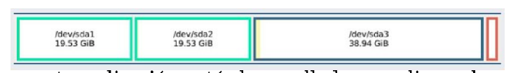
       *   Como esta aplicación está desarrollada para linux, las unidades de disco duro se nombran como lo hace este sistema operativo, es decir, el primer disco duro que se encuentre conectado en el ordenador (será normalmente el que se utiliza para instalar el sistema operativo) se llamará sda (realmente en linux su nombre  completo oficialmente es /dev/sda). Si se pincha un segundo disco duro (aunque fuese una memoria flash USB o un disco duro externo USB) se llamará sdb, y si se conectase un tercero se llamaría sdc. Las particiones que se creen dentro del disco duro añadirán un número al nombre del dispositivo. Dichas particiones  se van creando y numerando de izquierda a derecha (como /dev/sda1, /dev/sda2, /dev/sda3, /dev/sda4).

*   **Formatear (`mkfs`):** El dispositivo debe estar desmontado.
    `mkfs -t ntfs /dev/sdc1` o `mkfs.ntfs /dev/sdc1`
    * Estas opciones son equivalentes:
    ```
    sudo mkfs.ntfs /dev/sdc1
    sudo mkntfs /dev/sdc1
    sudo mkfs -t ntfs /dev/sdc1
    ```

*   **Chequeo (`fsck`):** Analiza y repara el sistema de ficheros.
    `fsck -t ext4 /dev/sda1` (`-a` repara automático, `-r` pide confirmación).
    * Ejemplo: 
    ```
    fsck [-A][-V][-t tipo_sistema_archivos][-a][-r][sistema_de_archivos]
    ```

    * Opciones:
      * A: Chequea todos los sistemas de archivos establecidos en /etc/fstab
      * V: detalla las acciones realizadas por fsck
      * -t tipo_sistema_archivos: tipo de sistema de archivos que se desea chequear como ext3, ext4, ntfs, …
      * a: repara sin pedir confirmación
      * r: pide confirmación antes de reparar
    * Ejemplo: 
        ```
        fsck -t ext4 /dev/sd1
        ```

**Manuales y ayuda para la gestión de particiones**
* Manual de utilización de GParted: [https://gparted.org/display-doc.php?name=help-manual&lang=es](https://gparted.org/display-doc.php?name=help-manual&lang=es)
* Tutorial GParted: [https://www.youtube.com/watch?v=-kYe3BYPurA](https://www.youtube.com/watch?v=-kYe3BYPurA)
* Copiar particiones con Gparted: [https://www.youtube.com/watch?v=yJPdxCQ0PDU](https://www.youtube.com/watch?v=yJPdxCQ0PDU)
* Añadir disco duro a MV en VirtualBox: [https://www.youtube.com/watch?v=5QxiBTM2lAU](https://www.youtube.com/watch?v=5QxiBTM2lAU)
* Crear particiones linux desde terminal con fdisk: [https://www.youtube.com/watch?v=VDsfvHICZaU](https://www.youtube.com/watch?v=VDsfvHICZaU)


---

### RAID en Linux (Redundant Array of Independent Disks)
Establece configuraciones de varios discos para aumentar integridad, capacidad o velocidad.
*   **RAID 0 (Striping):** Divide datos sin redundancia. Suma capacidades, aumenta velocidad. Si falla un disco, se pierde todo.
    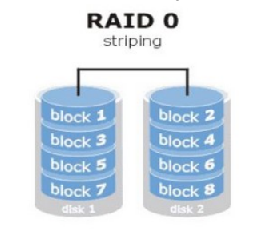

*   **RAID 1 (Mirroring):** Copia exacta (espejo) en dos o más discos. Aumenta fiabilidad.
    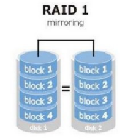

*   **RAID 5 (Striping con Paridad):** Distribuye datos y bloques de **paridad** (CRC) en al menos 3 discos. Tolera el fallo de 1 disco reconstruyéndolo.
    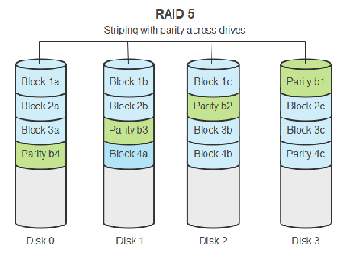

*   **RAID 10, 50:** Combinaciones anidadas.
    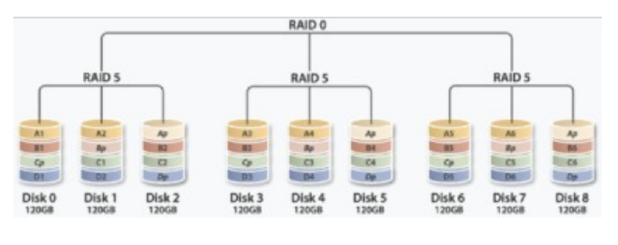

* **RAID 0,1,5 y 10:** [https://www.youtube.com/watch?v=kXSuXSakndI](https://www.youtube.com/watch?v=kXSuXSakndI)


**Gestión con `mdadm`:**
*  Instalación en la distribución de LliureX: `sudo apt install mdadm`
*  Ver estado: `cat /proc/mdstat`
*  Crear: `mdadm --create /dev/md0 --level=5 --raid-devices=3 /dev/sda /dev/sdb /dev/sdc`
*   Gestionar: `--fail` (marcar roto), `--remove` (quitar), `--add` (añadir repuesto), `--stop` (detener).

*   ***Los comandos más comunes empleados para la gestión RAID son:***
    *   Establecer un disco como defectuoso en un RAID `mdadm /dev/mdX --fail /dev/sdY`
    *   Eliminar un disco de un RAID `mdadm /dev/mdX --remove /dev/sdY`
    *   Añadir un disco a un RAID `mdadm /dev/mdX --add /dev/sdY`
    *   Comprobar el estado de todos los multidispositivos `cat /proc/mdstat`
    *   Obtener información de todos los multidispositivos `mdadm --detail --scan`
    *   Obtener información de un multidispositivo `mdadm --detail /dev/mdX o mdadm --detail /dev/mdX --scan`
    *   Examinar el estado de un dispositivo asociado a un RAID `mdadm --examine /dev/sdX`
    *   Detener un RAID `mdadm --stop /dev/mdX`

*  **AUTOAYUDA:**
   *   Crear un RAID de discos en Linux:  [ https://www.youtube.com/watch?v=eaPizT-rJvU]( https://www.youtube.com/watch?v=eaPizT-rJvU)
   *    Configuración de RAID 0, 1 y 5 en Ubuntu Server 22.04: [ https://www.youtube.com/watch?v=43KG6UTNxos]( https://www.youtube.com/watch?v=43KG6UTNxos)

---

## Gestión de almacenamiento en Microsoft Windows (Entorno Gráfico)

En Windows, se utilizan 3 herramientas principales:

1.  **Administrador de discos (`diskmgmt.msc`):**
    Interfaz gráfica donde figuran todos los discos físicos y particiones (volúmenes). Permite crear "Nuevos volúmenes simples", formatear y cambiar letras de unidad.

    *   **Discos Dinámicos:** Permite convertir discos básicos a dinámicos para implementar RAID por software en Windows (Volumen distribuido, reflejado [RAID 1], seccionado [RAID 0], RAID-5).
    Con este concepto, Windows permite crear distintos tipos de volúmenes y alguno de ellos de tipo RAID:
        *  Volumen distribuido: consiste en unir diferentes espacios de diferentes discos bajo una misma unidad lógica. 
        *  Volumen reflejado (Mirrored Volume): conocido como RAID-1. Genera redundancia de datos. 
        *  Volumen seccionado (Striped Volume): conocido como RAID-0.
        *  Volumen RAID-5: permite distribuir los datos entre tres o más discos con tolerancia a fallos de forma distribuida. 
        *  Volumen simple: una única unidad de disco.
    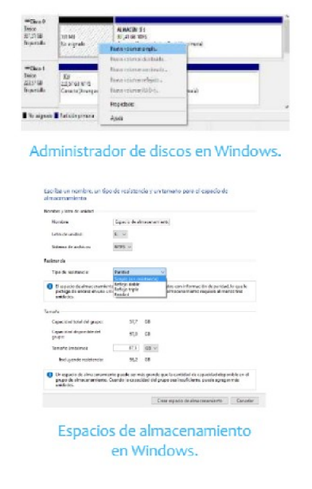

2.  **Configuración -> Almacenamiento:**
    Muestra de forma intuitiva el espacio libre y el desglose de "Uso de almacenamiento" (Apps, Archivos temporales, Sistema). Permite activar el "Sensor de almacenamiento" para borrado automático de temporales.
    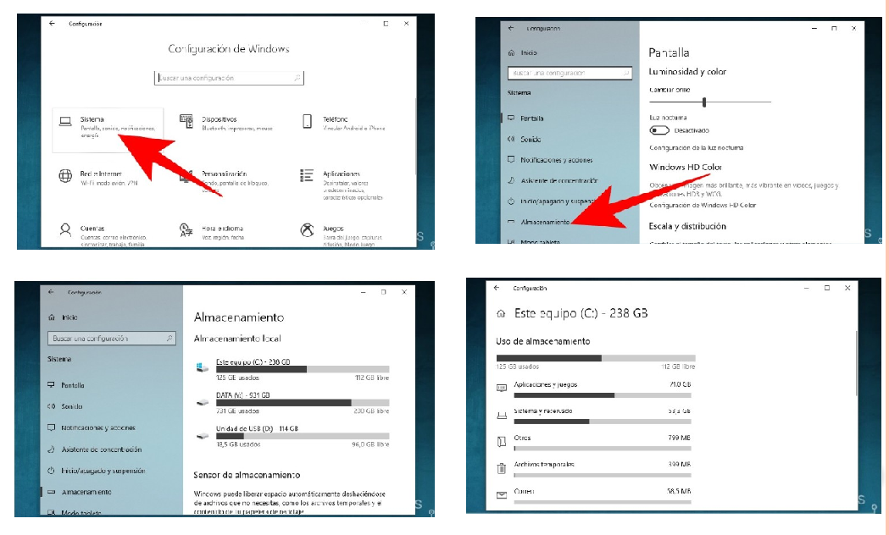
    *Imágenes: Capturas de la pantalla Configuración > Sistema > Almacenamiento mostrando las barras de uso de los discos C:, D:, Y:.*

3.  **Espacios de almacenamiento (Storage Spaces):**
    Herramienta en el Panel de Control para virtualizar el almacenamiento. Agrupa discos físicos en "pools" (grupos). Permite crear espacios con diferentes "Tipos de resistencia":
    *   Simple (similar a RAID 0).
    *   Reflejo doble / triple (similar a RAID 1).
    *   Paridad (similar a RAID 5).
    *Imagen: Ventana del Panel de control de Espacios de almacenamiento creando un nuevo grupo y seleccionando el tipo de resistencia.*

* ***AUTOAYUDA:***
  *  Crear particiones en Windows: [https://www.youtube.com/watch?v=nT7rY3eTYCU](https://www.youtube.com/watch?v=nT7rY3eTYCU)
  *  Cómo Configurar RAID 0, 1 y 5 en Windows Server 2022 con el Administrador de Discos: [ https://www.youtube.com/watch?v=Xfpw9_-dz2Y]( https://www.youtube.com/watch?v=Xfpw9_-dz2Y)
  *  Raid 0, 1 y 5 en Windows 10 con la herramientas Espacios de Almacenamiento: [ https://www.youtube.com/watch?v=JaT6uasaWwY]( https://www.youtube.com/watch?v=JaT6uasaWwY)
  *  Como hacer un RAID1 en Windows 10: [ https://www.youtube.com/watch?v=cpBCqax2pN4]( https://www.youtube.com/watch?v=cpBCqax2pN4)