# SISTEMAS OPERATIVOS: GESTIÓN DE USUARIOS Y PROCESOS

---

## Índice de Contenidos

* [1. Mapa Conceptual y Fundamentos de Usuarios en Linux](#mapa-conceptual)
* [2. Ficheros Fundamentales de Usuarios y Grupos en Linux](#ficheros-usuarios)
* [3. Gestión de Cuentas de Usuario y Grupos en Linux](#gestion-usuarios-linux)
* [4. Gestión de Contraseñas y Políticas de Seguridad](#gestion-contrasenas)
* [5. Gestión de Permisos y Propiedad de Recursos](#permisos-propiedad)
* [6. Configuración de Perfiles y Variables de Entorno](#perfiles-variables)
* [7. Gestión de Usuarios y Grupos en Microsoft Windows](#usuarios-windows)
* [8. Conceptos y Ciclo de Vida de los Procesos](#procesos-conceptos)
* [9. Monitorización y Control de Procesos en Linux](#monitorizacion-procesos)
* [10. Automatización de Tareas en Linux (`at` y `cron`)](#automatizacion-tareas)
* [11. Monitorización del Rendimiento y Diagnóstico del Sistema](#rendimiento-diagnostico)
* [12. Actividades Prácticas y Soluciones Paso a Paso](#actividades-practicas)
* [13. Videografía y Recursos Complementarios](#recursos)

---

<h2 id="mapa-conceptual"><u>1. Mapa Conceptual y Fundamentos de Usuarios en Linux</u></h2>

En los sistemas operativos modernos multiusuario como Linux y Windows, la administración de usuarios y grupos es el pilar central de la seguridad, el control de acceso a los recursos y la asignación de privilegios.

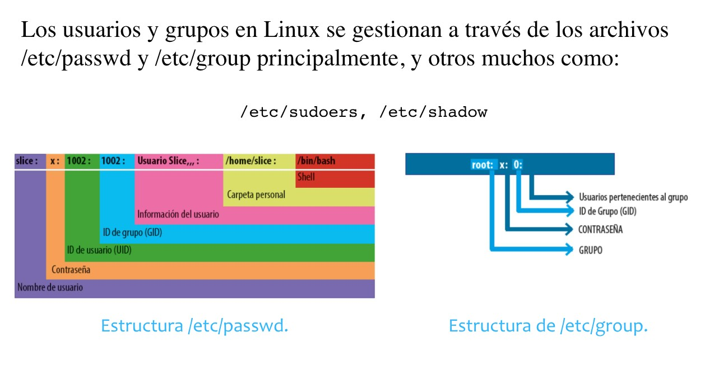

### Principios Fundamentales
* **Seguridad y Aislamiento:** Cada usuario cuenta con un espacio personal de trabajo (`/home/usuario`), permisos diferenciados y credenciales de acceso privadas para evitar que usuarios no autorizados accedan o modifiquen la información de terceros o comprometan la estabilidad del sistema.
* **Autenticación Obligatoria:** Linux requiere invariablemente que todo usuario se valide ante el sistema (localmente mediante terminal/interfaz gráfica o remotamente a través de SSH/red) utilizando un identificador (*login*) y una credencial secreta (contraseña, clave criptográfica o certificado).
* **Superusuario (`root`):** Usuario con identificador único `UID = 0`. Posee privilegios totales e irrestrictos sobre el kernel, procesos, ficheros y configuración del hardware.
* **Administrador (`sudo`):** Usuario estándar perteneciente a grupos administrativos (como `sudo` o `wheel`) autorizado a elevar privilegios mediante el comando `sudo` para ejecutar tareas de mantenimiento específicas definidas en `/etc/sudoers`.

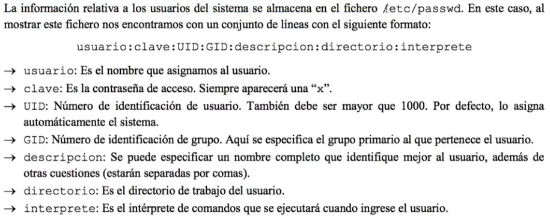

---

<h2 id="ficheros-usuarios"><u>2. Ficheros Fundamentales de Usuarios y Grupos en Linux</u></h2>

A diferencia de otros sistemas operativos basados en bases de datos binarias (como el Registro de Windows), Linux almacena la definición y configuración de usuarios y grupos en ficheros de texto plano estructurados en el directorio `/etc`.

### 2.1 El archivo `/etc/passwd`
Es la base de datos pública del sistema donde se definen todas las cuentas de usuario. Cada línea representa un usuario y consta de 7 campos separados por dos puntos (`:`):

```text
juan:x:1001:1001:Juan Pérez:/home/juan:/bin/bash
```

| Campo | Componente | Descripción |
| :---: | :--- | :--- |
| **1** | `juan` | **Nombre de inicio de sesión (*login*):** Cadena única que identifica al usuario en el sistema. |
| **2** | `x` | **Contraseña:** Antiguamente contenía el hash; por seguridad, hoy en día se indica `x`, delegando el hash protegido al fichero `/etc/shadow`. |
| **3** | `1001` | **UID (User ID):** Identificador numérico único de usuario. `0` para `root`, `1–999` para cuentas del sistema y servicios, `>= 1000` para usuarios humanos regulares. |
| **4** | `1001` | **GID (Group ID):** Identificador numérico del **grupo principal** al que pertenece el usuario. |
| **5** | `Juan Pérez` | **Información GECOS:** Datos descriptivos (nombre completo, número de habitación, teléfono, notas). |
| **6** | `/home/juan` | **Directorio personal (*Home directory*):** Directorio inicial de trabajo al iniciar sesión. |
| **7** | `/bin/bash` | **Shell predeterminado:** Intérprete de comandos asignado al usuario (e.g., `/bin/bash`, `/bin/zsh`, o `/usr/sbin/nologin` si no tiene acceso a terminal). |

### 2.2 El archivo `/etc/shadow`
Contiene las contraseñas cifradas y los parámetros temporales de expiración de las cuentas de usuario. Solo es legible por el superusuario `root` (permisos `640` o `000` con `sudo`).

```text
juan:$6$rounds=4096$salt$hash...:19800:0:90:7:30:19900:
```

1. **Nombre de usuario:** Coincide con `/etc/passwd`.
2. **Contraseña cifrada:** Hash precedido por el algoritmo utilizado (`$1$` MD5, `$5$` SHA-256, `$6$` SHA-512, `$y$` yescrypt). Si contiene `!` o `*`, la cuenta está bloqueada.
3. **Último cambio de contraseña:** Días transcurridos desde el 1 de enero de 1970 (*Unix Epoch*).
4. **Días mínimos para cambio:** Tiempo que debe transcurrir antes de poder volver a modificar la contraseña.
5. **Días máximos de validez:** Tiempo máximo de vigencia de la contraseña antes de caducar.
6. **Días de aviso:** Días de antelación con los que el sistema alerta al usuario de la caducidad.
7. **Días de inactividad:** Días tras la caducidad antes de bloquear incondicionalmente la cuenta.
8. **Fecha de expiración de la cuenta:** Fecha límite absoluta de validez de la cuenta (en días desde Epoch).
9. **Campo reservado:** Para uso futuro.

### 2.3 El archivo `/etc/group`
Define los grupos del sistema y la pertenencia secundaria de los usuarios.

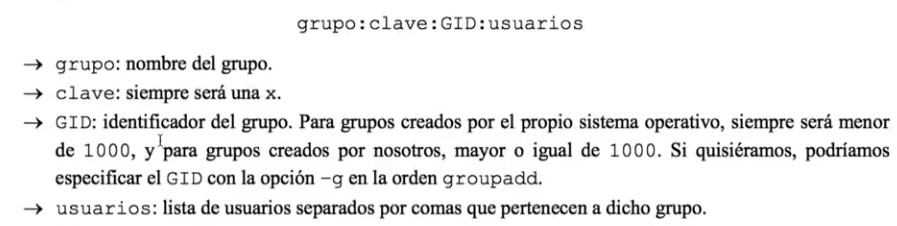

```text
developers:x:1002:juan,maria,pedro
```

* **Nombre del grupo:** `developers`
* **Contraseña del grupo:** `x` (almacenada cifrada en `/etc/gshadow`).
* **GID:** `1002` (identificador numérico del grupo).
* **Lista de miembros secundarios:** Usuarios pertenecientes al grupo (`juan,maria,pedro`).

### 2.4 El archivo `/etc/gshadow`
Contiene las contraseñas seguras de los grupos, los administradores del grupo y sus listas de miembros con permisos especiales.

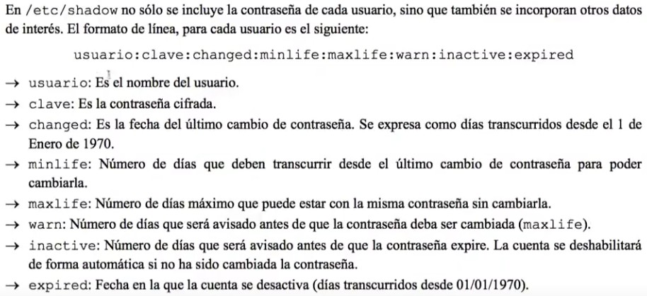

---

<h2 id="gestion-usuarios-linux"><u>3. Gestión de Cuentas de Usuario y Grupos en Linux</u></h2>

### 3.1 Gestión en Modo Gráfico
En entornos con interfaz de escritorio (GNOME, Ubuntu Desktop):
1. Acceder a **Configuración > Usuarios**.
2. Hacer clic en **Desbloquear** e ingresar la contraseña de superusuario/administrador.
3. Pulsar en **Añadir usuario...**:
   * **Tipo de cuenta:** *Estándar* (uso regular) o *Administrador* (acceso a `sudo`).
   * **Nombre completo** y **Nombre de usuario (login)**.
   * **Contraseña:** Establecerla inmediatamente, forzar al usuario a crearla en el primer inicio, o permitir inicio de sesión automático sin contraseña (no recomendado en entornos multiusuario).

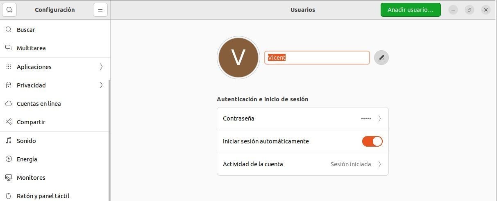
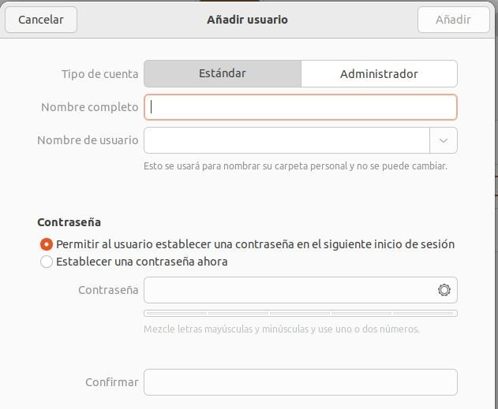

> [!TIP]
> Para gestionar grupos de forma avanzada en entorno gráfico, se puede instalar la utilidad clásica `gnome-system-tools`:
> ```bash
> sudo apt install gnome-system-tools
> users-admin
> ```

---

### 3.2 Gestión en Modo Terminal (Comandos de Sistema)

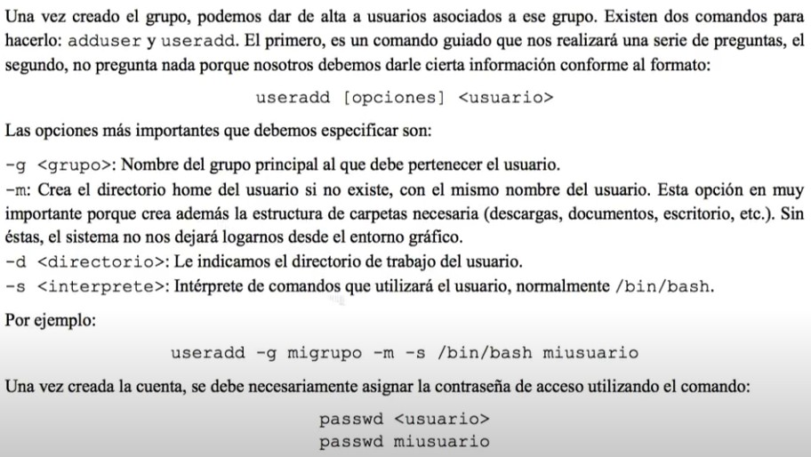

#### Alta de Usuarios: `useradd` vs `adduser`
* **`useradd`:** Comando de bajo nivel nativo del estándar POSIX/Linux.
* **`adduser`:** Script amigable en Perl (específico de Debian/Ubuntu) que interactúa con el usuario solicitando datos paso a paso.

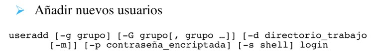

```bash
# Sintaxis básica de useradd
sudo useradd [opciones] nombre_usuario

# Crear usuario maria con su home (/home/maria) copiando plantillas de /etc/skel
sudo useradd -m maria

# Crear usuario german con grupo principal ventas, home específico y shell bash
sudo useradd -g ventas -d /home/German -m -s /bin/bash german
```

#### Opciones más comunes de `useradd` y `usermod`:

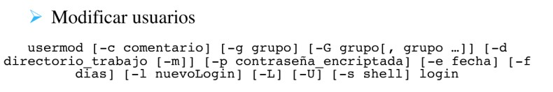

| Opción | Comando | Acción |
| :---: | :---: | :--- |
| `-m` | `useradd` | Crea automáticamente el directorio de inicio del usuario (`/home/usuario`). |
| `-d <ruta>` | `useradd` / `usermod` | Define una ruta alternativa para el directorio *home*. |
| `-g <grupo>` | `useradd` / `usermod` | Asigna o cambia el **grupo principal** (por GID o nombre). |
| `-G <g1,g2>` | `useradd` / `usermod` | Asigna **grupos secundarios** (usar `-aG` en `usermod` para añadir sin borrar los existentes). |
| `-s <shell>` | `useradd` / `usermod` | Establece el intérprete de comandos por defecto (e.g. `/bin/bash`, `/bin/zsh`, `/usr/sbin/nologin`). |
| `-l <nuevo>` | `usermod` | Cambia el nombre de inicio de sesión (*login*) del usuario. |
| `-L` / `-U` | `usermod` | Bloquea (*Lock*) o Desbloquea (*Unlock*) la cuenta del usuario. |
| `-e <fecha>` | `usermod` | Establece la fecha de expiración de la cuenta (`YYYY-MM-DD`). |

#### Baja de Usuarios: `userdel`

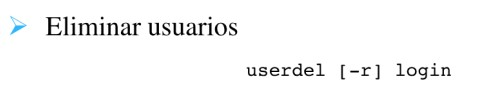
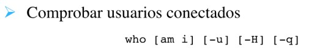

```bash
# Elimina la cuenta manteniendo sus ficheros y su directorio personal
sudo userdel usuarioA

# Elimina la cuenta Y borra completamente su directorio /home y su buzón de correo
sudo userdel -r usuarioB
```

---

### 3.3 Gestión de Grupos en Terminal

```bash
# Crear un grupo
sudo groupadd [-g GID] nombre_grupo

# Modificar un grupo existente
sudo groupmod [-g nuevo_GID] [-n nuevo_nombre] nombre_grupo

# Eliminar un grupo
sudo groupdel nombre_grupo

# Añadir un usuario a un grupo secundario (método adduser)
sudo adduser usuario grupo

# Añadir un usuario a un grupo secundario (método usermod recomendado)
sudo usermod -aG grupo usuario

# Eliminar un usuario de un grupo
sudo deluser usuario grupo

# Consultar los grupos a los que pertenece un usuario
groups usuario

# Consultar UID, GID y todos los grupos del usuario
id usuario
```

---

### 3.4 Usuarios y Grupos Predeterminados del Sistema

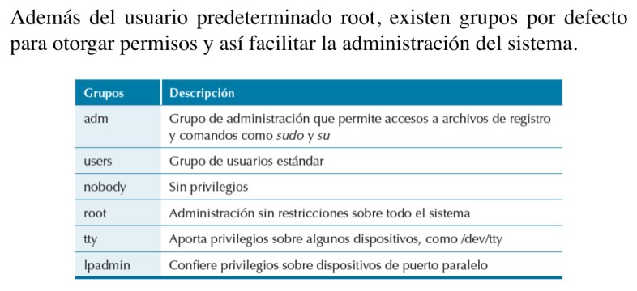

Linux incorpora una jerarquía de cuentas de servicio preconfiguradas que no corresponden a personas reales, sino a demonios y subsistemas para mitigar riesgos de seguridad:
* **`root` (UID 0):** Administrador absoluto del sistema.
* **`daemon` / `bin` / `sys`:** Procesos del sistema y binarios esenciales.
* **`nobody`:** Usuario sin privilegios ni ficheros propios, empleado para servicios sin acceso concedido.
* **`www-data`:** Servidores web (Apache, Nginx).
* **Grupos del sistema:** `sudo`, `adm`, `audio`, `video`, `plugdev`, `netdev`, `disk`.

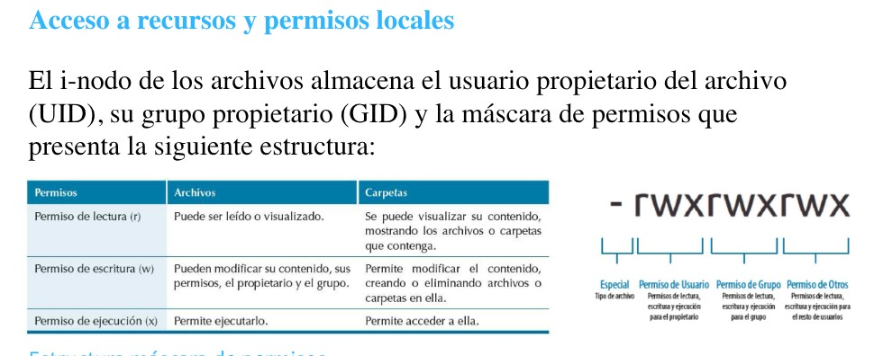
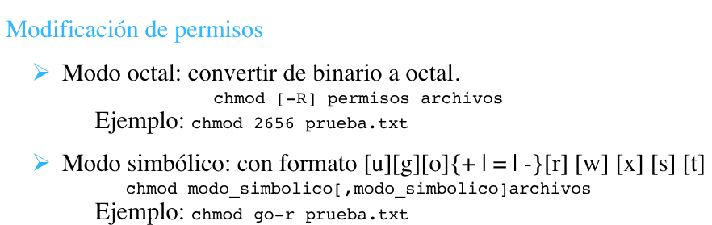

---

<h2 id="gestion-contrasenas"><u>4. Gestión de Contraseñas y Políticas de Seguridad</u></h2>

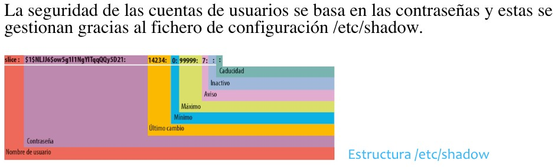

### Requisitos de Contraseñas Robustas
Para proteger el sistema frente a ataques de fuerza bruta y diccionario:
1. Longitud mínima aconsejada: entre 8 y 12 caracteres (mínimo técnico 6-7).
2. Combinación de mayúsculas, minúsculas, dígitos numéricos y símbolos especiales (`!`, `@`, `#`, `$`, `%`, `_`).
3. No contener partes del nombre real del usuario, ni secuencias de teclado obvias (`123456`, `qwerty`).
4. Obligatoriedad de rotación periódica.

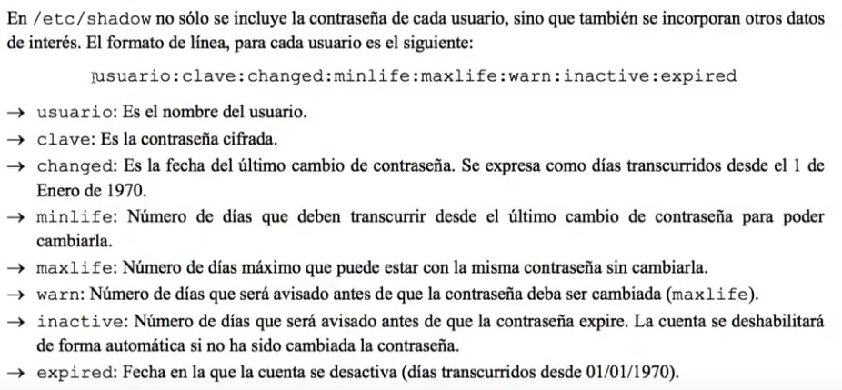

---

### 4.1 Modificación de Contraseñas: `passwd`

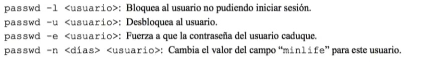

```bash
# Cambiar la contraseña del propio usuario
passwd

# Como superusuario, cambiar la contraseña de otro usuario sin pedir la actual
sudo passwd nombre_usuario

# Establecer parámetros de caducidad con passwd
# -w (aviso previo), -x (máximo días validez), -n (mínimo días entre cambios)
sudo passwd paco -w 3 -x 45 -n 2
```

---

### 4.2 Cifrado Criptográfico con `openssl passwd`
Permite generar contraseñas con hash criptográfico para automatizar la creación de usuarios en scripts:

```bash
# Algoritmo MD5 (-1)
openssl passwd -1 "contraseña_secreta"

# Algoritmo SHA-256 (-5)
openssl passwd -5 "contraseña_secreta"

# Algoritmo SHA-512 (-6)
openssl passwd -6 "contraseña_secreta"

# Asignar contraseña directamente en la creación de usuario con sustitución de comandos $()
sudo useradd -m -p $(openssl passwd -6 "sistEmas_%20") carlos
```

---

### 4.3 Control de Caducidad y Expiración: `chage`

El comando `chage` (*Change Age*) permite auditar y forzar políticas de ciclo de vida en las contraseñas:

```bash
# Consultar el estado y fechas de caducidad de una cuenta
chage -l usuario

# Forzar al usuario a cambiar su contraseña en el próximo inicio de sesión
sudo chage -d 0 usuario

# Obligar a renovar la contraseña cada 30 días
sudo chage -M 30 usuario

# Establecer un intervalo mínimo de 10 días entre cambios
sudo chage -m 10 usuario

# Avisar con 7 días de antelación
sudo chage -W 7 usuario

# Fijar fecha límite exacta de expiración de la cuenta
sudo chage -E 2026-12-31 usuario

# Eliminar la expiración de la cuenta (hacerla indefinida)
sudo chage -E -1 usuario
```

---

<h2 id="permisos-propiedad"><u>5. Gestión de Permisos y Propiedad de Recursos</u></h2>

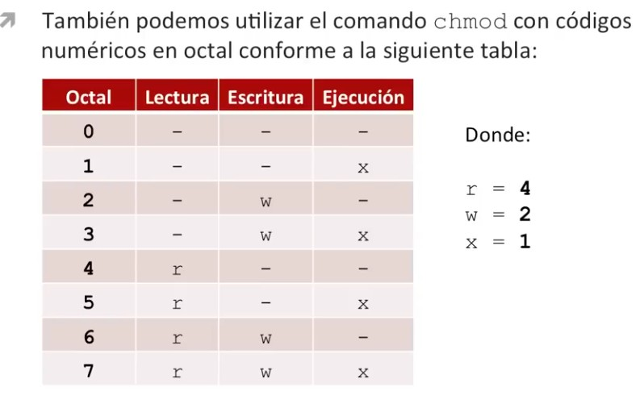

### 5.1 Permisos en Linux (`chmod`)
Cada fichero o directorio dispone de un triplete de permisos para tres entidades: **Propietario (*user* - `u`)**, **Grupo (*group* - `g`)** y **Otros (*others* - `o`)**.

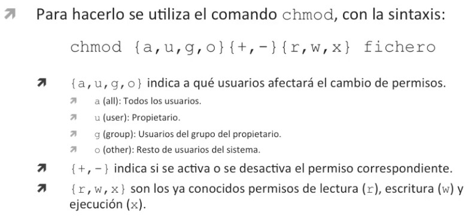

| Símbolo | Tipo de Permiso | En Archivos Regulares | En Directorios |
| :---: | :--- | :--- | :--- |
| `r` (4) | **Lectura** | Permite abrir y ver el contenido del archivo. | Permite listar (`ls`) el contenido del directorio. |
| `w` (2) | **Escritura** | Permite modificar y sobrescribir el archivo. | Permite crear, borrar y renombrar ficheros dentro. |
| `x` (1) | **Ejecución** | Permite ejecutar el fichero como programa o script. | Permite acceder y entrar (`cd`) al directorio. |
| `-` (0) | **Sin permiso** | No se concede acceso. | No se concede acceso. |

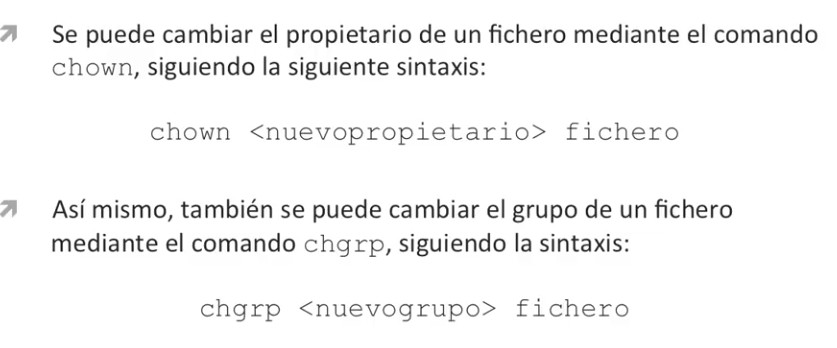

```bash
# Notación octal
chmod 755 script.sh     # rwxr-xr-x
chmod 644 documento.txt # rw-r--r--
chmod 700 carpeta_priv  # rwx------

# Notación simbólica (+ añade, - quita, = asigna exacto)
chmod g+w archivo.txt
chmod o-rwx confidencial.pdf
chmod ug=rwx,o-rwx proyecto/
```

---

### 5.2 Cambio de Propietario y Grupo (`chown` y `chgrp`)

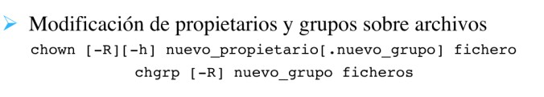

```bash
# Cambiar propietario de un archivo
sudo chown usuario archivo.txt

# Cambiar propietario y grupo a la vez (separados por : o .)
sudo chown usuario:grupo archivo.txt

# Cambiar propietario y grupo de forma recursiva a todo un directorio
sudo chown -R usuario1:SI1 /home/usuario/dirPerm

# Cambiar únicamente el grupo de un recurso
sudo chgrp nuevo_grupo archivo.txt
sudo chgrp -R nuevo_grupo /carpeta
```

---

<h2 id="perfiles-variables"><u>6. Configuración de Perfiles y Variables de Entorno</u></h2>

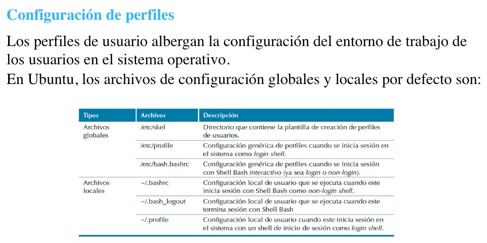

En los sistemas tipo UNIX/Linux, el comportamiento de la sesión del usuario y las aplicaciones se parametriza mediante variables de memoria denominadas variables de entorno y variables locales de shell.

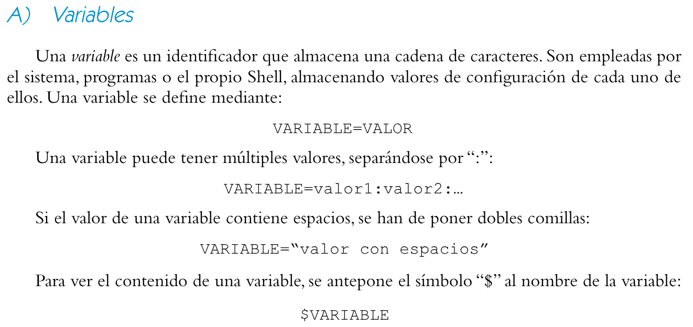

```bash
# Mostrar el valor de una variable
echo $HOME
echo $USER
echo $SHELL
echo $PWD
echo $HOSTNAME
```

---

### 6.1 Variables Locales vs Variables Globales (de Entorno)

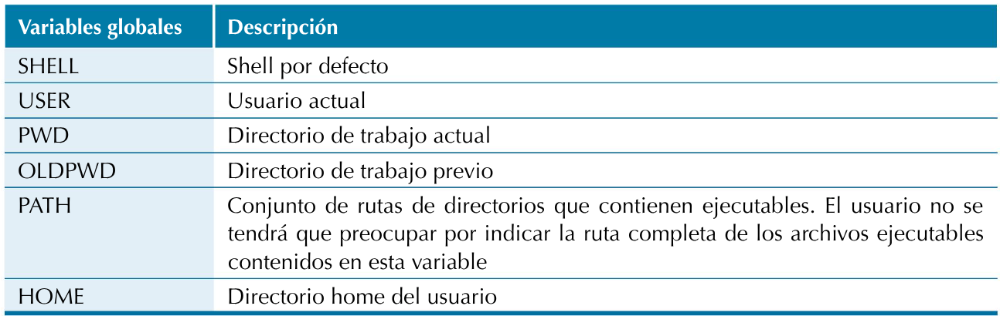
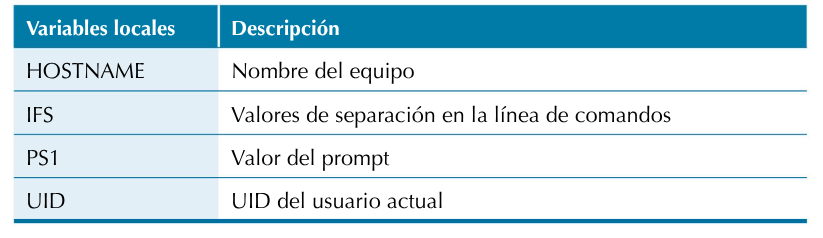

* **Variables Locales (de Shell):** Solo son accesibles en el proceso de terminal actual. No son heredadas por los subprocesos o scripts hijos que se lancen. Se listan mediante `set`.
* **Variables Globales (de Entorno):** Marcadas con el atributo de exportación. Cualquier subproceso o programa lanzado desde el shell heredará una copia de su valor. Se listan mediante `env` o `printenv`.

```bash
# Crear una variable local
PRUEBA=1
set | grep PRUEBA

# Exportarla a global (de entorno)
export PRUEBA
env | grep PRUEBA

# Desmarcarla de global a local (no se hereda a hijos)
export -n PRUEBA

# Eliminar completamente una variable
unset PRUEBA
```

---

### 6.2 Persistencia de Variables y Alias

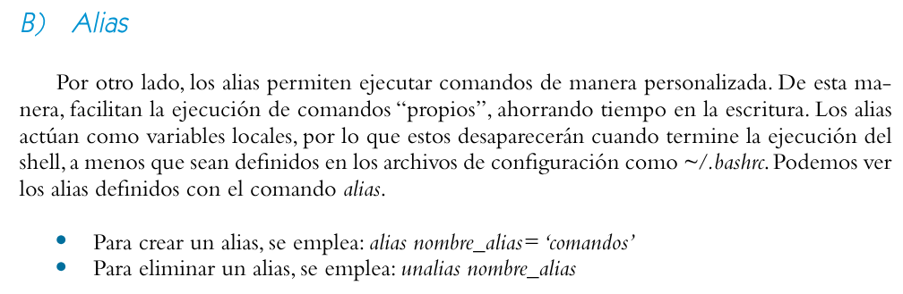

Las variables declaradas en la terminal desaparecen al cerrarla. Para hacerlas permanentes:
* **A nivel de usuario:** Se añaden al final del archivo personal `~/.bashrc` o `~/.bash_profile`.
* **A nivel global del sistema:** Se configuran en `/etc/profile` o en un script `/etc/profile.d/mis_variables.sh`.

#### Gestión de Alias
Los alias permiten abreviar órdenes complejas o agregar modificadores por defecto:

```bash
# Crear un alias temporal
alias listado='ls -ltra'
alias crearfichero='touch'

# Comprobar su funcionamiento
listado
crearfichero documento.txt

# Eliminar el alias
unalias listado
unalias crearfichero

# Para hacerlo permanente, añadirlo a ~/.bashrc:
echo "alias listado='ls -ltra'" >> ~/.bashrc
source ~/.bashrc
```

---

<h2 id="usuarios-windows"><u>7. Gestión de Usuarios y Grupos en Microsoft Windows</u></h2>

### 7.1 Introducción a las Cuentas Locales en Windows
Una cuenta local permite iniciar sesión en un equipo concreto sin depender de un controlador de dominio (Active Directory):
* **Usuario Administrador:** Creado por el sistema durante la instalación. Posee privilegios totales sobre la máquina.
* **Cuentas Estándar:** Diseñadas para usuarios habituales. Permiten ejecutar programas y guardar ficheros propios, pero impiden modificar ficheros del sistema, cambiar la configuración global o instalar software en rutas comunes.

---

### 7.2 Alta, Modificación y Baja Gráfica en Windows
1. **Configuración > Cuentas > Otros usuarios > Agregar otra persona a este equipo.**
2. Configurar si la cuenta usará correo Microsoft o se creará como **cuenta local sin cuenta Microsoft**.
3. Asignar contraseña y preguntas de seguridad.

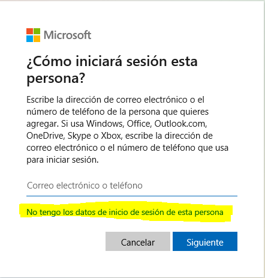
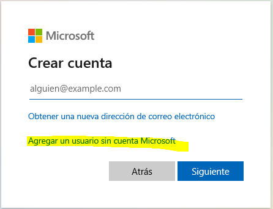
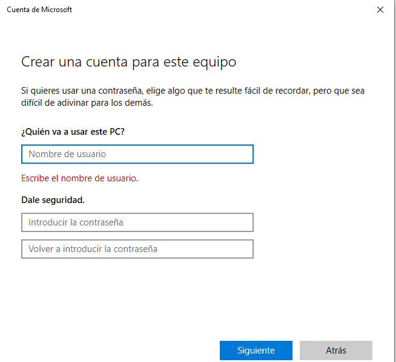
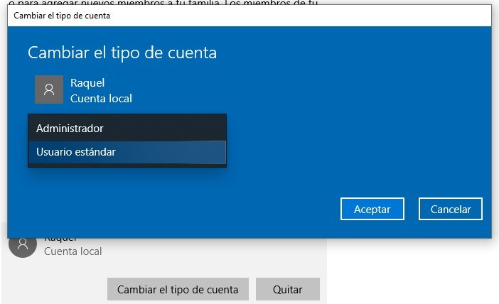

#### Gestión de Contraseñas y Cuentas en Panel de Control

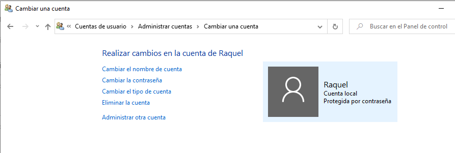
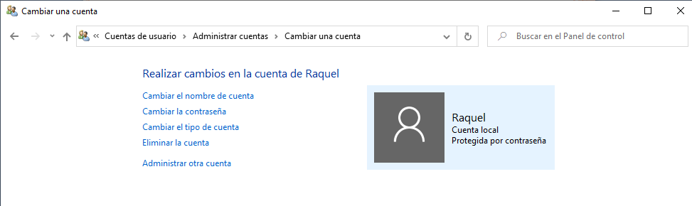

---

### 7.3 Grupos de Usuarios en Windows y Herramienta `lusrmgr.msc`

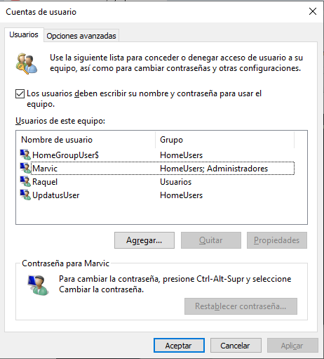

A través de la consola de administración **`lusrmgr.msc`** (Usuarios y grupos locales en Windows Pro/Enterprise):
* **Administradores:** Control total sin restricciones sobre la máquina.
* **Usuarios:** Cuentas regulares con permisos limitados.
* **Usuarios avanzados:** Grupo heredado con permisos administrativos parciales.
* **Usuarios de escritorio remoto:** Permiso explícito para conectar vía RDP.
* **Invitados:** Cuentas temporales con máximas restricciones.

#### Gestión mediante Símbolo del Sistema (`cmd`) / PowerShell:
```cmd
:: Ver lista de usuarios
net user

:: Crear un nuevo usuario local con contraseña
net user juan Secreto123* /add

:: Modificar contraseña
net user juan NuevaClave456*

:: Activar o desactivar cuenta
net user juan /active:no
net user juan /active:yes

:: Añadir usuario a un grupo local
net localgroup Administradores juan /add

:: Eliminar usuario
net user juan /delete
```

---

<h2 id="procesos-conceptos"><u>8. Conceptos y Ciclo de Vida de los Procesos</u></h2>

Un **proceso** es una instancia de un programa informático en ejecución. Mientras que un programa es una entidad pasiva almacenada en disco, el proceso es una entidad activa que requiere memoria, registros de CPU, puntero de instrucción y recursos del sistema.

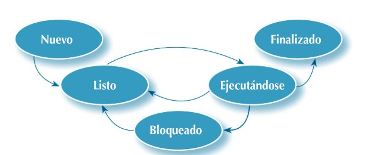
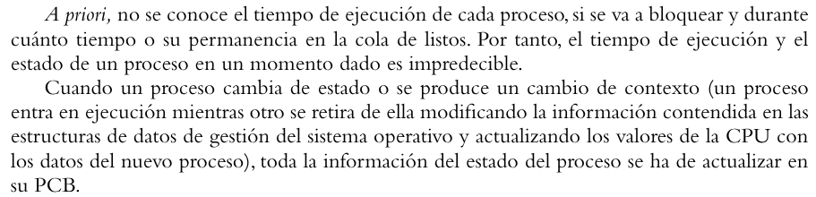

### 8.1 Estados Fundamentales de un Proceso
1. **Nuevo (*New*):** El sistema operativo reserva las estructuras de datos de gestión (**PCB / BCP - Bloque de Control de Proceso**) y espacio en memoria.
2. **Listo / Preparado (*Ready*):** El proceso está cargado en RAM y preparado para ejecutarse, a la espera de que el planificador le asigne un turno de CPU.
3. **En Ejecución (*Running*):** La CPU está procesando activamente las instrucciones del proceso.
4. **Bloqueado / Suspendido (*Blocked / Waiting*):** El proceso no puede continuar hasta que ocurra un evento externo (finalización de lectura en disco, entrada de red, recepción de señal).
5. **Finalizado / Terminado (*Terminated / Zombie*):** El proceso ha concluido su tarea. Libera sus recursos de memoria y hardware, permaneciendo en la tabla de procesos hasta que el padre lee su estado de salida.

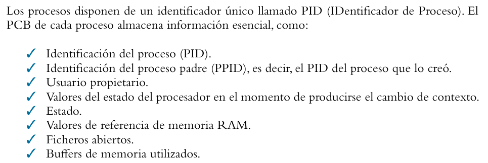


### 8.2 Modos y Formas de Ejecución
* **Modo Usuario (*User Mode*):** Nivel no privilegiado (Ring 3) donde se ejecutan las aplicaciones de usuario. No permite acceso directo al hardware.
* **Modo Kernel / Núcleo (*Kernel Mode*):** Nivel privilegiado (Ring 0) donde se ejecuta el núcleo del sistema operativo con acceso absoluto a la CPU e instrucciones de máquina.
* **Procesamiento por Lotes (*Batch*):** Tareas ejecutadas secuencialmente en segundo plano sin intervención humana directa (ej.: copias de seguridad nocturnas).
* **Procesamiento Interactivo:** Tareas que responden continuamente a eventos y pulsaciones del usuario (ej.: navegadores web, editores de texto).

---

<h2 id="monitorizacion-procesos"><u>9. Monitorización y Control de Procesos en Linux</u></h2>

### 9.1 Monitorización Gráfica: Monitor del Sistema
El Monitor del Sistema de GNOME proporciona una vista en tiempo real de todos los procesos y el consumo global de hardware:

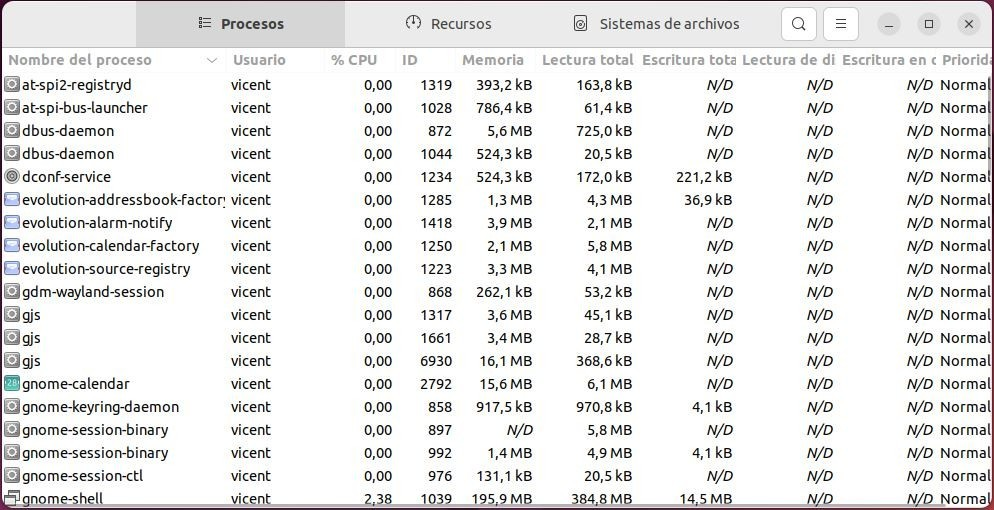
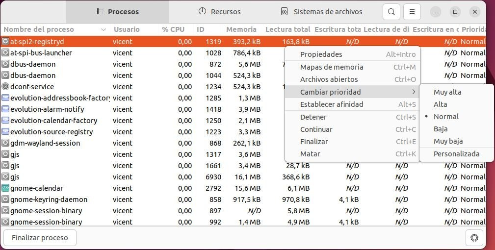
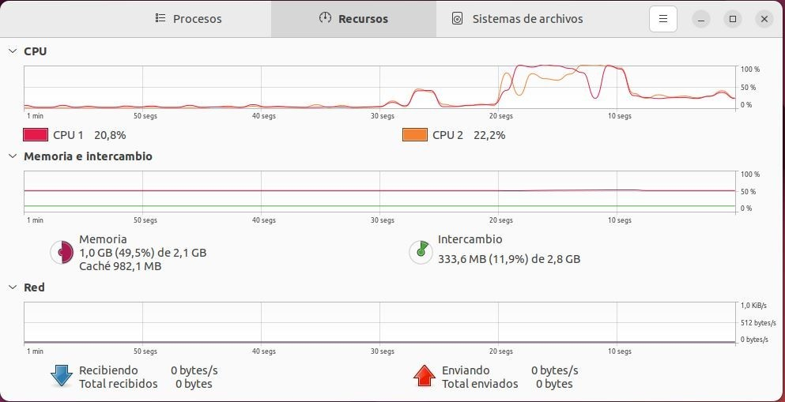
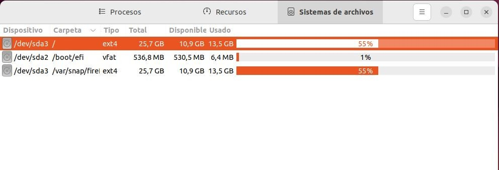

Haciendo clic derecho sobre cualquier proceso es posible:
* **Detener proceso:** Pausa temporalmente su ejecución.
* **Continuar proceso:** Reanuda un proceso previamente pausado.
* **Finalizar proceso:** Envía una señal limpia de cierre (`SIGTERM`).
* **Matar proceso:** Fuerza su terminación incondicional inmediata (`SIGKILL`).
* **Cambiar prioridad:** Ajusta el nivel de preferencia de CPU (*nice*).

---

### 9.2 Monitorización en Terminal: Comando `ps`

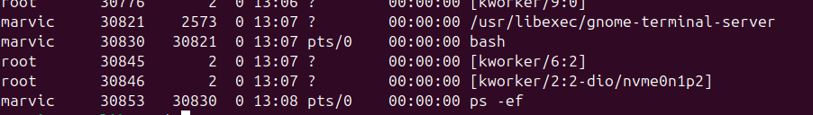
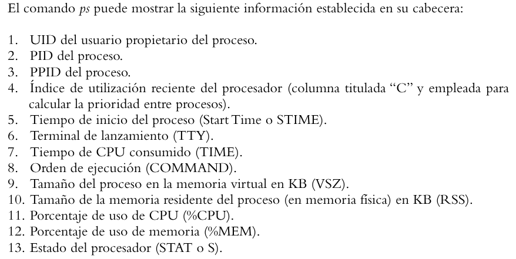
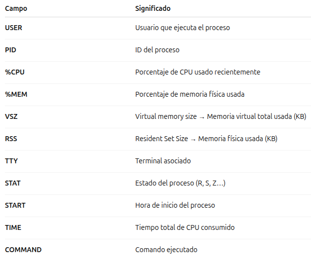
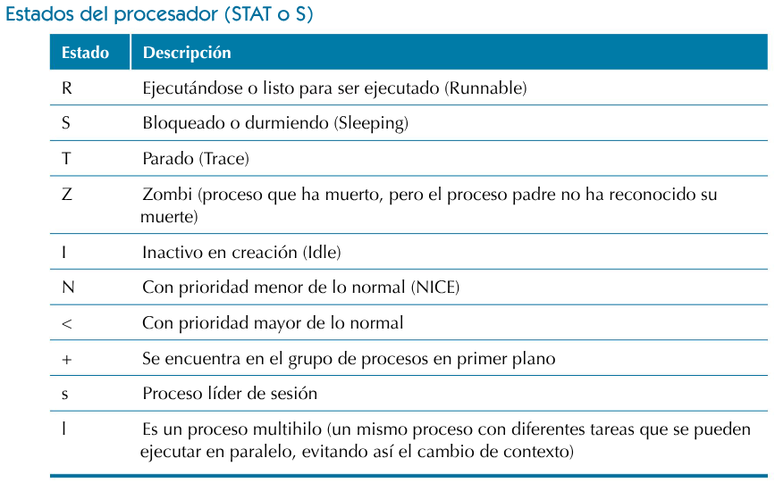

```bash
# Mostrar procesos de la terminal actual
ps

# Formato estándar BSD: ver TODOS los procesos del sistema con usuario y recursos
ps aux

# Formato estándar System V: ver árbol completo de procesos con jerarquía padre-hijo
ps -ef

# Formato largo detallado (muestra UID, PID, PPID, PRI, NI, WCHAN, etc.)
ps -l
```

#### Campos Clave de la Salida de `ps`:
* **`USER`:** Propietario que ejecuta el proceso.
* **`PID`:** Identificador numérico único del proceso.
* **`%CPU` / `%MEM`:** Porcentaje de tiempo de procesador y memoria física ocupada.
* **`VSZ` / `RSS`:** Memoria virtual total y memoria física residente en RAM (en KB).
* **`TTY`:** Terminal asociada (`?` indica un demonio sin terminal).
* **`STAT`:** Estado del proceso (`R` corriendo, `S` durmiendo, `D` espera no interrumpible, `Z` zombi, `T` detenido).
* **`TIME`:** Tiempo total acumulado de CPU consumido.
* **`COMMAND`:** Nombre del comando o ejecutable con sus parámetros.

---

### 9.3 Monitorización Dinámica: `top` y `htop`

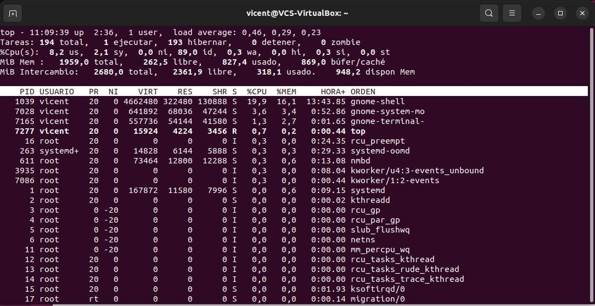
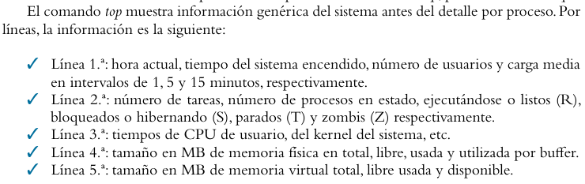
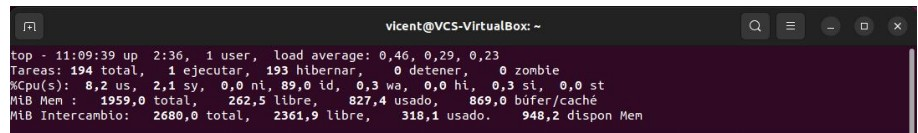
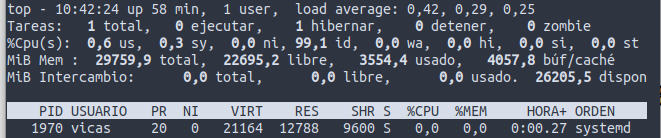

```bash
# Lanzar top interactivo
top

# Actualizar cada 2 segundos y mostrar únicamente los procesos de un usuario
top -d 2 -u luis

# Monitorizar exclusivamente un PID concreto
top -p 1970
```

> [!TIP]
> Instala y utiliza **`htop`** para disponer de una interfaz a color con soporte para ratón, barras de uso de CPU por núcleo, medidor de memoria y accesos rápidos (F9 para matar, F7/F8 para modificar prioridad):
> ```bash
> sudo apt install htop
> htop
> ```

---

### 9.4 Control de Procesos y Señales: `kill` y `killall`

Las señales son notificaciones asíncronas enviadas por el sistema operativo o un usuario para alterar el estado de un proceso.

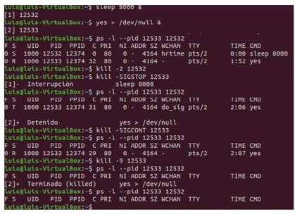

| Número | Señal | Efecto | Acción |
| :---: | :--- | :--- | :--- |
| **`2`** | **`SIGINT`** | Interrupción interactiva | Equivale a presionar `Ctrl + C` en la terminal. Solicita una parada controlada. |
| **`9`** | **`SIGKILL`** | Muerte forzada | El kernel destruye el proceso de forma inmediata. No puede ser atrapada ni ignorada. |
| **`15`** | **`SIGTERM`** | Terminación elegante | Señal por defecto de `kill`. Permite al proceso guardar datos y cerrar ficheros. |
| **`18`** | **`SIGCONT`** | Continuar ejecución | Reanuda la ejecución de un proceso detenido previamente. |
| **`19`** | **`SIGSTOP`** | Pausa incondicional | Detiene el proceso inmediatamente. No puede ser interceptada ni ignorada. |

```bash
# Terminar proceso de forma limpia por PID (señal 15 por defecto)
kill 5800

# Matar proceso incondicionalmente si no responde (señal 9)
kill -9 5800
kill -SIGKILL 5800

# Pausar un proceso (señal 19)
kill -19 5800
kill -SIGSTOP 5800

# Reanudar un proceso pausado (señal 18)
kill -18 5800
kill -SIGCONT 5800

# Matar todos los procesos con el mismo nombre
sudo killall firefox
sudo killall gnome-terminal
```

---

### 9.5 Gestión de Primer y Segundo Plano (*Jobs*)

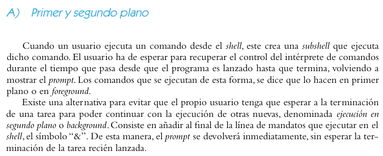


```bash
# Lanzar un proceso directamente en segundo plano añadiendo '&' al final
sleep 300 &

# Suspender un proceso que corre en primer plano
# Presionar Ctrl + Z (se detiene y queda pausado en segundo plano)

# Ver la lista de trabajos gestionados por la sesión actual
jobs

# Reanudar el trabajo suspendido en segundo plano (background)
bg %1

# Traer un trabajo al primer plano (foreground)
fg %1
```

---

### 9.6 Prioridad de los Procesos: `nice` y `renice`


En Linux, la prioridad de cálculo de un proceso ante el planificador viene modulada por el valor **`NI` (*Nice*)**:
* **Rango:** De `-20` (máxima prioridad, menos amable con los demás) a `19` (mínima prioridad, muy amable).
* **Valor por defecto:** `0`.
* **Privilegios:** Cualquier usuario puede reducir la prioridad de sus procesos (hacerlos más amables, valores positivos). **Solo el superusuario `root` puede asignar prioridades altas (valores negativos de -1 a -20)**.

```bash
# Lanzar un comando con prioridad mínima (+19)
nice -n 19 ./calculo_pesado.sh

# Lanzar un comando con prioridad máxima (-20, requiere sudo)
sudo nice -n -20 ./servicio_critico.sh

# Modificar en caliente la prioridad de un proceso en ejecución mediante su PID
sudo renice +10 -p 4321
sudo renice -20 -p 4321
```

---

<h2 id="automatizacion-tareas"><u>10. Automatización de Tareas en Linux (`at` y `cron`)</u></h2>

### 10.1 Ejecución Puntual Única: Comando `at`


El comando `at` permite programar una tarea para ejecutarse una única vez en un momento temporal específico futuro:

```bash
# Programar para una hora concreta hoy
at 5:00 PM
at> /home/usuario/mi_script.sh
at> <Ctrl + D>

# Programar con fecha y hora absoluta
at 7:00 AM 03/01/2026
at> /home/usuario/respaldo.sh
at> <Ctrl + D>

# Programar con tiempo relativo
at now + 2 minutes
at> touch /home/usuario/planificado.txt
at> <Ctrl + D>

# Consultar las tareas encoladas pendientes
atq

# Eliminar una tarea programada indicando su identificador
atrm 3
```

---

### 10.2 Ejecución Periódica Recurrente: Demonio `cron` y Fichero `crontab`


El servicio `cron` ejecuta de forma programada scripts y comandos periódicos según las reglas definidas en la tabla `crontab`.

#### Sintaxis de los 5 Campos de Tiempo:
```text
┌───────────── minuto (0 - 59)
│ ┌────────────── hora (0 - 23)
│ │ ┌─────────────── día del mes (1 - 31)
│ │ │ ┌──────────────── mes (1 - 12 o JAN-DEC)
│ │ │ │ ┌───────────────── día de la semana (0 - 6, donde 0 es Domingo)
│ │ │ │ │
* * * * * comando_a_ejecutar
```

#### Ejemplos Típicos de `crontab`:
```bash
# Editar el crontab del usuario actual
crontab -e

# Listar las tareas periódicas activas
crontab -l

# Eliminar todas las tareas del crontab
crontab -r

# Ejemplos de programación:
# Ejecutar cada medianoche (00:00) todos los días
0 0 * * * /backup/copia_diaria.sh

# Ejecutar a las 8:30 de lunes a viernes (días 1 a 5)
30 8 * * 1-5 /scripts/iniciar_jornada.sh

# Ejecutar cada 15 minutos
*/15 * * * * /monitor/comprobar_web.sh

# Ejecutar el primer día de cada mes a las 04:00
0 4 1 * * /scripts/informe_mensual.sh
```

---

<h2 id="rendimiento-diagnostico"><u>11. Monitorización del Rendimiento y Diagnóstico del Sistema</u></h2>

Para auditar y diagnosticar el uso del hardware en Linux se emplean utilidades complementarias:
1. **Espacio en Disco (`df`):** Informa sobre el espacio ocupado y disponible en todos los sistemas de archivos montados:
   ```bash
   df -h
   ```
2. **Consumo de Memoria (`free`):** Muestra el estado de la memoria RAM y del espacio de intercambio (*Swap*):
   ```bash
   free -m -h
   ```
3. **Información de Hardware (`lshw` / `hardinfo`):** Audita CPU, memoria, placas, buses y dispositivos:
   ```bash
   sudo lshw -short
   ```

---

<h2 id="actividades-practicas"><u>12. Actividades Prácticas y Soluciones Paso a Paso</u></h2>

### Actividad 1: Creación y Eliminación de Usuarios
Crea dos usuarios (`usuarioA` y `usuarioB`) con directorio de trabajo `/home/usuarioA` y `/home/usuarioB` y shell `/bin/bash`. Elimina `usuarioA` conservando sus archivos personales en disco. Elimina `usuarioB` borrando completamente su cuenta y sus datos.

<details>
<summary><b>Ver Solución</b></summary>

```bash
# 1. Crear los usuarios con sus directorios y shell bash
sudo useradd -m -d /home/usuarioA -s /bin/bash usuarioA
sudo useradd -m -d /home/usuarioB -s /bin/bash usuarioB

# 2. Eliminar usuarioA conservando sus ficheros
sudo userdel usuarioA

# 3. Eliminar usuarioB borrando su home y correo
sudo userdel -r usuarioB

# 4. Comprobación
ls -ld /home/usuarioA # El directorio permanece intacto
ls -ld /home/usuarioB # El directorio ya no existe (mensaje de error)
```
</details>

---

### Actividad 2: Gestión de Grupos y Pertenencia de Recursos
Crea un usuario con su grupo propio. Crea varios archivos con dicho usuario. Modifica el grupo del usuario y comprueba cómo afecta a los archivos y a la asignación de recursos.

<details>
<summary><b>Ver Solución</b></summary>

```bash
# 1. Crear usuario y asignarle contraseña
sudo useradd -m -d /home/usuarioA -s /bin/bash usuarioA
sudo passwd usuarioA

# 2. Iniciar sesión como usuarioA y crear archivos
su - usuarioA
touch /home/usuarioA/texto1.txt
touch /home/usuarioA/texto2.txt
ls -l /home/usuarioA
exit

# 3. Crear un nuevo grupo y cambiar el grupo principal de usuarioA
sudo groupadd grupoA
sudo usermod -g grupoA usuarioA

# 4. Asignar los archivos al nuevo grupo
sudo chown usuarioA:grupoA /home/usuarioA/texto*
ls -l /home/usuarioA/texto*
```
</details>

---

### Actividad 3: Políticas de Seguridad y Caducidad de Contraseñas
1. Crea los usuarios `usuario1` y `usuario2` con shell `/bin/bash` y sus directorios home.
2. Asigna la contraseña cifrada `sistEmas_%20` a ambos utilizando `openssl passwd`.
3. Deshabilita la cuenta de `usuario1` mediante fecha de expiración y bloquea la contraseña de `usuario2`. Comprueba los accesos.
4. Habilita y desbloquea ambas cuentas y comprueba su correcto inicio de sesión.
5. Fija 20 días de máximo y 10 días de mínimo para la contraseña de `usuario2`.
6. Establece una fecha de caducidad de cuenta para `usuario2` en `2026-01-01` y luego retira dicha restricción.

<details>
<summary><b>Ver Solución</b></summary>

```bash
# 1. Creación de usuarios
sudo useradd -d /home/usuario1 -m -s /bin/bash usuario1
sudo useradd -d /home/usuario2 -m -s /bin/bash usuario2

# 2. Asignación de contraseña cifrada con openssl
sudo usermod -p $(openssl passwd -6 "sistEmas_%20") usuario1
sudo usermod -p $(openssl passwd -6 "sistEmas_%20") usuario2

# 3. Deshabilitar cuenta usuario1 y bloquear contraseña de usuario2
# La fecha Epoch 1 equivale al 02/01/1970 (cuenta ya caducada)
sudo usermod --expiredate 1 usuario1
# Bloqueo con -L (añade ! al hash en /etc/shadow)
sudo usermod -L usuario2

# Comprobaciones
su - usuario1 # Notifica: 'La cuenta ha caducado'
su - usuario2 # Notifica: 'Fallo de autenticación'

# 4. Rehabilitar y desbloquear
sudo usermod --expiredate -1 usuario1
sudo usermod -U usuario2
su - usuario1 # Accede correctamente
su - usuario2 # Accede correctamente

# 5. Políticas de rotación con chage
sudo chage -m 10 -M 20 usuario2
sudo cat /etc/shadow | grep usuario2

# 6. Expiración de cuenta con fecha límite y posterior retirada
sudo usermod -e 2026-01-01 usuario2
chage -l usuario2
sudo chage -E -1 usuario2
chage -l usuario2 # Muestra: 'La cuenta caduca: nunca'
```
</details>

---

### Actividad 4: Permisos Octales y Simbólicos
1. En la carpeta personal de tu usuario, crea la carpeta `dirPerm` y dentro un archivo llamado `permisos`.
2. Asigna a `dirPerm` los permisos `rwxr-----` (octal) y desactiva el permiso de lectura para el grupo sobre `permisos` (simbólico).
3. Asigna a `dirPerm` los permisos `rwxrwxrw-` (octal) y otorga todos los permisos a propietario y grupo retirándoselos a otros sobre `permisos` (simbólico).
4. Cambia de forma recursiva el propietario y grupo de `dirPerm` a `usuario1:SI1`.

<details>
<summary><b>Ver Solución</b></summary>

```bash
# 1. Creación de recursos
mkdir ~/dirPerm
touch ~/dirPerm/permisos

# 2. Permisos del primer bloque
chmod 740 ~/dirPerm
ls -ld ~/dirPerm
chmod g-r ~/dirPerm/permisos
ls -l ~/dirPerm/permisos

# 3. Permisos del segundo bloque
chmod 776 ~/dirPerm
ls -ld ~/dirPerm
chmod ug=rwx,o-rwx ~/dirPerm/permisos
ls -l ~/dirPerm/permisos

# 4. Creación del grupo SI1 y asignación de propiedad recursiva
sudo groupadd SI1
sudo usermod -aG SI1 usuario1
sudo chown -R usuario1:SI1 ~/dirPerm
ls -ld ~/dirPerm
ls -l ~/dirPerm/permisos
```
</details>

---

### Actividad 5: Variables de Entorno, Persistencia y Creación de Alias
1. Crea una variable local `PRUEBA=1`. Conviértela en variable global y compruébalo. Bórrala.
2. Consulta el directorio actual, nombre de máquina, shell y login mediante variables predeterminadas.
3. Crea un alias `crearfichero` que invoque `touch`. Pruébalo y elimínalo con `unalias`.
4. Define la variable global `SISTEMAS=SI_2026` y hazla permanente en `~/.bashrc`.

<details>
<summary><b>Ver Solución</b></summary>

```bash
# 1. Variable local y exportación
PRUEBA=1
set | grep PRUEBA
export PRUEBA
env | grep PRUEBA
unset PRUEBA

# 2. Consulta de variables del sistema
echo "Directorio: $PWD | Host: $HOSTNAME | Shell: $SHELL | Usuario: $USER"

# 3. Creación y borrado de alias
alias crearfichero='touch'
crearfichero fichero_prueba.txt
ls -l fichero_prueba.txt
unalias crearfichero

# 4. Persistencia en ~/.bashrc
echo 'export SISTEMAS=SI_2026' >> ~/.bashrc
source ~/.bashrc
echo $SISTEMAS
```
</details>

---

### Actividad 6: Gestión de Procesos en Segundo Plano y Envío de Señales
1. Desde un terminal lanza el proceso `yes > /dev/null`. Pásalo a segundo plano con `Ctrl + Z` y `bg`.
2. Desde otro terminal localiza el proceso mediante `ps aux | grep yes`.
3. Detén el proceso con la señal 19 (`SIGSTOP`), reanúdalo con la señal 18 (`SIGCONT`) y destrúyelo con la señal 9 (`SIGKILL`).

<details>
<summary><b>Ver Solución</b></summary>

```bash
# Terminal 1:
yes > /dev/null
# Pulsar Ctrl + Z (se detiene con mensaje [1]+ Detenido)
jobs
bg %1
jobs # Muestra [1]+ ejecutando

# Terminal 2:
ps aux | grep yes # Localizamos el PID (ej. 4520)

# Pausar el proceso
sudo kill -19 4520
# Reanudar el proceso
sudo kill -18 4520
# Terminar incondicionalmente
sudo kill -9 4520
```
</details>

---

### Actividad 7: Prioridad de Procesos (`nice` y `renice`)
Lanza `sleep 500` en segundo plano con mínima prioridad (`+19`). Consulta su campo `NI`. Modifícalo con `renice`. Comprueba que un usuario sin privilegios no puede asignar prioridades negativas.

<details>
<summary><b>Ver Solución</b></summary>

```bash
# 1. Lanzar con mínima prioridad en segundo plano
nice -n 19 sleep 500 &

# 2. Consultar PID y valor NI
ps -l | grep sleep

# 3. Modificar con renice como usuario regular
renice +10 -p [PID]
ps -l | grep sleep

# 4. Intentar asignar valor negativo sin sudo (dará permiso denegado)
renice -5 -p [PID]

# 5. Asignar prioridad alta con sudo
sudo renice -20 -p [PID]
ps -l | grep sleep
```
</details>

---

### Actividad 8: Programación con `at`
Programa la creación de un archivo de texto `planificado.txt` dentro de 2 minutos. Lista la cola de tareas con `atq`.

<details>
<summary><b>Ver Solución</b></summary>

```bash
at now + 2 minutes
at> touch /home/$USER/planificado.txt
at> <Ctrl + D>

# Listar tareas
atq

# Esperar dos minutos y comprobar
ls -l /home/$USER/planificado.txt
```
</details>

---

<h2 id="recursos"><u>13. Videografía y Recursos Complementarios</u></h2>

* **Gestión de usuarios y grupos en terminal:** [https://www.youtube.com/watch?v=6jQDaGy-TJo](https://www.youtube.com/watch?v=6jQDaGy-TJo)
* **Gestión de usuarios y grupos con interfaz gráfica y comandos:** [https://www.youtube.com/watch?v=LL48HCy3KpA](https://www.youtube.com/watch?v=LL48HCy3KpA)
* **Permisos de archivos y directorios en Linux:** [https://www.youtube.com/watch?v=CU_DnPaP78U](https://www.youtube.com/watch?v=CU_DnPaP78U)
* **Permisos con interfaz gráfica en Linux:** [https://www.youtube.com/watch?v=Btzn4lEVFpA](https://www.youtube.com/watch?v=Btzn4lEVFpA)
* **Alta y gestión de usuarios locales en Windows 10/11:** [https://www.youtube.com/watch?v=ACAkbCi_0GI](https://www.youtube.com/watch?v=ACAkbCi_0GI)
* **Recuperar contraseñas de usuario en Windows:** [https://www.youtube.com/watch?v=ogYBbcawXKQ](https://www.youtube.com/watch?v=ogYBbcawXKQ)
* **Consola de usuarios y grupos locales en Windows (`lusrmgr.msc`):** [https://www.youtube.com/watch?v=GvX0PQLwI88](https://www.youtube.com/watch?v=GvX0PQLwI88)
* **Monitor del sistema y gestión gráfica de procesos en Ubuntu:** [https://www.youtube.com/watch?v=oCn3AH-9Pa8](https://www.youtube.com/watch?v=oCn3AH-9Pa8)
* **Comando `ps` a fondo en Linux:** [https://www.youtube.com/watch?v=3BNbj_qjPVM](https://www.youtube.com/watch?v=3BNbj_qjPVM)
* **Gestión completa de procesos en Linux:** [https://www.youtube.com/watch?v=apOjn4tfbMc](https://www.youtube.com/watch?v=apOjn4tfbMc)
* **Automatización con `cron` y `crontab`:** [https://www.youtube.com/watch?v=tnGetpLAMpg](https://www.youtube.com/watch?v=tnGetpLAMpg)
* **Automatización puntual con `at`:** [https://www.youtube.com/watch?v=DFWFGQcqZGk](https://www.youtube.com/watch?v=DFWFGQcqZGk)

