# SISTEMAS INFORMÁTICOS EN RED: CONFIGURACIÓN Y EXPLOTACIÓN

---

## Índice de Contenidos

* [1. Mapa Conceptual y Fundamentos de Redes](#mapa-conceptual)
* [2. Modelos de Referencia de Red: OSI y TCP/IP](#modelos-referencia)
* [3. Protocolos de Enlace y Acceso al Medio (Ethernet, Wi-Fi y Dirección MAC)](#protocolos-enlace)
* [4. Protocolos de Red: Direccionamiento IPv4 e IPv6 y Subnetting](#protocolo-ip)
* [5. Protocolos de Transporte: TCP vs UDP](#protocolos-transporte)
* [6. Configuración de Red: Estática vs Dinámica (DHCP y NAT)](#configuracion-tcpip)
* [7. Dispositivos de Interconexión de Redes (Hub, Switch, Router, AP, Repetidor)](#componentes-red)
* [8. Topologías de Red y Dominios de Colisión y Difusión](#topologias-dominios)
* [9. Medios de Transmisión: Redes Cableadas e Inalámbricas](#medios-transmision)
* [10. Ficheros y Herramientas de Configuración de Red en Linux y Windows](#ficheros-configuracion)
* [11. Monitorización, Diagnóstico y Comandos de Red](#monitorizacion-red)
* [12. Metodología de Resolución de Problemas de Red](#resolucion-problemas)
* [13. Seguridad en las Comunicaciones y Tipos de Ataques](#seguridad-red)
* [14. Actividades Prácticas y Ejercicios Resueltos Paso a Paso](#actividades-practicas)
* [15. Videografía y Recursos Complementarios](#recursos)

---

<h2 id="mapa-conceptual"><u>1. Mapa Conceptual y Fundamentos de Redes</u></h2>

Una red de computadoras es un conjunto de equipos informáticos y dispositivos de telecomunicación interconectados mediante enlaces físicos (cables de cobre o fibra óptica) o inalámbricos (ondas electromagnéticas), con la finalidad de compartir información, recursos y servicios.

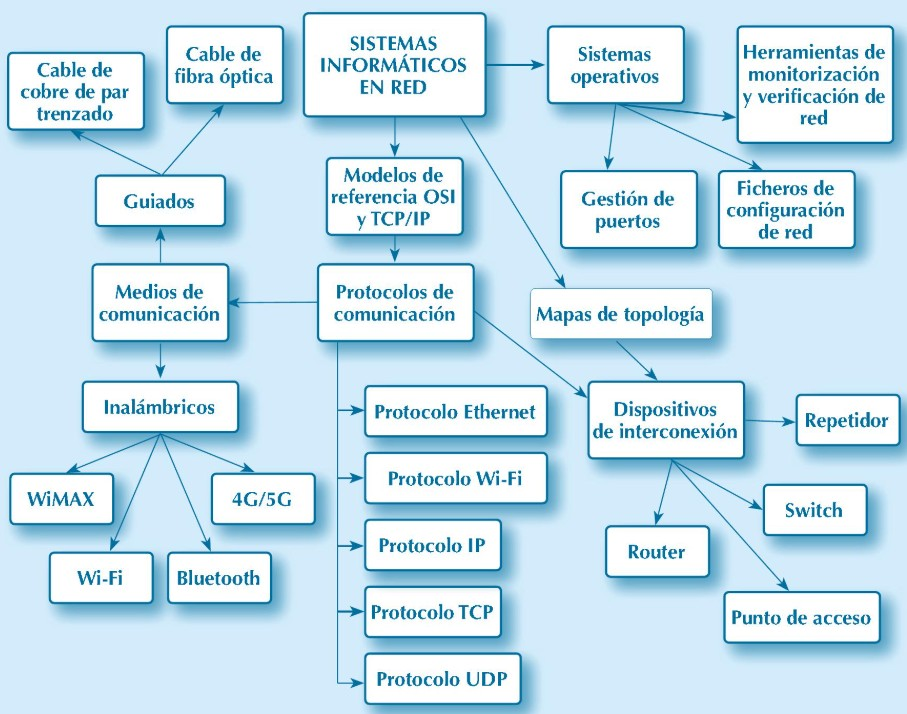

### Objetivos y Ventajas de una Red
* **Compartición de recursos físicos y lógicos:** Impresoras, almacenamiento masivo, servidores de bases de datos y aplicaciones corporativas.
* **Acceso y centralización de la información:** Reducción de redundancias, copias de seguridad unificadas y gestión de versiones.
* **Comunicación ágil y colaborativa:** Mensajería, correo electrónico, voz sobre IP (VoIP) y plataformas de trabajo concurrente.
* **Seguridad y auditoría centralizada:** Gestión de identidades, perfiles de acceso y directivas unificadas.

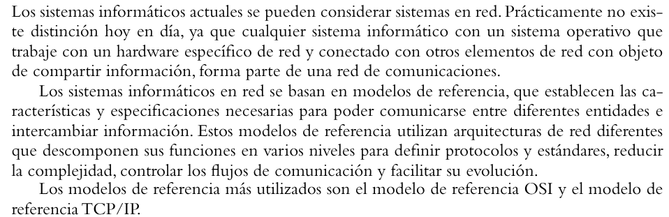
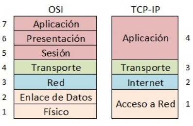

---

<h2 id="modelos-referencia"><u>2. Modelos de Referencia de Red: OSI y TCP/IP</u></h2>

Para permitir que equipos con distintos sistemas operativos, arquitecturas hardware y tecnologías de transmisión se comuniquen entre sí, los organismos de estandarización desarrollaron modelos en capas.

### 2.1 El Modelo de Referencia OSI (Open Systems Interconnection)
Desarrollado por la Organización Internacional de Normalización (ISO) en 1984, divide la comunicación en 7 niveles conceptuales:

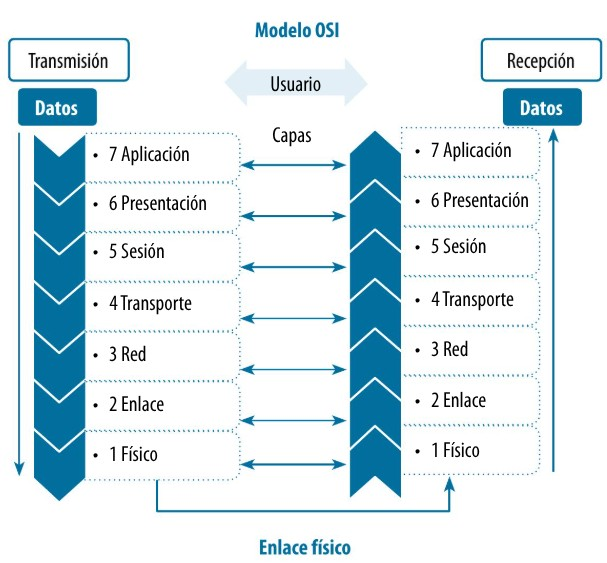
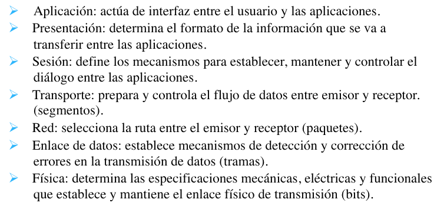

| Nivel / Capa | Unidad de Datos (PDU) | Función Principal | Tecnologías y Ejemplos |
| :---: | :---: | :--- | :--- |
| **7. Aplicación** | Datos | Proporciona interfaz directa para los programas y servicios del usuario. | HTTP, HTTPS, FTP, DNS, SMTP, SSH |
| **6. Presentación** | Datos | Traduce, comprime y cifra la información para su correcta interpretación. | TLS/SSL, ASCII, Unicode, JPEG, PNG |
| **5. Sesión** | Datos | Establece, mantiene y finaliza las sesiones de diálogo entre aplicaciones. | RPC, NetBIOS, Sockets, PPTP |
| **4. Transporte** | Segmento (TCP) / Datagrama (UDP) | Comunicación extremo a extremo, control de flujo, fiabilidad y multiplexación. | TCP, UDP |
| **3. Red** | Paquete | Enrutamiento lógico, direccionamiento IP y determinación de la mejor ruta. | IPv4, IPv6, ICMP, OSPF, BGP |
| **2. Enlace de Datos** | Trama (*Frame*) | Direccionamiento físico, detección de errores y control de acceso al medio. | Ethernet (802.3), Wi-Fi (802.11), MAC, Switch |
| **1. Física** | Bits | Transmisión de señales eléctricas, ópticas o radioeléctricas sobre el medio. | Cables UTP, Fibra óptica, Conectores RJ45, Hub |

---

### 2.2 La Arquitectura de Protocolos TCP/IP
Diseñada originalmente por DARPA para la red ARPANET, es la arquitectura práctica real sobre la que funciona Internet y las redes corporativas. Agrupa las 7 capas OSI en 4 capas pragmáticas:

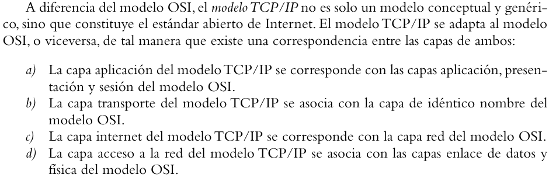
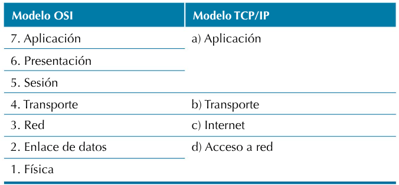
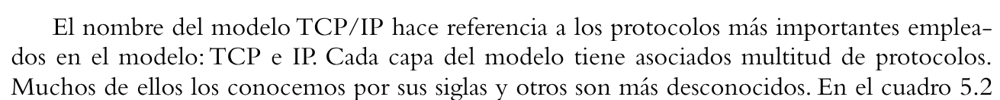
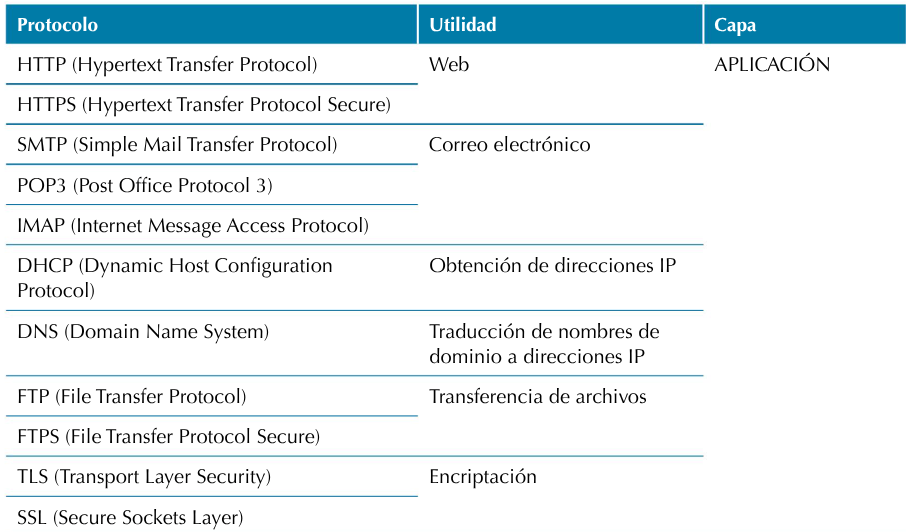
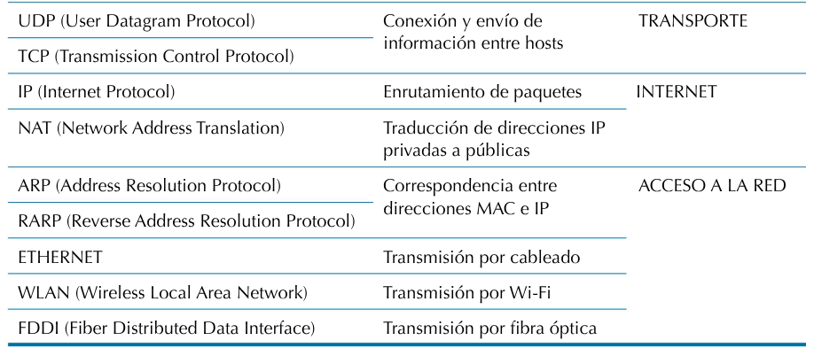

1. **Capa de Aplicación:** Equivale a las capas 5, 6 y 7 de OSI. Gestiona la lógica de los servicios finales.
2. **Capa de Transporte:** Idéntica a la capa 4 de OSI. Implementa TCP y UDP.
3. **Capa de Internet:** Idéntica a la capa 3 de OSI. Implementa el protocolo IP, ICMP y ARP.
4. **Capa de Acceso a la Red (*Network Access*):** Engloba las capas 1 y 2 de OSI. Gobierna el hardware, las tramas y la modulación de señales.

---

<h2 id="protocolos-enlace"><u>3. Protocolos de Enlace y Acceso al Medio (Ethernet, Wi-Fi y Dirección MAC)</u></h2>

### 3.1 Protocolo Ethernet (IEEE 802.3) y Mecanismo CSMA/CD

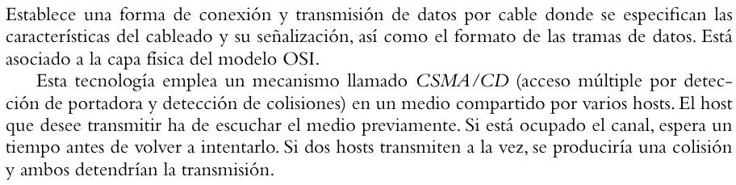
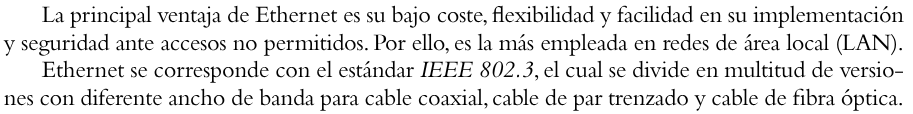
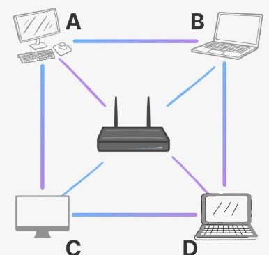

Ethernet es el estándar dominante para redes locales cableadas (LAN):
* **Mecanismo de Acceso al Medio:** Utiliza **CSMA/CD** (*Carrier Sense Multiple Access with Collision Detection* - Acceso múltiple por detección de portadora con detección de colisiones):
  1. **Carrier Sense (Detección de portadora):** El equipo "escucha" el medio antes de transmitir. Si el canal está ocupado, espera.
  2. **Multiple Access (Acceso múltiple):** Múltiples estaciones comparten el mismo medio físico.
  3. **Collision Detection (Detección de colisiones):** Si dos equipos transmiten simultáneamente, sus señales interfieren (colisión). Al detectarla, ambos abortan la emisión, envían una señal de atasco (*jam signal*) y esperan un tiempo aleatorio antes de reintentar (*backoff algorithm*).
* **Evolución:** En redes conmutadas modernas (full-duplex sobre switches dedicados), las colisiones quedan eliminadas ya que la recepción y transmisión ocurren en pares de cables independientes.

---

### 3.2 Protocolo Wi-Fi (IEEE 802.11) y Mecanismo CSMA/CA

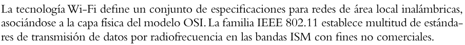
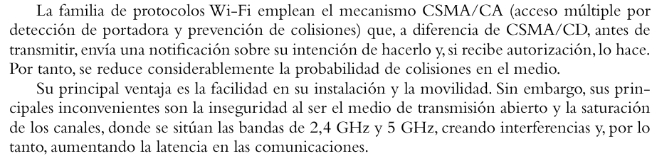
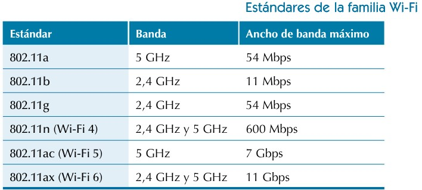

En redes inalámbricas (WLAN), una estación no puede transmitir y escuchar al mismo tiempo para detectar colisiones en el aire (*problema del nodo oculto*). Por tanto, se utiliza **CSMA/CA** (*Carrier Sense Multiple Access with Collision Avoidance* - Evitación de colisiones):
* Antes de transmitir, el emisor escucha el canal. Si está libre durante un periodo (DIFS), espera un tiempo aleatorio adicional (*contention window*).
* Opcionalmente emplea el intercambio de tramas de control **RTS/CTS** (*Request to Send / Clear to Send*) para reservar el canal radioeléctrico.
* El receptor envía siempre una confirmación explícita (**ACK**). Si el emisor no recibe el ACK, asume pérdida y retransmite.

---

### 3.3 La Dirección Física MAC (Media Access Control)

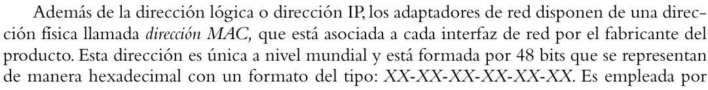

* Es un identificador binario de **48 bits (6 bytes)** grabado en la memoria no volátil (ROM/EEPROM) de cada tarjeta de red (NIC).
* Se representa habitualmente en formato hexadecimal agrupado en parejas separadas por dos puntos o guiones:
  `00:1A:2B:3C:4D:5E`
* **Estructura:**
  * **Primeros 24 bits (3 primeros bytes):** Identificador Único de Organización (**OUI - Organizationally Unique Identifier**), asignado por el IEEE al fabricante (e.g., Intel, Realtek, Cisco).
  * **Últimos 24 bits (3 últimos bytes):** Número de serie único asignado por el fabricante a la tarjeta.

```bash
# Consultar la dirección MAC en Linux
ip link show
# o con comando tradicional:
ifconfig -a

# Consultar la dirección MAC en Windows
getmac /v
# o en la salida detallada:
ipconfig /all
```

---

<h2 id="protocolo-ip"><u>4. Protocolos de Red: Direccionamiento IPv4 e IPv6 y Subnetting</u></h2>

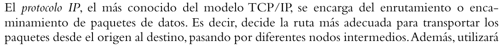
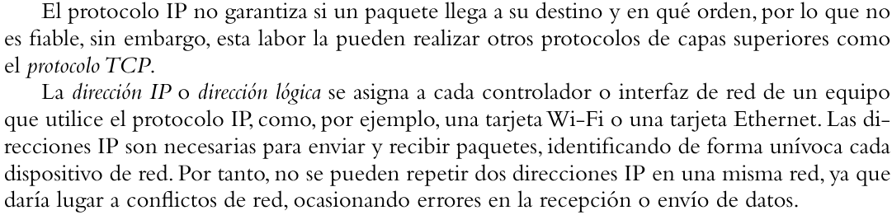

El protocolo IP es no orientado a conexión y no fiable (*best-effort*), encargándose de direccionar y encaminar los paquetes a través de redes heterogéneas.

### 4.1 Direccionamiento IPv4
Consta de **32 bits**, organizados en 4 octetos (bytes) representados en notación decimal con puntos:
`192.168.1.1` $\rightarrow$ `11000000.10101000.00000001.00000001`

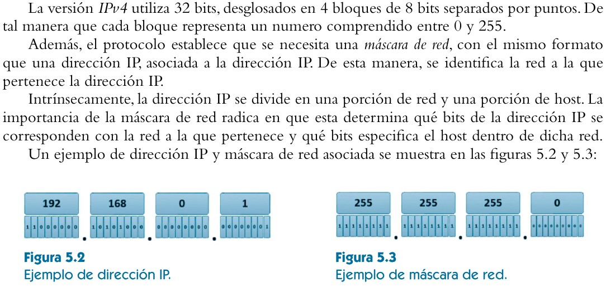
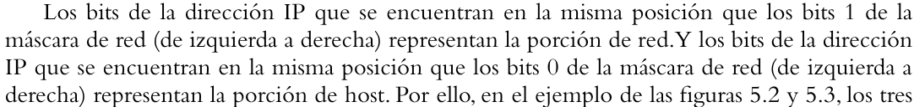

#### Clases Tradicionales de Direcciones IPv4:
* **Clase A:** Rango `1.0.0.0` a `126.255.255.255` (Máscara `/8` o `255.0.0.0`). Primer bit en `0`. Para redes muy grandes (hasta 16.777.214 hosts).
  *(Nota: La red `127.0.0.0/8` está reservada para bucle local o loopback).*
* **Clase B:** Rango `128.0.0.0` a `191.255.255.255` (Máscara `/16` o `255.255.0.0`). Primeros bits `10`. Redes medianas (hasta 65.534 hosts).
* **Clase C:** Rango `192.0.0.0` a `223.255.255.255` (Máscara `/24` o `255.255.255.0`). Primeros bits `110`. Redes pequeñas (hasta 254 hosts).
* **Clase D:** Rango `224.0.0.0` a `239.255.255.255`. Primeros bits `1110`. Reservada para multidifusión (*Multicast*).
* **Clase E:** Rango `240.0.0.0` a `255.255.255.255`. Primeros bits `1111`. Reservada para investigación y uso futuro.

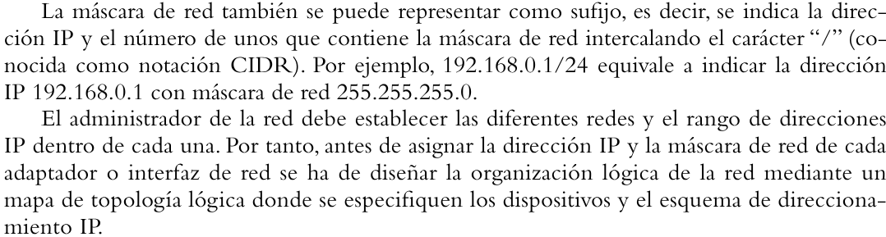
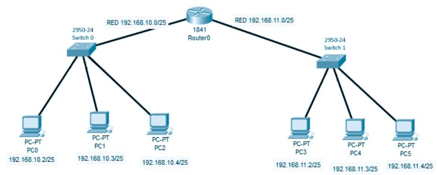

#### Rangos de Direcciones IP Privadas (RFC 1918):
No son enrutables directamente en la Internet pública:
* **Clase A:** `10.0.0.0` a `10.255.255.255` (`10.0.0.0/8`)
* **Clase B:** `172.16.0.0` a `172.31.255.255` (`172.16.0.0/12`)
* **Clase C:** `192.168.0.0` a `192.168.255.255` (`192.168.0.0/16`)

---

### 4.2 Enrutamiento sin Clases (CIDR) y Subnetting

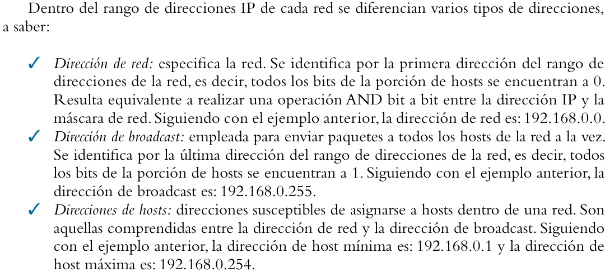
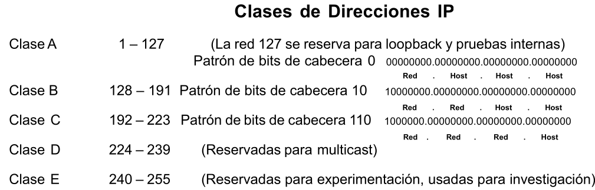
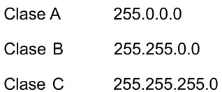

El enrutamiento sin clases (**CIDR - Classless Inter-Domain Routing**) utiliza un prefijo `/N` que indica cuántos bits contiguos corresponden a la parte de red.

#### Fórmulas Fundamentales de Subnetting:
1. **Número de direcciones totales:** $N_{\text{total}} = 2^{h}$, donde $h = 32 - \text{prefijo}$.
2. **Número de hosts utilizables:** $N_{\text{hosts}} = 2^{h} - 2$ (se restan 2: la dirección de red y la de broadcast).
3. **Cálculo de la Dirección de Red:** Operación lógica **AND** bit a bit entre la dirección IP y la máscara de red.
4. **Cálculo de la Dirección de Broadcast:** Los bits de la parte de red se conservan y todos los bits de host se establecen a `1`.
5. **Rango de hosts válidos:** Desde $(\text{Dirección de Red} + 1)$ hasta $(\text{Dirección de Broadcast} - 1)$.

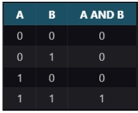
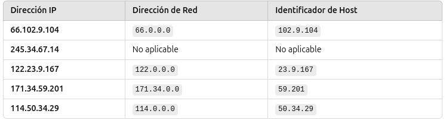

---

### 4.3 El Protocolo IPv6

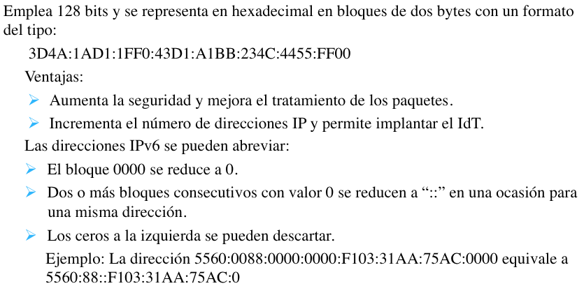
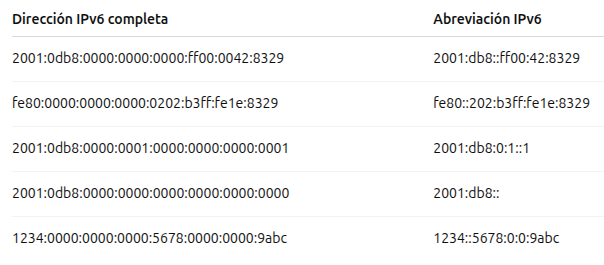

Diseñado para resolver el agotamiento de direcciones de IPv4:
* Tamaño de dirección: **128 bits (16 bytes)**, proporcionando $2^{128} \approx 3.4 \times 10^{38}$ direcciones.
* Se escribe en 8 grupos de 4 dígitos hexadecimales separados por dos puntos (`:`):
  `2001:0db8:85a3:0000:0000:8a2e:0370:7334`

#### Reglas de Abreviación de IPv6:
1. **Omisión de ceros a la izquierda:** En cualquier bloque, los ceros iniciales pueden suprimirse:
   `0042` $\rightarrow$ `42`, `0000` $\rightarrow$ `0`.
2. **Compresión con doble dos puntos (`::`):** Una secuencia contigua de uno o más bloques formados solo por ceros puede comprimirse a `::`. **Esta sustitución solo puede realizarse una única vez por dirección** para evitar ambigüedades.
   * Dirección original: `2001:0db8:0000:0000:0000:0000:1428:57ab`
   * Abreviada: `2001:db8::1428:57ab`
3. **IPv4 Embebida en IPv6:** Para representar una IPv4 dentro del espacio IPv6:
   `::ffff:192.168.1.1` (o en hexadecimal `::ffff:c0a8:0101`).

---

<h2 id="protocolos-transporte"><u>5. Protocolos de Transporte: TCP vs UDP</u></h2>

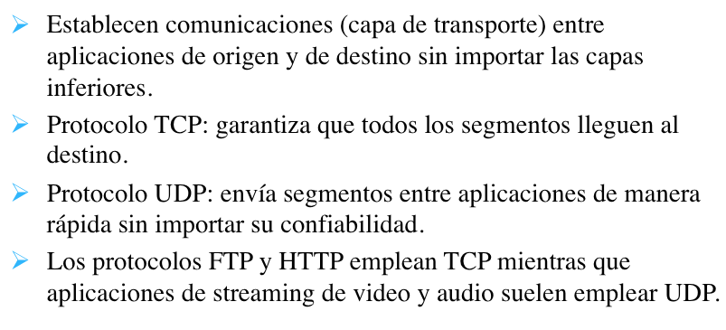
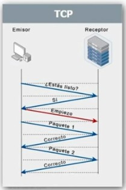
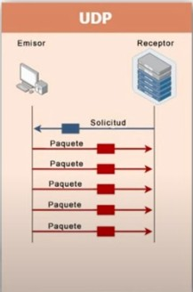

La capa de transporte permite la comunicación entre procesos finales ejecutándose en distintas máquinas mediante el concepto de **puerto de comunicación**.

| Característica | TCP (Transmission Control Protocol) | UDP (User Datagram Protocol) |
| :--- | :--- | :--- |
| **Orientación a conexión** | Sí. Requiere establecer conexión previa mediante saludo en 3 fases (*Three-Way Handshake* - SYN, SYN-ACK, ACK). | No. Envía datagramas directamente sin conexión previa. |
| **Fiabilidad** | Garantizada. Implementa confirmaciones (ACK), retransmisión de paquetes perdidos y control de errores. | No garantizada (*Best-effort*). Si un paquete se pierde, se descarta. |
| **Orden de entrega** | Garantizado. Numera los segmentos para reconstruirlos en orden exacto. | No garantizado. Los paquetes pueden llegar desordenados o duplicados. |
| **Control de flujo y congestión** | Sí (ventana deslizante y algoritmos de congestión). | No implementa control de flujo ni de saturación de red. |
| **Sobrecarga (*Overhead*)** | Alta (cabecera mínima de 20 bytes más proceso de confirmación). | Mínima (cabecera ligera de 8 bytes). |
| **Velocidad y latencia** | Mayor latencia por el control de entrega. | Máxima velocidad y latencia mínima. |
| **Casos de uso habituales** | Páginas web (HTTP/HTTPS), transferencia de ficheros (FTP), correo (SMTP/IMAP), acceso remoto seguro (SSH). | Streaming de vídeo/audio en vivo, videojuegos online, DNS, DHCP, VoIP. |

---

<h2 id="configuracion-tcpip"><u>6. Configuración de Red: Estática vs Dinámica (DHCP y NAT)</u></h2>

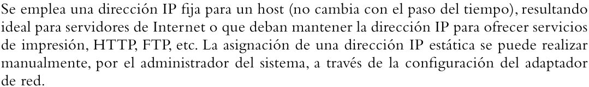
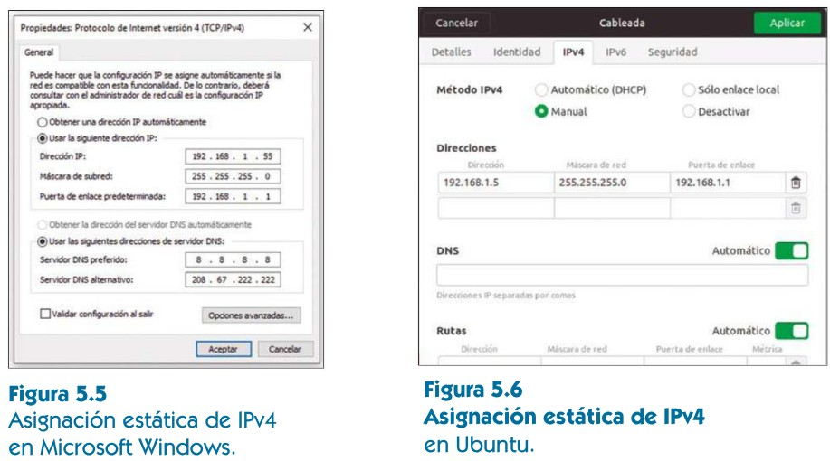

### 6.1 Parámetros Fundamentales de Conectividad IP
1. **Dirección IP:** Identificador único del equipo en el segmento de red.
2. **Máscara de subred:** Delimita qué parte de la IP corresponde a la red y qué parte a la máquina local.
3. **Puerta de Enlace Predeterminada (*Default Gateway*):** Dirección IP del router local encargada de reenviar los paquetes dirigidos a redes externas o Internet.
4. **Servidores DNS (*Domain Name System*):** Servidores que traducen nombres de dominio comprensibles para humanos (`www.google.es`) en direcciones IP (`142.250.200.67`). Ejemplos públicos: Google (`8.8.8.8`, `8.8.4.4`), Cloudflare (`1.1.1.1`).

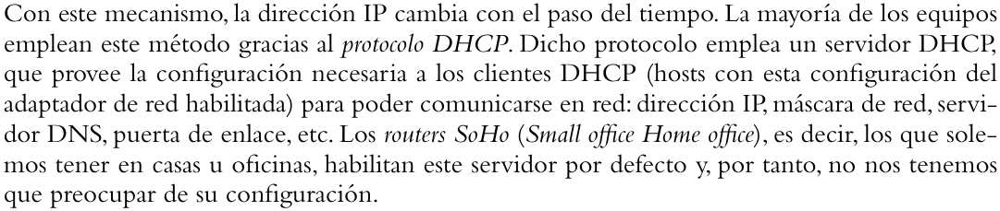
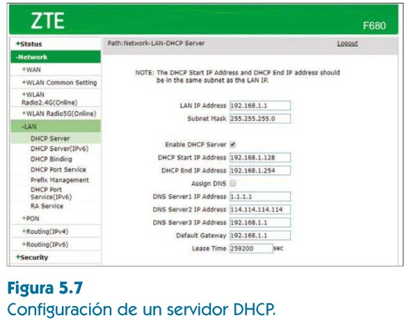

### 6.2 Asignación Dinámica mediante DHCP
El protocolo **DHCP** (*Dynamic Host Configuration Protocol*) automatiza la configuración de red en clientes mediante el proceso en cuatro etapas conocido como **DORA**:
1. **Discover (DHCPDISCOVER):** El cliente recién conectado envía un broadcast buscando servidores DHCP disponibles.
2. **Offer (DHCPOFFER):** Un servidor DHCP responde ofreciendo una dirección IP libre, máscara, gateway y DNS.
3. **Request (DHCPREQUEST):** El cliente acepta la oferta y solicita formalmente el arrendamiento (*lease*).
4. **Acknowledge (DHCPACK):** El servidor confirma el alquiler y registra los parámetros asignados a la MAC del cliente.

### 6.3 Traducción de Direcciones de Red (NAT)
Debido a la escasez de direcciones IPv4 públicas, los routers domésticos y corporativos implementan **NAT** (*Network Address Translation*):
* Todos los dispositivos de la red interna utilizan direcciones privadas (e.g. `192.168.1.X`).
* Cuando salen hacia Internet, el router sustituye la IP privada de origen por su **única IP pública** asignada por el proveedor (ISP), mapeando la conexión mediante números de puerto efímeros (**NAPT / PAT**).

---

<h2 id="componentes-red"><u>7. Dispositivos de Interconexión de Redes</u></h2>

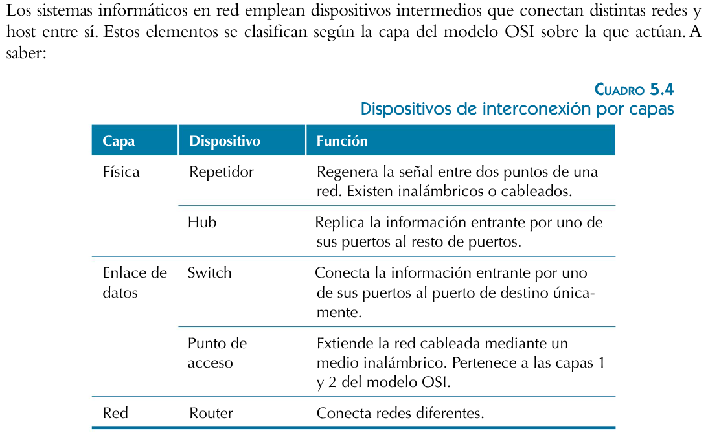

### 7.1 Switch (Conmutador)

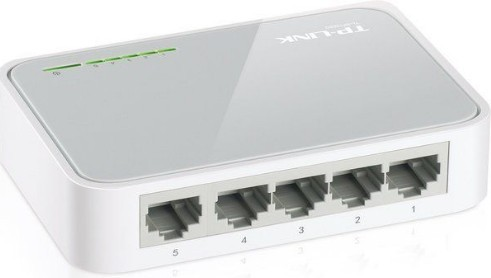
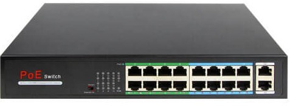

* Periférico de comunicaciones inteligente que opera en la **Capa 2 (Enlace de datos)**.
* Conecta múltiples equipos en una misma red de área local mediante puertos Ethernet RJ-45 (habitualmente en múltiplos de 8: 8, 16, 24, 48 puertos).
* **Funcionamiento:** Mantiene una tabla en memoria (**Tabla CAM / MAC**) donde asocia cada dirección MAC con el puerto físico por el que fue detectada. Cuando recibe una trama, solo la conmuta hacia el puerto donde reside el destinatario, aislando el tráfico y eliminando colisiones.

---

### 7.2 Hub (Concentrador)

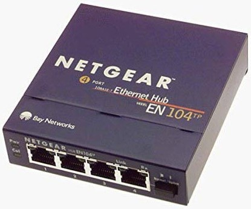

* Dispositivo simple que opera en la **Capa 1 (Física)**.
* Actúa como un repetidor multipuerto: cualquier señal eléctrica que entra por un puerto se replica de forma ciega por todos los demás puertos.
* Inseguro e ineficiente: todo el tráfico es recibido por todas las máquinas y genera frecuentes colisiones de datos. Actualmente se encuentra obsoleto.

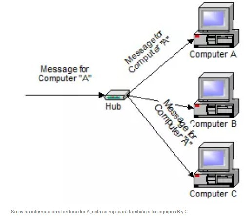
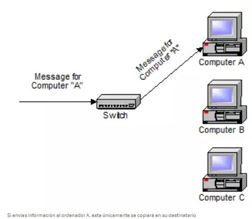

---

### 7.3 Router (Enrutador)

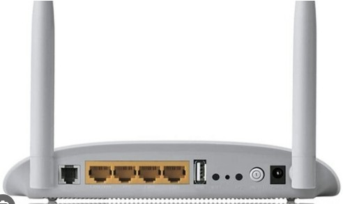
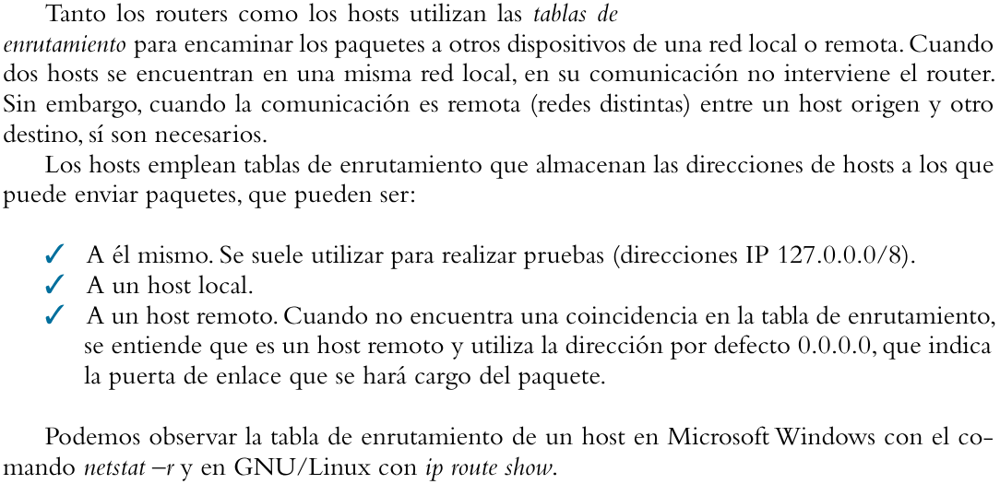

* Dispositivo inteligente que opera en la **Capa 3 (Red)**.
* Su cometido principal es **interconectar redes distintas** y determinar la mejor ruta para enviar paquetes IP basándose en sus **tablas de enrutamiento**.
* Modos: Desde modelos domésticos SoHo (que integran módem/ONT, router, switch y AP Wi-Fi en un solo aparato) hasta routers empresariales modulares montados en armarios rack.

---

### 7.4 Punto de Acceso (AP / WAP) y Repetidores Wi-Fi

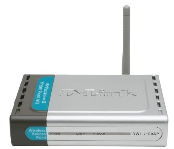
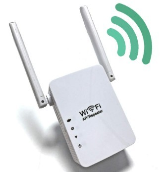

* **Punto de Acceso (Access Point - AP):** Conecta dispositivos inalámbricos a una red cableada. Permite autenticar clientes, aislar redes y gestionar directivas de seguridad.
* **Repetidor Wi-Fi:** Dispositivo simple que capta una señal inalámbrica existente y la amplifica para extender el rango de cobertura en zonas con baja recepción, sin capacidad de gestión de red.

---

<h2 id="topologias-dominios"><u>8. Topologías de Red y Dominios de Colisión y Difusión</u></h2>

### 8.1 Topologías Físicas y Lógicas

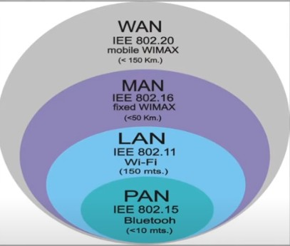
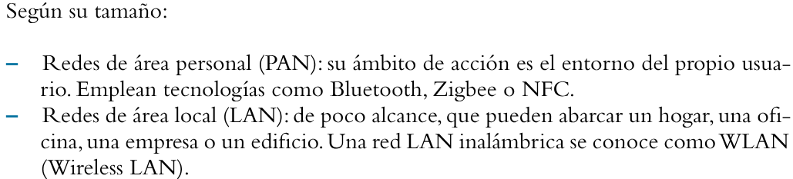
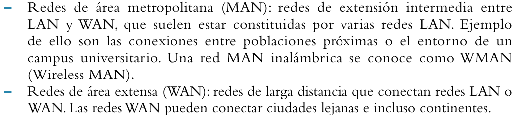


* **Topología Física:** Disposición real y trazado del cableado y los equipos en el edificio:
  * **Estrella:** Todos los equipos se conectan individualmente a un nodo central (Switch). Es el estándar universal de las redes locales actuales (si falla un cable, solo se desconecta un equipo).
  * **Árbol / Jerárquica:** Varios switches conectados entre sí formando una estructura jerárquica con un switch central o troncal.
  * **Malla:** Múltiples enlaces punto a punto entre nodos, ofreciendo máxima tolerancia a fallos (típica en redes WAN e infraestructura crítica).
  * **Bus:** Equipos conectados a un único cable coaxial compartido con terminadores en los extremos (obsoleta).
  * **Anillo:** Los nodos forman un circuito cerrado (Token Ring, FDDI).


* **Topología Lógica:** Forma en que los datos viajan a través de los medios independientemente del cableado físico.

---

### 8.2 Dominios de Colisión y de Difusión


* **Dominio de Colisión:** Espacio de red en el que dos tramas transmitidas al mismo tiempo colisionan entre sí.
  * Los **hubs** crean un único gran dominio de colisión para todos sus puertos.
  * Los **switches** crean **un dominio de colisión independiente por cada puerto**.
  * Los **routers** separan dominios de colisión.
* **Dominio de Difusión (*Broadcast Domain*):** Conjunto de dispositivos que reciben un mensaje emitido a la dirección de difusión (*broadcast*).
  * Los **hubs y switches** reenvían los paquetes broadcast a todos los puertos, perteneciendo al mismo dominio de difusión.
  * Los **routers NO reenvían broadcasts** de red local, actuando como frontera y delimitador de los dominios de difusión.

---

<h2 id="medios-transmision"><u>9. Medios de Transmisión: Redes Cableadas e Inalámbricas</u></h2>

### 9.1 Cables de Par Trenzado (UTP / STP / FTP)


El cable de par trenzado consiste en 4 pares de hilos de cobre trenzados entre sí para cancelar interferencias electromagnéticas y diafonía (*crosstalk*):
* **UTP (*Unshielded Twisted Pair*):** Par trenzado sin apantallar. El más económico y utilizado en oficinas y hogares.
* **FTP (*Foiled Twisted Pair*):** Apantallado global mediante lámina de aluminio exterior.
* **STP (*Shielded Twisted Pair*):** Apantallado individual con malla metálica por cada par de hilos.

#### Estándares de Conectorización RJ-45:
* **T568A:** Blanco/Verde, Verde, Blanco/Naranja, Azul, Blanco/Azul, Naranja, Blanco/Marrón, Marrón.
* **T568B:** Blanco/Naranja, Naranja, Blanco/Verde, Azul, Blanco/Azul, Verde, Blanco/Marrón, Marrón.


* **Cable Directo (*Straight-Through*):** Misma norma en ambos extremos (T568B en ambos lados). Conecta dispositivos de diferente capa (PC a Switch, Switch a Router).
* **Cable Cruzado (*Crossover*):** T568A en un extremo y T568B en el otro. Conecta dispositivos de la misma capa (PC a PC, Switch a Switch, Router a Router). *Nota: Los puertos modernos con Auto-MDIX detectan y corrigen automáticamente el cruce.*


| Categoría | Ancho de Banda Máximo | Velocidad Máxima | Distancia Máxima | Aplicaciones Típicas |
| :---: | :---: | :---: | :---: | :--- |
| **Cat 5e** | 100 MHz | 1 Gbps (1000BASE-T) | 100 metros | Redes domésticas estándar |
| **Cat 6** | 250 MHz | 1 Gbps (10 Gbps hasta 55 m) | 100 metros | Instalaciones de oficina modernas |
| **Cat 6a** | 500 MHz | 10 Gbps (10GBASE-T) | 100 metros | Centros de datos y cableado estructurado |
| **Cat 7** | 600 MHz | 10 Gbps | 100 metros | Entornos industriales con apantallamiento estricto |
| **Cat 8** | 2000 MHz | 25 Gbps / 40 Gbps | 30 metros | Interconexión de servidores en racks de centros de datos |

---

### 9.2 Fibra Óptica


Transmite pulsos de luz modulados a través de un filamento de vidrio o plástico transparente, completamente inmune a interferencias electromagnéticas:
* **Fibra Multimodo (MMF):** Núcleo más ancho (50 o 62.5 $\mu\text{m}$). Emplea emisores LED o láser VCSEL económicos. La luz rebota en múltiples ángulos generando dispersión modal. Distancia hasta 500 metros (redes de campus y centros de datos).
* **Fibra Monomodo (SMF):** Núcleo diminuto (9 $\mu\text{m}$). La luz láser viaja en un único rayo rectilíneo sin rebotes. Permite distancias de hasta decenas de kilómetros a velocidades superiores a 100 Gbps (redes troncales y WAN).
* **Conectores comunes:** SC (cuadrado a presión), LC (pequeño factor de forma con pestaña), ST (bayoneta redonda), FC (a rosca).


---

### 9.3 Tecnologías y Estándares Inalámbricos (Wi-Fi)


* **Banda de 2.4 GHz:** Mayor alcance y mejor penetración a través de paredes y obstáculos, pero menor velocidad máxima y alto nivel de interferencias (microondas, Bluetooth, teléfonos inalámbricos). Consta de 13-14 canales, de los cuales solo 3 no se solapan entre sí (canales 1, 6 y 11).
* **Banda de 5 GHz:** Menor alcance físico, pero canales mucho más anchos (20/40/80/160 MHz) y velocidades drásticamente mayores sin saturación.
* **Banda de 6 GHz (Wi-Fi 6E y Wi-Fi 7):** Amplio espectro sin interferencias para aplicaciones de ultra-baja latencia y vídeo 8K.

---

<h2 id="ficheros-configuracion"><u>10. Ficheros y Herramientas de Configuración de Red en Linux y Windows</u></h2>

### 10.1 Configuración de Red en Linux con Netplan


En Ubuntu Desktop y Server moderno, la configuración de red se gestiona mediante ficheros YAML en el directorio `/etc/netplan/`:

#### Ejemplo de Configuración con IP Dinámica (DHCP):
```yaml
# /etc/netplan/01-netcfg.yaml
network:
  version: 2
  renderer: networkd # o NetworkManager en versión Desktop
  ethernets:
    enp0s3:
      dhcp4: true
```

#### Ejemplo de Configuración con IP Estática:
```yaml
# /etc/netplan/01-netcfg.yaml
network:
  version: 2
  renderer: networkd
  ethernets:
    enp0s3:
      dhcp4: false
      addresses:
        - 192.168.1.100/24
      routes:
        - to: default
          via: 192.168.1.1
      nameservers:
        addresses:
          - 8.8.8.8
          - 1.1.1.1
```

```bash
# Probar la configuración antes de aplicarla (permite revertir si se pierde la conexión)
sudo netplan try

# Aplicar los cambios definitivamente
sudo netplan apply
```


#### Ficheros de Configuración Esenciales en Linux:
* **`/etc/resolv.conf`:** Especifica las direcciones IP de los servidores DNS que utilizará el sistema para resolver dominios.
* **`/etc/hosts`:** Mapeo estático local entre nombres de equipo y direcciones IP, consultado antes que el servidor DNS.
* **`/etc/nsswitch.conf`:** Define el orden de consulta de nombres (`hosts: files dns`).

---

<h2 id="monitorizacion-red"><u>11. Monitorización, Diagnóstico y Comandos de Red</u></h2>


```bash
# 1. Auditar hardware de red instalado
sudo lshw -C network

# 2. Consultar direcciones IP y estado de interfaces
ip addr show
ip -br a # Modo resumido

# 3. Comprobar conectividad y latencia hacia un destino
ping -c 4 8.8.8.8
ping -c 4 www.google.es

# 4. Mostrar la tabla de correspondencias ARP / Vecinos locales
ip neighbour show # Linux
arp -a            # Windows

# 5. Trazar los saltos de router hasta el destino
traceroute 8.8.8.8 # Linux
tracert 8.8.8.8    # Windows

# 6. Consultar puertos y conexiones en escucha
ss -tulnp # Linux (reemplazo moderno de netstat)
netstat -ano # Windows

# 7. Diagnosticar resolución de nombres DNS
nslookup www.google.es
dig www.google.es
```

---

<h2 id="resolucion-problemas"><u>12. Metodología de Resolución de Problemas de Red</u></h2>


Ante un fallo de red, se aplica el enfoque de diagnóstico **ascendente (*Bottom-Up*)** basado en la pila OSI:


---

<h2 id="seguridad-red"><u>13. Seguridad en las Comunicaciones y Tipos de Ataques</u></h2>


### 13.1 Los Tres Pilares de la Seguridad (Tríada CIA)
1. **Confidencialidad:** La información solo es accesible por personas y procesos autorizados (mediante cifrado TLS, VPN, SSH).
2. **Integridad:** Los datos transmitidos no pueden ser alterados, corrompidos ni manipulados durante el tránsito (mediante hashes SHA-256, firmas digitales).
3. **Disponibilidad:** Los sistemas, redes y servicios permanecen operativos y accesibles cuando los usuarios autorizados los requieren (mediante redundancia, balanceo de carga y protección anti-DDoS).

### 13.2 Tipos de Amenazas y Ataques en Red
* **Eavesdropping / Sniffing:** Interceptación pasiva del tráfico de red que viaja en texto plano mediante analizadores como Wireshark.
* **Ataque Man-in-the-Middle (MitM) / Envenenamiento ARP (ARP Spoofing):** Un atacante envía respuestas ARP falsificadas a la red para asociar su MAC con la IP del router, desviando todo el tráfico a través de su equipo antes de reenviarlo.
* **Denegación de Servicio (DoS / DDoS):** Saturación de un servidor o enlace de red mediante millones de peticiones simultáneas distribuidas para agotar sus recursos y dejarlo fuera de servicio.
* **Phishing e Ingeniería Social:** Suplantación de identidad mediante correos o páginas web falsas para sustraer credenciales.

---

<h2 id="actividades-practicas"><u>14. Actividades Prácticas y Ejercicios Resueltos Paso a Paso</u></h2>

### Actividad 1: Análisis de Dirección IPv4 `/24`
Dado un adaptador de red con la dirección IPv4 **`192.168.121.15/24`**, calcula:
1. Máscara de red en formato decimal con puntos.
2. Dirección de red.
3. Dirección de broadcast.
4. Cantidad de hosts utilizables.
5. Rango de direcciones válidas asignables a equipos.

<details>
<summary><b>Ver Solución</b></summary>

1. **Máscara decimal:** `/24` significa 24 bits a `1`:
   `11111111.11111111.11111111.00000000` $\rightarrow$ **`255.255.255.0`**
2. **Dirección de red:** Aplicamos AND entre IP y máscara:
   * IP: `11000000.10101000.01111001.00001111` (`192.168.121.15`)
   * Máscara: `11111111.11111111.11111111.00000000` (`255.255.255.0`)
   * Resultado AND: `11000000.10101000.01111001.00000000` $\rightarrow$ **`192.168.121.0`**
3. **Dirección de broadcast:** Bits de host a `1`:
   `11000000.10101000.01111001.11111111` $\rightarrow$ **`192.168.121.255`**
4. **Cantidad de hosts utilizables:**
   $2^{32 - 24} - 2 = 2^{8} - 2 = 256 - 2 =$ **`254 hosts`**
5. **Rango de direcciones válidas para hosts:**
   Desde **`192.168.121.1`** hasta **`192.168.121.254`**
</details>

---

### Actividad 2: Análisis de Dirección IPv4 `/27`
Dado un adaptador con la dirección IPv4 **`50.50.50.130/27`**, calcula:
1. Máscara de red en formato decimal.
2. Dirección de red.
3. Dirección de broadcast.
4. Cantidad de hosts utilizables.
5. Rango de direcciones válidas.

<details>
<summary><b>Ver Solución</b></summary>

1. **Máscara decimal:** `/27` equivale a 27 bits en `1`:
   `11111111.11111111.11111111.11100000` $\rightarrow$ **`255.255.255.224`**
2. **Dirección de red:** Operación AND en el cuarto octeto:
   * 130 en binario: `10000010`
   * 224 en binario: `11100000`
   * AND: `10000000` ($128$)
   * Dirección de Red: **`50.50.50.128`**
3. **Dirección de broadcast:** Llenando con `1` los 5 bits de host:
   * `10011111` ($128 + 31 = 159$)
   * Dirección de Broadcast: **`50.50.50.159`**
4. **Hosts utilizables:**
   $2^{32 - 27} - 2 = 2^{5} - 2 = 32 - 2 =$ **`30 hosts`**
5. **Rango de direcciones válidas:**
   Desde **`50.50.50.129`** hasta **`50.50.50.158`**
</details>

---

### Actividad 3: Subnetting con Dirección `192.168.168.0/24`
A partir de la dirección `192.168.168.0/24`, se toman prestados **3 bits** para crear subredes:
1. ¿Cuántas subredes se obtienen?
2. ¿Cuántos hosts utilizables tendrá cada subred?
3. Indica la dirección de red de todas las subredes.
4. ¿Cuál es la dirección de broadcast de la subred #3?
5. Asigna un ejemplo de dirección IP válida a un equipo de la subred #1.

<details>
<summary><b>Ver Solución</b></summary>

1. **Número de subredes:** $2^{3} =$ **`8 subredes`** (prefijo nuevo: $24 + 3 =$ `/27`, máscara `255.255.255.224`).
2. **Hosts por subred:** Quedan $32 - 27 = 5$ bits de host $\rightarrow 2^{5} - 2 =$ **`30 hosts utilizables`**. Salto de red = $32$.
3. **Direcciones de las 8 subredes:**
   * Subred 0: `192.168.168.0/27`
   * Subred 1: `192.168.168.32/27`
   * Subred 2: `192.168.168.64/27`
   * Subred 3: `192.168.168.96/27`
   * Subred 4: `192.168.168.128/27`
   * Subred 5: `192.168.168.160/27`
   * Subred 6: `192.168.168.192/27`
   * Subred 7: `192.168.168.224/27`
4. **Dirección de broadcast de la subred #3 (`192.168.168.96/27`):**
   Último valor del rango antes de la siguiente red: **`192.168.168.127`**.
5. **Ejemplo de IP válida para la subred #1 (`192.168.168.32/27`):**
   Rango utilizable: de `192.168.168.33` a `192.168.168.62`.
   IP válida de ejemplo: **`192.168.168.40`**.
</details>

---

<h2 id="recursos"><u>15. Videografía y Recursos Complementarios</u></h2>

* **El Modelo OSI explicado al detalle:** [https://www.youtube.com/watch?v=vfcpqnWYl1E](https://www.youtube.com/watch?v=vfcpqnWYl1E)
* **Arquitectura del Modelo TCP/IP:** [https://www.youtube.com/watch?v=JQDCL17sARA](https://www.youtube.com/watch?v=JQDCL17sARA)
* **Protocolos básicos de Internet:** [https://www.youtube.com/watch?v=wtOKwmwgofc](https://www.youtube.com/watch?v=wtOKwmwgofc)
* **Direccionamiento IPv4 y Subnetting paso a paso:** [https://www.youtube.com/watch?v=ZNqBmVwZdoQ](https://www.youtube.com/watch?v=ZNqBmVwZdoQ)
* **Ejercicios prácticos de Subredes IPv4:** [https://www.youtube.com/watch?v=2yJiH5lV2NM](https://www.youtube.com/watch?v=2yJiH5lV2NM)
* **Protocolo IPv6 y reglas de abreviación:** [https://www.youtube.com/watch?v=u1n5406RzZ0](https://www.youtube.com/watch?v=u1n5406RzZ0)
* **Direcciones MAC vs Direcciones IP:** [https://www.youtube.com/watch?v=C1q7mC0kYTc](https://www.youtube.com/watch?v=C1q7mC0kYTc)
* **Diferencias entre TCP y UDP:** [https://www.youtube.com/watch?v=F0AeFEuGDRM](https://www.youtube.com/watch?v=F0AeFEuGDRM)
* **¿Qué es DHCP y cómo funciona?** [https://www.youtube.com/watch?v=0T2eA-01w9Y](https://www.youtube.com/watch?v=0T2eA-01w9Y)
* **Diferencias entre HUB, SWITCH y ROUTER:** [https://www.youtube.com/watch?v=qoU4cOkcPiA](https://www.youtube.com/watch?v=qoU4cOkcPiA)
* **Topologías Físicas vs Topologías Lógicas:** [https://www.youtube.com/watch?v=ZfR1RuXayic](https://www.youtube.com/watch?v=ZfR1RuXayic)
* **Dominios de Colisión y Difusión:** [https://www.youtube.com/watch?v=I7lpHcrpebY](https://www.youtube.com/watch?v=I7lpHcrpebY)
* **Configuración de Netplan en Linux (Estática y Dinámica):** [https://www.youtube.com/watch?v=nMY-Az6MSpY](https://www.youtube.com/watch?v=nMY-Az6MSpY)
* **Comandos esenciales de diagnóstico de red:** [https://www.youtube.com/watch?v=oGyVO37D4QI](https://www.youtube.com/watch?v=oGyVO37D4QI)

