# GESTIÓN DE RECURSOS EN RED DE UN SISTEMA INFORMÁTICO

---

## Índice de Contenidos

* [1. Mapa Conceptual y Gestión de Recursos en Red](#mapa-conceptual)
* [2. Permisos en Microsoft Windows: Permisos NTFS vs Permisos Compartidos](#permisos-windows)
* [3. Herencia de Permisos y Listas de Control de Acceso (ACL y ACE)](#herencia-acls)
* [4. Compartición de Recursos y Carpetas en Red (Windows y Linux/Samba)](#compartir-recursos)
* [5. Derechos de Usuario y Directivas de Grupo (GPO y RSOP)](#derechos-directivas)
* [6. Requisitos de Seguridad del Sistema y de los Datos](#seguridad-datos)
* [7. Arquitectura Cliente-Servidor y Roles de Servidores](#servidores-roles)
* [8. Conexión Remota y Herramientas de Administración](#conexion-remota)
* [9. Herramientas de Seguridad en Red (Cortafuegos, Antivirus y Respaldos)](#herramientas-seguridad)
* [10. Actividades Prácticas y Ejercicios Guiados](#actividades-practicas)
* [11. Videografía y Recursos Complementarios](#recursos)

---

<h2 id="mapa-conceptual"><u>1. Mapa Conceptual y Gestión de Recursos en Red</u></h2>

La gestión de recursos en red comprende el conjunto de técnicas, protocolos y directivas orientadas a permitir que múltiples usuarios y equipos accedan de forma segura, estructurada y eficiente a los ficheros, impresoras, aplicaciones y servicios compartidos en el sistema informático.

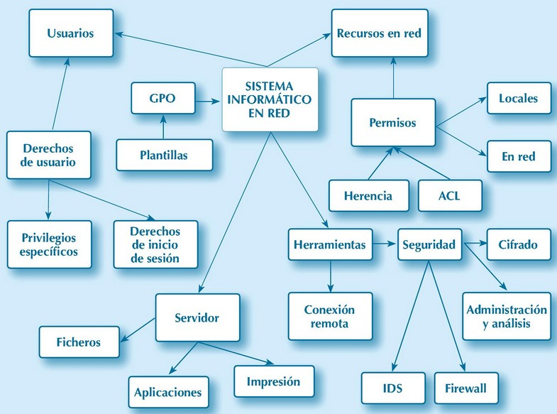

### Principios Fundamentales
* **Seguridad de Acceso:** Diferenciar con exactitud los privilegios de cada identidad (usuario o grupo) sobre cada elemento del sistema de archivos.
* **Separación de Niveles de Permiso:** Distinguir entre los permisos aplicados a nivel del sistema de ficheros local (**permisos NTFS**) y los aplicados a través del protocolo de red (**permisos de recurso compartido / *Share Permissions***).
* **Principio de Mínimo Privilegio (*Least Privilege*):** Conceder a los usuarios y servicios exclusivamente los permisos estrictamente necesarios para desempeñar su labor laboral o funcional.

---

<h2 id="permisos-windows"><u>2. Permisos en Microsoft Windows: Permisos NTFS vs Permisos Compartidos</u></h2>

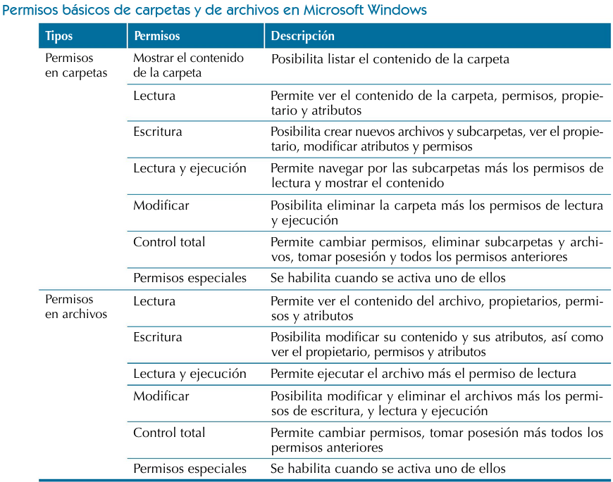
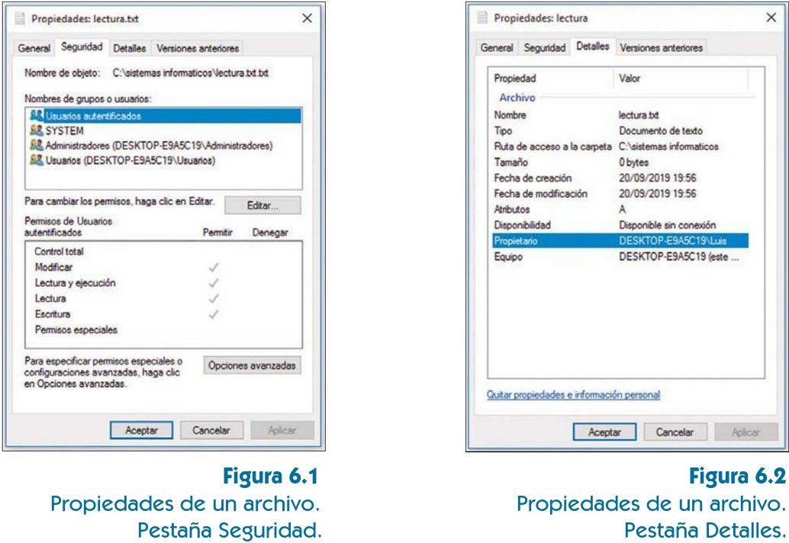
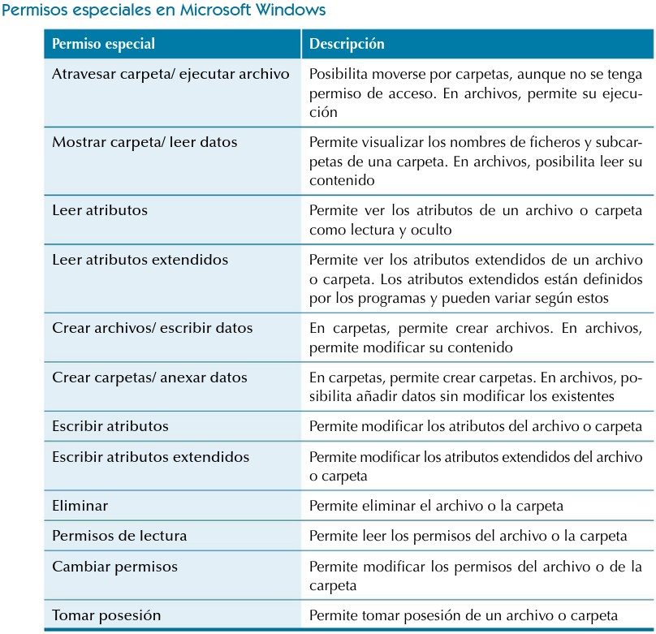

En los sistemas operativos Windows existen dos capas independientes de control de acceso:

### 2.1 Permisos NTFS (Pestaña "Seguridad")
Se aplican localmente sobre los volúmenes formateados en NTFS (o ReFS) y protegen los archivos tanto si el usuario accede localmente sentado frente al equipo como si accede a través de la red:

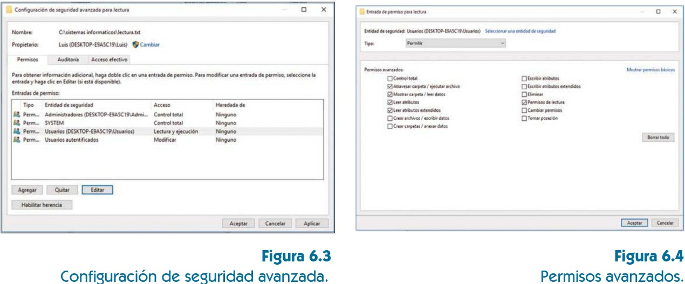
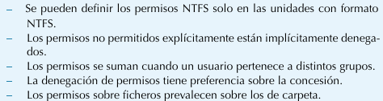

| Nivel de Permiso NTFS | Acciones Permitidas |
| :--- | :--- |
| **Control total (*Full Control*)** | Permite leer, escribir, modificar, borrar, cambiar permisos y tomar posesión de la propiedad del recurso. |
| **Modificar (*Modify*)** | Permite leer, escribir, ejecutar y **eliminar** el archivo o carpeta, pero **no** cambiar permisos ni asumir propiedad. |
| **Lectura y ejecución (*Read & Execute*)** | Permite ver el contenido y ejecutar archivos ejecutables o scripts. |
| **Mostrar el contenido de la carpeta (*List folder contents*)** | Exclusivo de carpetas: permite listar los archivos que contiene. |
| **Lectura (*Read*)** | Permite abrir y visualizar el contenido del archivo y sus atributos. |
| **Escritura (*Write*)** | Permite sobrescribir el archivo, añadir datos y crear nuevos archivos dentro de una carpeta. |
| **Permisos especiales** | Ajustes granulares avanzados (eliminar subcarpetas, sincronizar, lectura/escritura de atributos extendidos). |

---

### 2.2 Permisos de Recurso Compartido (Pestaña "Compartir")

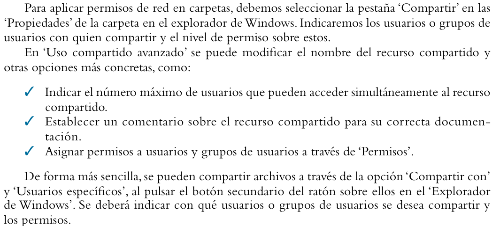
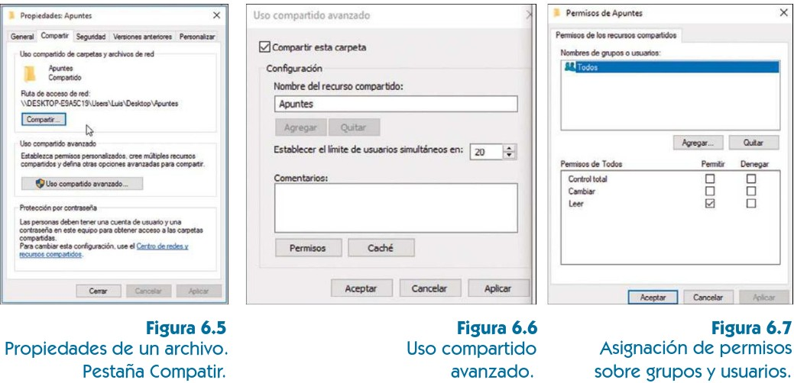

Solo tienen efecto cuando se accede a la carpeta a través de la red (mediante rutas UNC tipo `\\Servidor\CarpetaCompartida`). No aplican si el usuario inicia sesión localmente:
* **Control total (*Full Control*):** Permite cambiar permisos NTFS remotos si el usuario además dispone de privilegios para ello.
* **Cambiar (*Change*):** Permite leer, modificar y borrar archivos dentro del recurso compartido.
* **Leer (*Read*):** Permite ver carpetas, abrir archivos y consultar atributos (modo solo lectura).

---

### 2.3 Regla del Permiso Más Restrictivo (Permisos Efectivos)
Cuando un usuario accede a una carpeta compartida a través de la red, Windows evalúa **ambas capas de permisos (Compartir y NTFS)**. El permiso final resultante (**Permiso Efectivo**) es **invariablemente el más restrictivo de los dos**:

$$\text{Permiso Efectivo de Red} = \min(\text{Permiso Compartido}, \text{Permiso NTFS})$$

| Permiso de Recurso Compartido | Permiso NTFS Local | Permiso Efectivo en Red |
| :---: | :---: | :---: |
| **Leer** | **Control Total** | **Leer** (restringido por el compartido) |
| **Control Total** | **Leer** | **Leer** (restringido por NTFS) |
| **Cambiar** | **Modificar** | **Modificar** |
| **Leer** | **Modificar** | **Leer** |

> [!TIP]
> **Mejor Práctica de Administración en Windows:**
> La recomendación oficial de Microsoft es asignar **Control Total** (o *Cambiar*) al grupo *Usuarios autenticados* a nivel de recurso compartido, y gestionar toda la seguridad y granularidad fina exclusivamente mediante los **Permisos NTFS (pestaña Seguridad)**.

---

<h2 id="herencia-acls"><u>3. Herencia de Permisos y Listas de Control de Acceso (ACL y ACE)</u></h2>

### 3.1 Herencia de Permisos

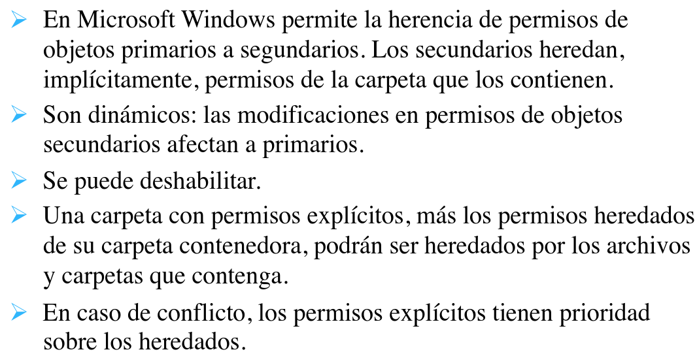
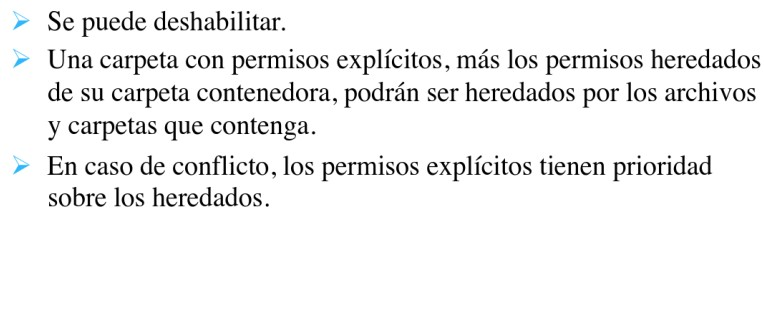

* De forma predeterminada, todo archivo o subcarpeta creado dentro de una carpeta padre **hereda automáticamente** los permisos NTFS configurados en dicha carpeta superior.
* **Bloquear / Deshabilitar Herencia:** Para personalizar los permisos de una carpeta específica sin afectar al resto del árbol, se desactiva la herencia en **Seguridad > Opciones avanzadas > Deshabilitar herencia**:
  * **Convertir los permisos heredados en permisos explícitos:** Mantiene los permisos actuales para poder editarlos y eliminar usuarios no deseados.
  * **Quitar todos los permisos heredados:** Deja la lista en blanco para definir los permisos desde cero.

---

### 3.2 Listas de Control de Acceso (ACL) y Entradas de Control de Acceso (ACE)

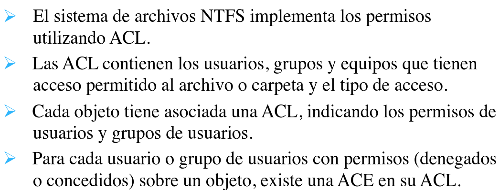

* **ACL (*Access Control List* - Lista de Control de Acceso):** Es la estructura de datos ligada al descriptor de seguridad de cada objeto en el sistema de archivos (DACL - *Discretionary Access Control List*). Contiene la lista exhaustiva de reglas de acceso aplicadas a dicho objeto.
* **ACE (*Access Control Entry* - Entrada de Control de Acceso):** Es cada una de las líneas o reglas individuales contenidas dentro de una ACL. Cada ACE especifica:
  1. El **identificador de seguridad (SID)** del usuario o grupo al que aplica.
  2. El **tipo de regla**: *Permitir* (*Allow*) o *Denegar* (*Deny*).
  3. La **máscara de acceso**: El conjunto de permisos otorgados o denegados (lectura, escritura, etc.).
  4. Los **parámetros de herencia**: Si aplica solo a la carpeta, a subcarpetas o a archivos.

#### Jerarquía de Evaluación de Reglas en Windows:
Windows evalúa los ACE en un orden estricto de precedencia:
1. **Denegar Explícito (*Explicit Deny*):** Si hay una regla explícita que deniega el permiso, se bloquea de inmediato.
2. **Permitir Explícito (*Explicit Allow*):** Si hay una regla explícita que lo permite, se concede el acceso.
3. **Denegar Heredado (*Inherited Deny*):** Bloquea el acceso si viene denegado desde una carpeta superior.
4. **Permitir Heredado (*Inherited Allow*):** Concede acceso si viene permitido desde la carpeta superior.
5. **Denegación Implícita por Defecto:** Si el usuario o sus grupos no aparecen en ninguna regla de permiso, el acceso queda denegado.

---

<h2 id="compartir-recursos"><u>4. Compartición de Recursos y Carpetas en Red</u></h2>

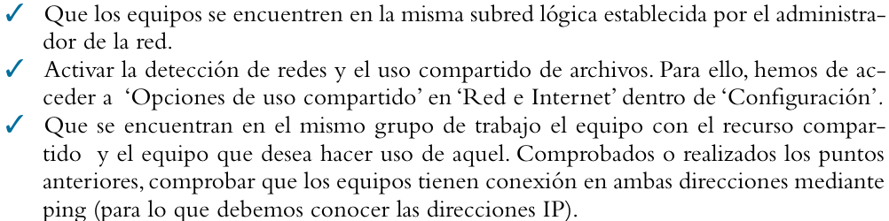
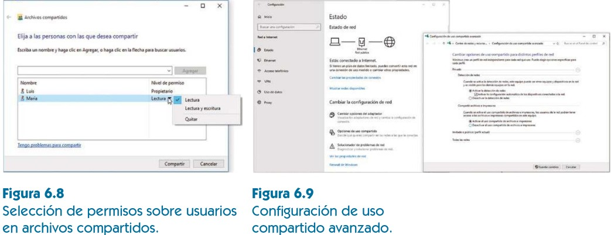
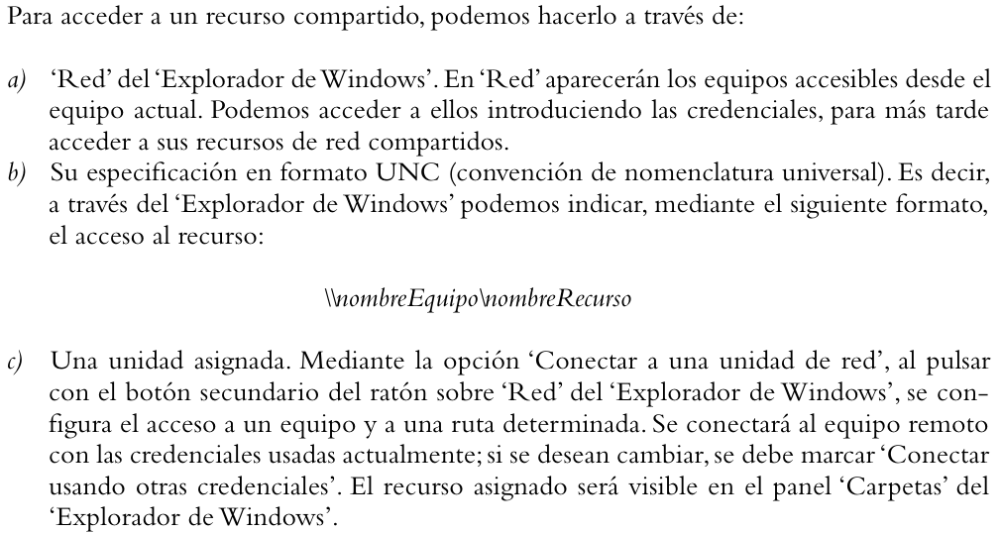
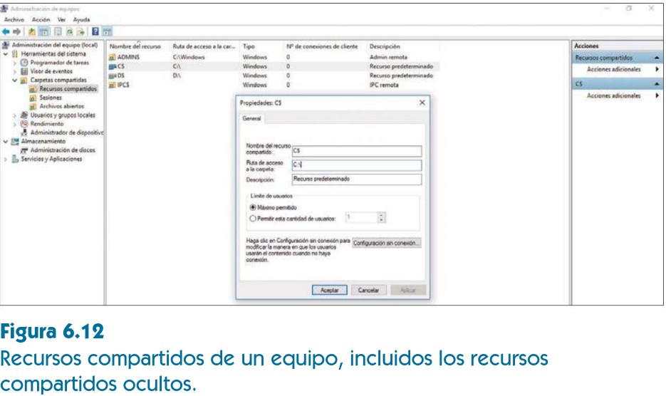

### 4.1 Compartir en Windows
1. Clic derecho en la carpeta > **Propiedades > Compartir**.
2. **Uso compartido avanzado:** Marcar *Compartir esta carpeta*, asignar un nombre de recurso compartido y configurar la cantidad máxima de conexiones simultáneas.
3. Hacer clic en **Permisos** para definir los permisos de red para los grupos deseados.
4. Los clientes de la red accederán tecleando la ruta UNC:
   `\\IP_DEL_SERVIDOR\NombreRecurso` o `\\NombreEquipo\NombreRecurso`

---

### 4.2 Compartir Archivos en Linux para Clientes Windows mediante Samba (SMB/CIFS)
En entornos heterogéneos, Linux utiliza el servicio **Samba** para actuar como servidor de archivos compatible con el protocolo SMB nativo de Windows:

```bash
# 1. Instalar el demonio Samba en Ubuntu/Debian
sudo apt update && sudo apt install -y samba

# 2. Crear la carpeta a compartir y asignar permisos locales
sudo mkdir -p /srv/samba/compartido
sudo chown nobody:nogroup /srv/samba/compartido
sudo chmod 777 /srv/samba/compartido

# 3. Editar el fichero principal de configuración
sudo nano /etc/samba/smb.conf
```

Añadir la definición del recurso compartido al final de `/etc/samba/smb.conf`:
```ini
[Compartido]
   comment = Carpeta compartida en red Samba
   path = /srv/samba/compartido
   browseable = yes
   read only = no
   guest ok = yes
   create mask = 0775
   directory mask = 0775
```

```bash
# 4. Crear contraseña de Samba para un usuario registrado
sudo smbpasswd -a usuario

# 5. Reiniciar y verificar el servicio Samba
sudo systemctl restart smbd
sudo systemctl status smbd
```

---

<h2 id="derechos-directivas"><u>5. Derechos de Usuario y Directivas de Grupo (GPO y RSOP)</u></h2>

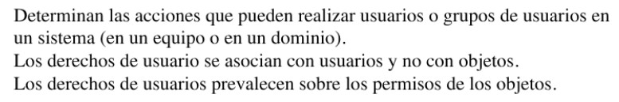
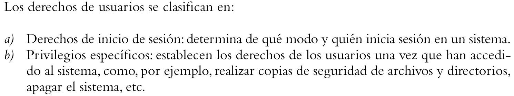
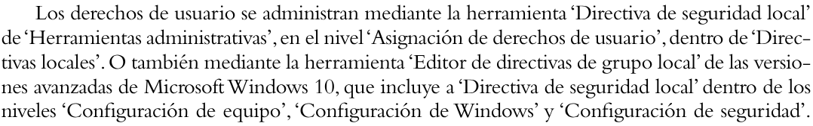

### 5.1 Diferencia entre Permisos y Derechos de Usuario
* **Permisos (*Permissions*):** Se asocian a **objetos** (archivos, carpetas, impresoras, claves del registro) y definen qué operaciones pueden realizarse sobre ellos.
* **Derechos de Usuario (*User Rights*):** Se asocian a **cuentas y grupos** en el sistema y les autorizan a realizar tareas globales sobre el sistema operativo (e.g. apagar el sistema, cambiar la hora, cargar controladores de dispositivos, iniciar sesión como servicio o permitir inicio de sesión local).

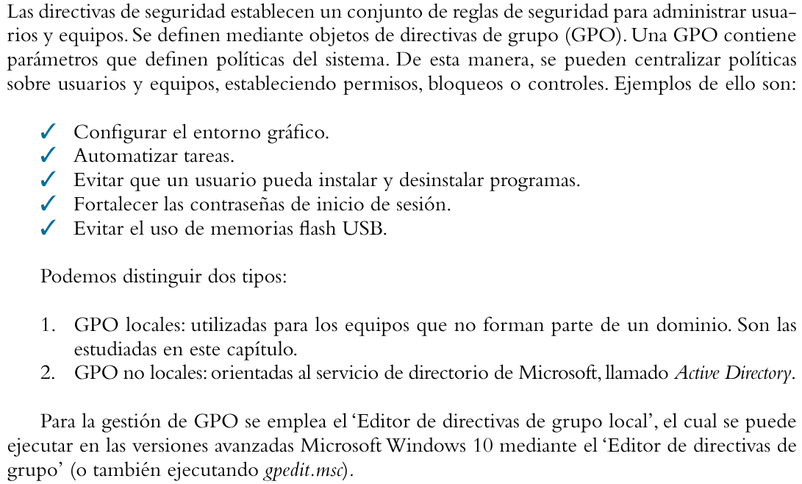
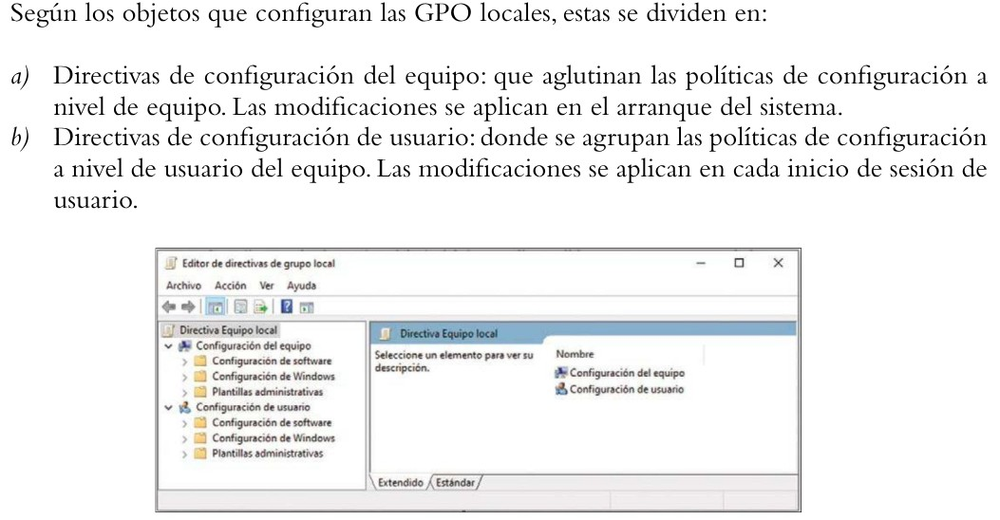
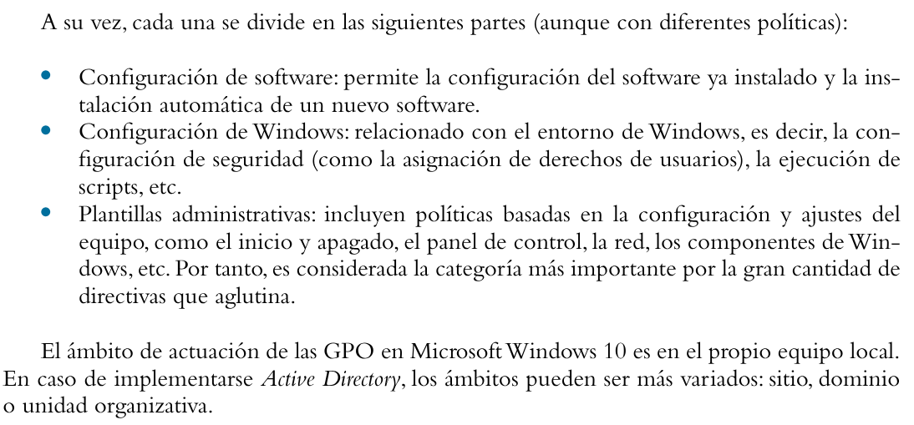

---

### 5.2 Herramientas de Gestión de Directivas en Windows
* **Editor de Directivas de Grupo Local (`gpedit.msc`):** Permite configurar directivas de equipo y de usuario en versiones Windows Pro, Enterprise y Server:
  * *Configuración del equipo:* Parámetros de seguridad del sistema, asignación de derechos, cortafuegos y políticas de contraseñas.
  * *Configuración de usuario:* Restricciones de interfaz, bloqueo de panel de control, fondo de escritorio y acceso a unidades.
* **Conjunto Resultante de Directivas (`rsop.msc`):** Muestra el informe en árbol de todas las directivas que se están aplicando de forma efectiva sobre la máquina y el usuario actual.
* **Comando `gpupdate` / `gpresult`:**
  ```cmd
  :: Forzar la actualización inmediata de directivas
  gpupdate /force

  :: Generar un informe detallado de directivas aplicadas
  gpresult /r
  ```

---

<h2 id="seguridad-datos"><u>6. Requisitos de Seguridad del Sistema y de los Datos</u></h2>

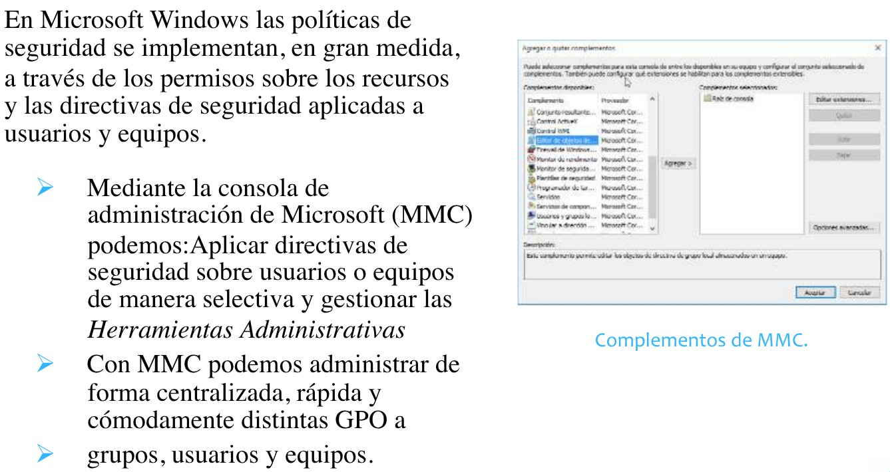

La seguridad en redes corporativas debe garantizar las dimensiones fundamentales del estándar ISO/IEC 27001:
1. **Confidencialidad:** Prevención de accesos no autorizados mediante autenticación fuerte, listas ACL estrictas y cifrado de datos en reposo (BitLocker / LUKS) y en tránsito (TLS / IPsec).
2. **Integridad:** Certeza de que la información no ha sido corrompida accidentalmente o modificada con intención maliciosa.
3. **Disponibilidad:** Garantía de que los servicios y datos están accesibles para usuarios legítimos mediante infraestructuras tolerantes a fallos (RAID, balanceadores, clusters).
4. **Autenticación:** Verificación fidedigna de la identidad del usuario o proceso solicitante.
5. **No Repudio:** Imposibilidad de que un emisor o receptor niegue haber ejecutado una operación o enviado un mensaje determinado.

---

<h2 id="servidores-roles"><u>7. Arquitectura Cliente-Servidor y Roles de Servidores</u></h2>

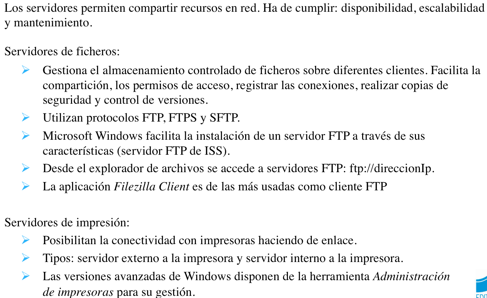
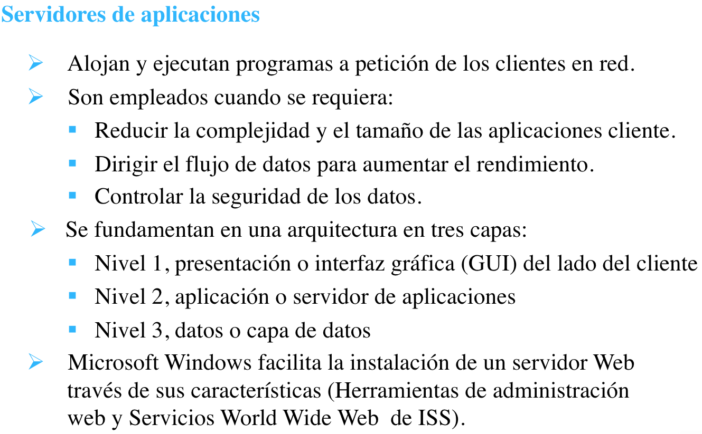

En el modelo Cliente-Servidor, los clientes solicitan servicios y los servidores procesan y entregan las respuestas centralizadamente:
* **Servidor de Archivos (File Server):** Almacena y gestiona el acceso concurrente a ficheros y carpetas compartidas en red (NFS, SMB, iSCSI).
* **Servidor de Impresión (Print Server):** Gestiona colas de impresión y controladores centralizados para el parque de impresoras de la empresa.
* **Servidor Web (HTTP/HTTPS):** Aloja portales y servicios web (Apache, Nginx, IIS).
* **Servidor de Bases de Datos (Database Server):** Gestiona motores de bases de datos transaccionales (MySQL, PostgreSQL, Microsoft SQL Server, Oracle).
* **Servidor DHCP y DNS:** Proporciona direccionamiento dinámico y resolución de nombres para toda la red.
* **Servidor de Directorio (Active Directory / OpenLDAP):** Base de datos centralizada de usuarios, grupos, permisos y recursos que unifica la autenticación en todo el dominio corporativo.

---

<h2 id="conexion-remota"><u>8. Conexión Remota y Herramientas de Administración</u></h2>

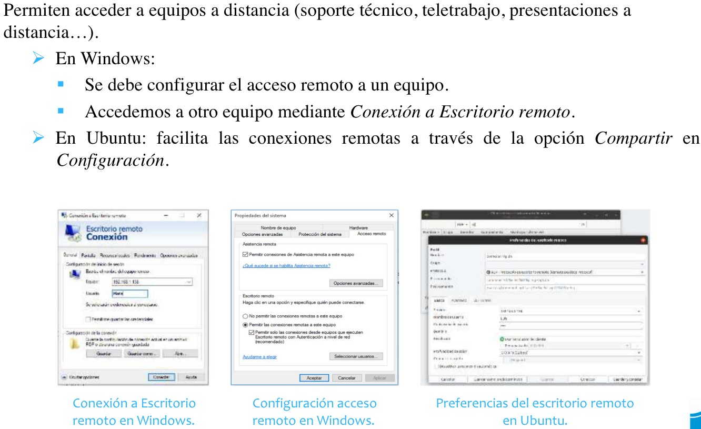

La administración remota permite controlar y configurar servidores y estaciones de trabajo a distancia a través de la red:

### 8.1 Escritorio Remoto de Microsoft (RDP)
* Protocolo propietario que opera sobre el puerto **TCP 3389**.
* Proporciona una interfaz gráfica completa del equipo remoto.
* En Windows se ejecuta mediante el cliente **`mstsc.exe`** (*Conexión a Escritorio Remoto*).
* Requiere que el usuario pertenezca al grupo *Administradores* o *Usuarios de escritorio remoto*.

### 8.2 SSH (Secure Shell)
* Protocolo estándar en entornos Linux y Unix para administración por línea de comandos segura, sobre el puerto **TCP 22**.
* Todo el tráfico viaja cifrado de extremo a extremo, impidiendo la captura de contraseñas.
* Permite autenticación mediante contraseña o mediante **claves criptográficas pública/privada (RSA, Ed25519)**:
  ```bash
  # Conexión SSH a un servidor
  ssh usuario@192.168.1.50

  # Copia segura de archivos a través de SSH (SCP)
  scp archivo.txt usuario@192.168.1.50:/home/usuario/
  ```

### 8.3 VNC y Herramientas Asistidas
* **VNC (*Virtual Network Computing*):** Protocolo multiplataforma que transmite la pantalla gráfica píxel a píxel sobre el puerto TCP 5900.
* **AnyDesk, TeamViewer y RustDesk:** Herramientas orientadas a soporte técnico que atraviesan firewalls y NAT mediante servidores de retransmisión intermediarios (*relay servers*).

---

<h2 id="herramientas-seguridad"><u>9. Herramientas de Seguridad en Red</u></h2>

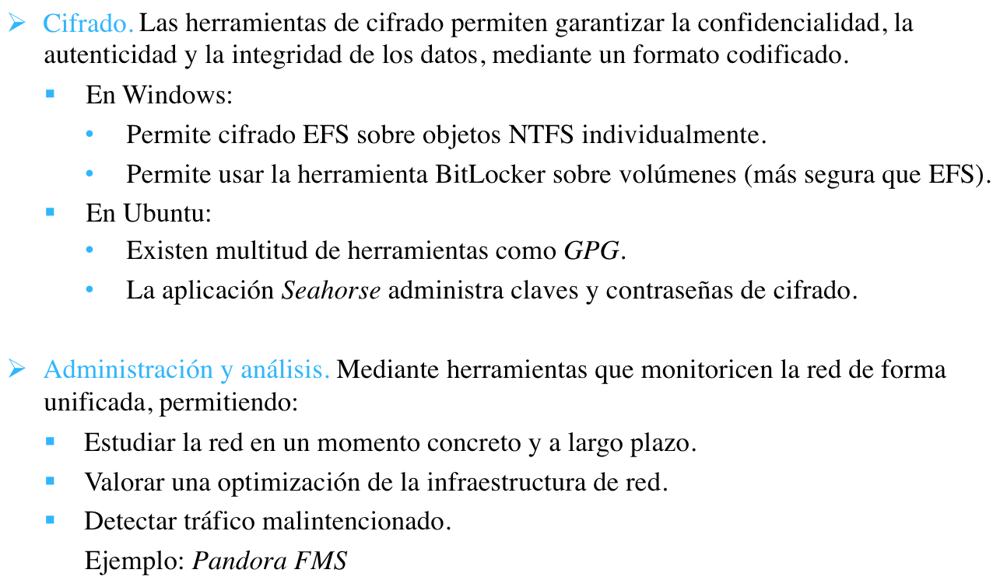
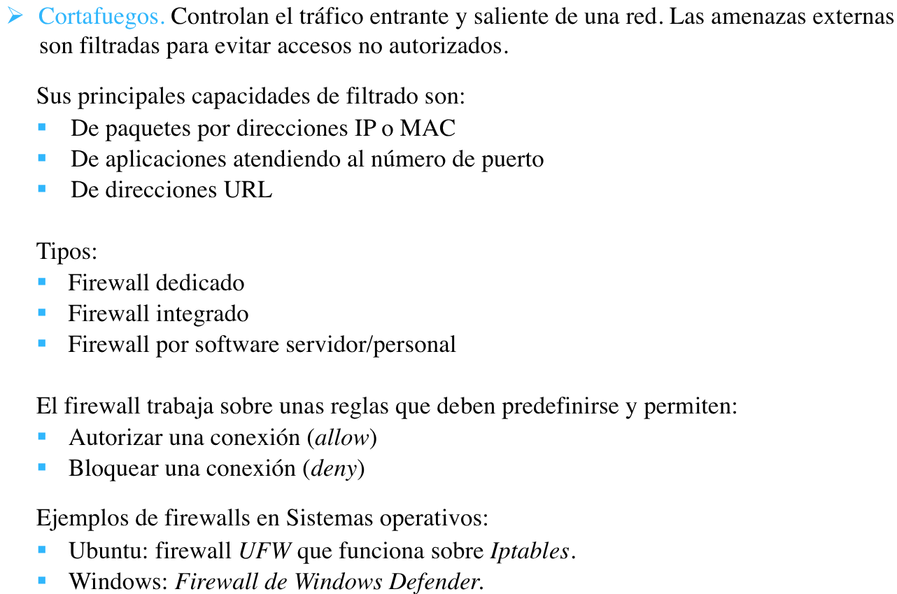
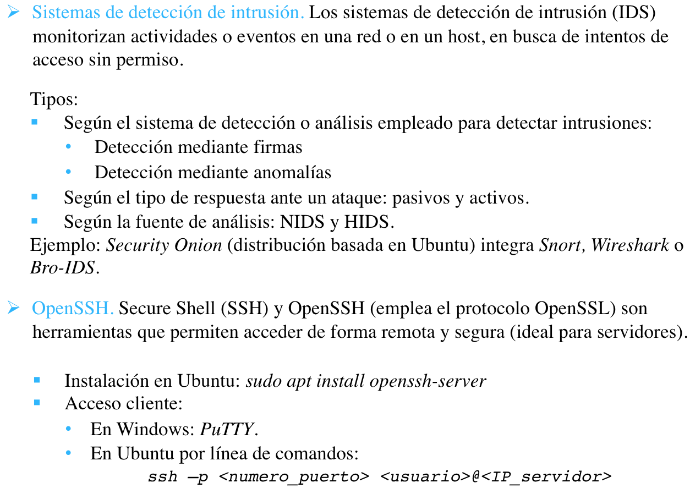

### 9.1 Cortafuegos (*Firewalls*)
Controla y filtra el tráfico de red entrante y saliente basándose en reglas predeterminadas de puertos, protocolos y direcciones IP:
* **Windows Defender Firewall:** Integrado en el sistema operativo, clasifica las redes en tres perfiles: *Dominio*, *Privada* y *Pública*, permitiendo crear reglas de entrada y salida detalladas.
* **UFW (*Uncomplicated Firewall*) en Linux:** Interfaz de alto nivel para gestionar las reglas de filtrado del kernel (`iptables` / `nftables`):
  ```bash
  # Activar el firewall
  sudo ufw enable

  # Permitir conexiones SSH entrantes (puerto 22)
  sudo ufw allow ssh

  # Permitir tráfico web HTTP y HTTPS
  sudo ufw allow 80/tcp
  sudo ufw allow 443/tcp

  # Consultar el estado y reglas activas
  sudo ufw status verbose
  ```

### 9.2 Antivirus y Protección contra Amenazas
* Motores de detección basados en firmas conocidas y análisis heurístico de comportamiento anómalo (*EDR - Endpoint Detection and Response*).
* Monitorización en tiempo real del sistema de archivos, tráfico web y correo electrónico.

### 9.3 Estrategia de Copias de Seguridad (Regla 3-2-1)
* **3 copias** de los datos críticos (la copia de producción original y 2 copias de respaldo).
* **2 medios diferentes** de almacenamiento (e.g. disco duro local y servidor NAS de red).
* **1 copia fuera de las instalaciones (*off-site*)**, idealmente en la nube o en una sede física secundaria para proteger frente a desastres físicos (incendio, inundación, robo) o ataques de ransomware.

---

<h2 id="actividades-practicas"><u>10. Actividades Prácticas y Ejercicios Guiados</u></h2>

### Actividad 1: Configurar un Recurso Compartido en Windows con Permisos Restringidos
Crea en la raíz `C:\` una carpeta llamada `Proyectos`. Compártela en red con el nombre `Proyectos$` (recurso oculto) con permiso compartido de **Cambiar** para el grupo *Usuarios*. En la pestaña **Seguridad (NTFS)**, asigna a un usuario `tecnico1` el permiso de **Modificar** y al usuario `consultor1` únicamente el permiso de **Lectura**. Comprueba qué permiso efectivo tiene cada uno al conectar en red.

<details>
<summary><b>Ver Solución</b></summary>

1. **Creación y Compartición en Windows:**
   * Crear la carpeta `C:\Proyectos`.
   * Clic derecho > *Propiedades* > pestaña *Compartir* > *Uso compartido avanzado*.
   * Marcar *Compartir esta carpeta* y fijar nombre: `Proyectos$` (el símbolo `$` oculta el recurso al explorar la red).
   * En *Permisos de recurso compartido*: agregar el grupo `Usuarios` y conceder la casilla **Cambiar** (que incluye Leer).
2. **Configuración de Permisos NTFS (Seguridad):**
   * Pestaña *Seguridad* > *Opciones avanzadas* > *Deshabilitar herencia* > *Convertir permisos*.
   * Agregar usuario `tecnico1` y marcar permiso **Modificar**.
   * Agregar usuario `consultor1` y marcar únicamente **Lectura y ejecución / Lectura**.
3. **Comprobación de Permisos Efectivos en Red:**
   * Para `tecnico1`: $\min(\text{Cambiar}, \text{Modificar}) =$ **Modificar** (puede crear, editar y borrar archivos).
   * Para `consultor1`: $\min(\text{Cambiar}, \text{Lectura}) =$ **Lectura** (solo puede abrir y visualizar archivos; si intenta borrar o guardar, Windows le denegará la acción).
</details>

---

### Actividad 2: Auditoría de Directivas Activas con `rsop.msc`
Abre la consola de administración en Windows para diagnosticar qué directivas de seguridad se están aplicando sobre la cuenta actual.

<details>
<summary><b>Ver Solución</b></summary>

```cmd
:: 1. Lanzar la consola gráfica de conjunto resultante
rsop.msc

:: 2. Alternativamente, generar el informe por consola
gpresult /r
```
* En la consola `rsop.msc` se visualiza el árbol completo indicando qué directiva de equipo o usuario ha sido aplicada y desde qué GPO origen procede.
</details>

---

<h2 id="recursos"><u>11. Videografía y Recursos Complementarios</u></h2>

* **Permisos en carpetas y archivos en Windows 11:** [https://www.youtube.com/watch?v=T_LSldZ2fz4](https://www.youtube.com/watch?v=T_LSldZ2fz4)
* **Compartir carpetas y archivos en red en Windows 10/11:** [https://www.youtube.com/watch?v=1Bu4_QNyEoM](https://www.youtube.com/watch?v=1Bu4_QNyEoM)
* **Compartir archivos en red en Ubuntu (Samba):** [https://www.youtube.com/watch?v=3InoSQPUxP4](https://www.youtube.com/watch?v=3InoSQPUxP4)
* **Carpeta compartida Linux a Windows:** [https://www.youtube.com/watch?v=7H2DsjPnIxY](https://www.youtube.com/watch?v=7H2DsjPnIxY)
* **Herencia de permisos y ACLs en Windows:** [https://www.youtube.com/watch?v=1i9cFBHatrI](https://www.youtube.com/watch?v=1i9cFBHatrI)
* **Listas de Control de Acceso (ACL) en Linux desde terminal:** [https://www.youtube.com/watch?v=PES4ykTiOuQ](https://www.youtube.com/watch?v=PES4ykTiOuQ)
* **Auditoría de Directivas de Grupo con RSOP.MSC:** [https://www.youtube.com/watch?v=_oEV6BK6wcM](https://www.youtube.com/watch?v=_oEV6BK6wcM)
* **¿Qué es Active Directory (Directorio Activo) de Microsoft?:** [https://www.youtube.com/watch?v=ZDFii9aI_O4](https://www.youtube.com/watch?v=ZDFii9aI_O4)
* **Cómo usar Escritorio Remoto (RDP) en Windows:** [https://www.youtube.com/watch?v=sGmuol96Qlg](https://www.youtube.com/watch?v=sGmuol96Qlg)
* **Compartir tu PC de forma remota en Linux:** [https://www.youtube.com/watch?v=y4K5vPtOG0A](https://www.youtube.com/watch?v=y4K5vPtOG0A)

