# APLICACIONES INFORMÁTICAS

---

## Índice de Contenidos

* [1. Mapa Conceptual y Clasificación del Software](#clasificacion-software)
* [2. Licencias de Software y Aspectos Legales](#licencias-software)
* [3. Documentación y Soporte Técnico al Usuario](#documentacion-soporte)
* [4. Requisitos y Despliegue de Aplicaciones](#requisitos-aplicaciones)
* [5. Herramientas Ofimáticas Corporativas](#herramientas-ofimaticas)
* [6. Herramientas de Internet y Transferencia de Archivos](#herramientas-internet)
* [7. Computación en la Nube (Cloud Computing: IaaS, PaaS, SaaS)](#cloud-computing)
* [8. Copias de Seguridad y Clonación de Sistemas (Clonezilla)](#copias-clonacion)
* [9. Actividades Prácticas y Ejercicios Guiados](#actividades-practicas)
* [10. Videografía y Recursos Complementarios](#recursos)

---

<h2 id="clasificacion-software"><u>1. Mapa Conceptual y Clasificación del Software</u></h2>

El software constituye la parte lógica e intangible de un sistema informático, integrada por los programas, datos y procedimientos que ordenan al hardware la ejecución de tareas específicas.

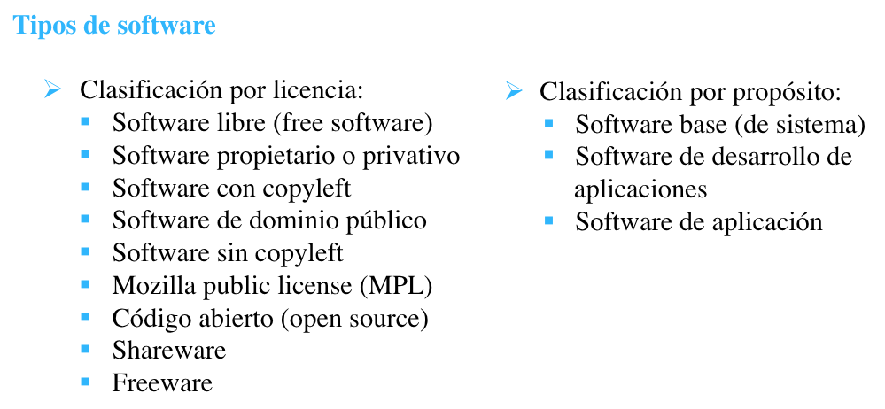

### Clasificación Fundamental del Software:
1. **Software de Sistema o Base:**
   * Es el software indispensable sin el cual el ordenador no puede operar. Administra y abstrae los recursos hardware (procesador, memoria RAM, discos, tarjetas de red) y provee una interfaz homogénea para los usuarios y los programas de aplicación.
   * *Ejemplos:* Sistemas operativos (GNU/Linux, Windows, macOS), controladores de dispositivos (*drivers*), sistemas básicos de arranque (BIOS/UEFI) y utilidades de bajo nivel de particionamiento y diagnóstico.
2. **Software de Aplicación:**
   * Programas diseñados para permitir al usuario final realizar tareas laborales, académicas, creativas o recreativas específicas.
   * *Ejemplos:* Suites ofimáticas (LibreOffice, Microsoft 365), navegadores web (Firefox, Chrome), diseño gráfico y retoque (GIMP, Photoshop), software de gestión empresarial (ERP, CRM) y reproductores multimedia.
3. **Software de Programación y Desarrollo:**
   * Herramientas y utilidades empleadas por los desarrolladores para diseñar, codificar, compilar, depurar y mantener otros programas y sistemas informáticos.
   * *Ejemplos:* Compiladores (GCC, Clang), intérpretes (Python, Node.js), depuradores (GDB) y Entornos de Desarrollo Integrados (IDE como Visual Studio Code, IntelliJ, Eclipse).

---

<h2 id="licencias-software"><u>2. Licencias de Software y Aspectos Legales</u></h2>

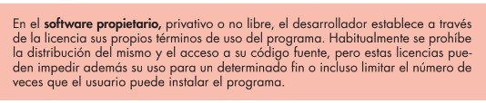
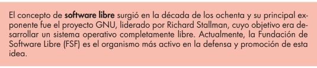

Una **licencia de software** es un contrato legal vinculante entre el titular de los derechos de autor (*copyright*) y el usuario final, donde se establecen los términos, permisos y restricciones de uso, modificación, copia y distribución del programa.

### 2.1 Software Libre vs Software de Código Abierto (Open Source)

#### Las Cuatro Libertades del Software Libre (Free Software Foundation - FSF):
Formuladas por Richard Stallman en el marco del proyecto GNU:
* **Libertad 0:** Libertad de ejecutar el programa con cualquier propósito (comercial, educativo, militar, de investigación), sin restricción alguna.
* **Libertad 1:** Libertad de estudiar cómo funciona el programa y modificarlo para adaptarlo a las propias necesidades. El acceso irrestricto al **código fuente** es un requisito previo indispensable.
* **Libertad 2:** Libertad de redistribuir y compartir copias del programa con otros usuarios para ayudar a la comunidad.
* **Libertad 3:** Libertad de mejorar el programa y publicar las modificaciones o mejoras al público general, para beneficio de toda la sociedad.

#### Software Libre vs Código Abierto (*Open Source*):
Aunque en la práctica técnica comparten el acceso público al código fuente, difieren en su motivación filosófica:
* El **Software Libre** prioriza una dimensión ética y filosófica centrada en la **libertad y los derechos civiles del usuario**.
* El **Código Abierto (Open Source Initiative - OSI)** enfoca su discurso en las ventajas técnicas, pragmáticas y económicas de la **metodología de desarrollo colaborativo**.

---

### 2.2 Marco Legal: Copyright, Dominio Público y Copyleft

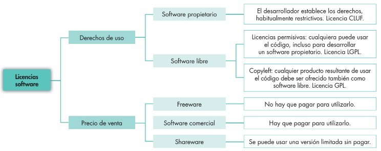
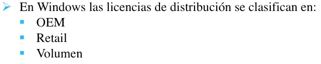
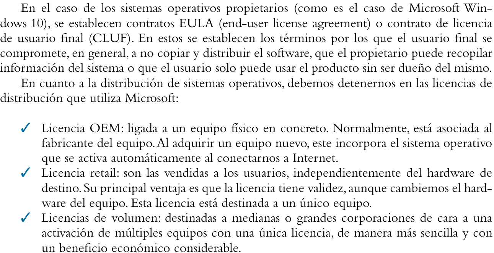

* **Copyright (©):** Derecho exclusivo de autor que reserva todos los derechos de explotación, modificación y distribución al creador o a la empresa licenciataria (*"Todos los derechos reservados"*).
* **Dominio Público:** Condición de las obras que carecen de derechos de autor (porque nunca fueron registradas o porque los derechos han prescrito legalmente). Cualquier persona puede utilizarlas, copiarlas, modificarlas o comercializarlas sin ninguna restricción legal ni atribución obligatoria.
* **Copyleft (🄯):** Estrategia jurídica inventada en el software libre que utiliza las propias leyes del copyright para garantizar la libertad continua del programa:
  * Obliga a que cualquier persona que modifique o redistribuya el software deba **hacerlo obligatoriamente bajo los mismos términos y con la misma licencia libre** (*herencia vírica de la libertad*).
  * Evita que un tercero cierre el código o lo convierta en software privativo.
  * La licencia representativa más extendida con copyleft fuerte es la **GNU GPL (General Public License)**.
* **Licencia GNU LGPL (*Lesser GPL*):** Versión permisiva de la GPL pensada para bibliotecas de software. Permite que programas no libres se vinculen (*linken*) con la biblioteca sin verse forzados a abrir su propio código fuente.
* **Licencias Permisivas (MIT, Apache 2.0, BSD):** Licencias libres sin copyleft. Permiten a cualquier desarrollador tomar el código, modificarlo, cerrarlo e integrarlo dentro de productos comerciales y privativos, exigiendo únicamente mantener la nota de autoría original.

---

### 2.3 Modelos de Distribución y Precio del Software

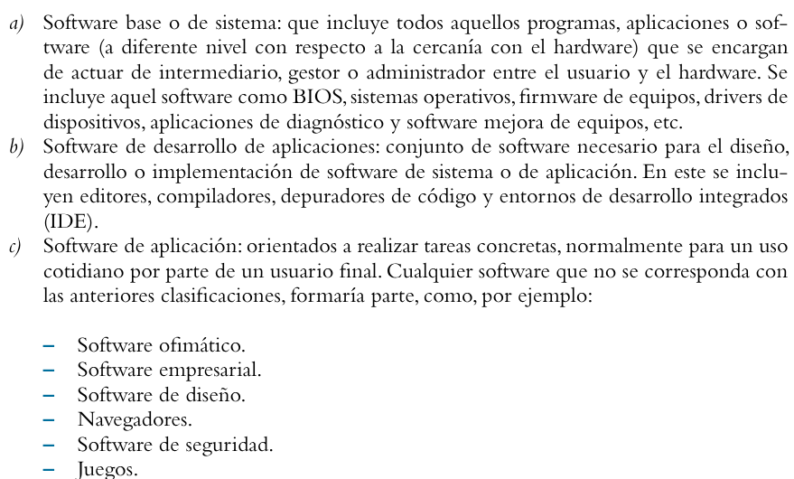

El modelo de licenciamiento es independiente de su coste económico:
* **Software Comercial:** Desarrollado con el objetivo de obtener beneficio económico directo. Puede ser tanto propietario (Windows, AutoCAD) como libre (Red Hat Enterprise Linux, SUSE).
* **Freeware:** Software propietario que se distribuye de forma gratuita, pero **sin acceso a su código fuente** y con restricciones que impiden su modificación o redistribución no autorizada (e.g. Adobe Acrobat Reader, Skype).
* **Shareware:** Modelo de prueba gratuita en el que el programa se distribuye con limitaciones funcionales, temporales (versión demo o trial de 30 días) o con pantallas de recordatorio (*nag screens*), invitando a pagar la licencia completa.
* **Crapware / Adware:** Software no deseado que incluye publicidad forzada o se preinstala en equipos nuevos.

---

<h2 id="documentacion-soporte"><u>3. Documentación y Soporte Técnico al Usuario</u></h2>

### 3.1 Documentación de las Aplicaciones Informáticas
El software corporativo requiere materiales de soporte adecuados para garantizar su correcto despliegue y aprovechamiento:
* **Manual de Instalación y Despliegue:** Describe los requisitos mínimos, dependencias de software, parámetros de red y pasos de instalación.
* **Manual de Usuario:** Guía estructurada paso a paso orientada al usuario final para guiarlo en los flujos de trabajo cotidianos.
* **Manual de Referencia Técnica / Documentación de API:** Especifica funciones, clases, sintaxis de comandos y parámetros de configuración para administradores y desarrolladores.
* **Ayuda Integrada:** Módulos de consulta contextual accesibles desde los menús de la propia aplicación (generalmente mediante la tecla `F1` o menús de ayuda).

---

### 3.2 Soporte Técnico y Gestión de Incidencias en la Empresa

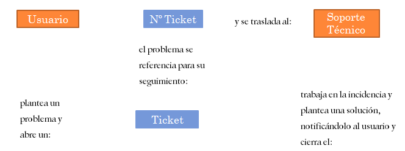
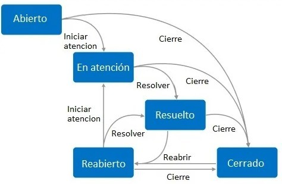
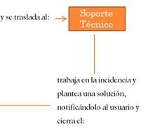

Una **incidencia** es cualquier evento anómalo o interrupción imprevista que degrada la calidad de un servicio o impide al usuario desarrollar su trabajo habitual. Las incidencias pueden tener origen en:
* **Hardware:** Fallo en discos duros, fuentes de alimentación, monitores, teclados o módulos de memoria RAM.
* **Conectividad y Red:** Imposibilidad de acceder a Internet, caída del switch, errores de asignación DHCP o resolución DNS.
* **Software:** Cierres inesperados de aplicaciones (*crashes*), incompatibilidad de drivers, corrupción de ficheros de configuración o infección por malware.

#### El Parte de Incidencias
Documento formal (digital o físico) donde se registra la trazabilidad completa del problema:
1. **Identificador del ticket:** Número correlativo único.
2. **Fecha y hora** de recepción y apertura.
3. **Datos del usuario afectado:** Nombre, departamento, teléfono y puesto de trabajo.
4. **Datos del equipo afectado:** Nombre de host (*hostname*), dirección IP, dirección MAC y sistema operativo.
5. **Categoría y Tipo de Incidencia:** Hardware, Software, Red, Seguridad o Petición de servicio.
6. **Prioridad e Impacto:** Crítica, Alta, Media o Baja (en función de si bloquea la actividad de la empresa).
7. **Descripción del problema:** Síntomas detallados observados y mensajes de error exactos.
8. **Acciones y pruebas de diagnóstico realizadas:** Pasos seguidos por el técnico para aislar la causa raíz.
9. **Resolución y Cierre:** Solución aplicada, fecha/hora de resolución y firma o conformidad del usuario.

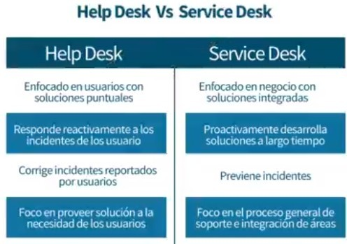

---

### 3.3 Estructuras de Soporte: CAU (Help Desk) vs Service Desk
* **CAU (Centro de Atención al Usuario) / Help Desk:**
  * Enfoque técnico y **reactivo**.
  * Punto de contacto único para la resolución ágil de incidencias técnicas del día a día (Nivel 1: reseteo de contraseñas, problemas con impresoras, errores de ofimática).
* **Service Desk (Mesa de Servicio):**
  * Enfoque estratégico y **proactivo**, alineado con las buenas prácticas **ITIL** (*Information Technology Infrastructure Library*).
  * No solo resuelve incidencias técnicas, sino que gestiona peticiones de nuevo equipamiento, solicitudes de cambio (RFC), acuerdos de nivel de servicio (**SLA**) y comunicación global con la dirección del negocio.

#### Herramientas de Ticketing Populares:
* **GLPI:** Herramienta de código abierto especializada en gestión de inventario informático e incidencias.
* **OTRS / Znuny:** Sistema de tickets de código abierto ampliamente utilizado en empresas de soporte.
* **Jira Service Management:** Plataforma corporativa para gestión de servicios de TI (ITSM).
* **Zendesk / Freshdesk:** Soluciones SaaS en la nube para atención al cliente y soporte multicanal.

---

<h2 id="requisitos-aplicaciones"><u>4. Requisitos y Despliegue de Aplicaciones</u></h2>

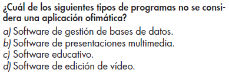
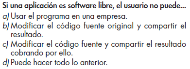
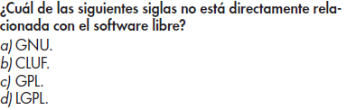
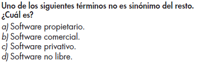
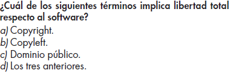
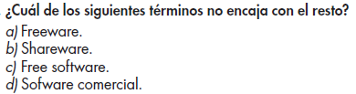
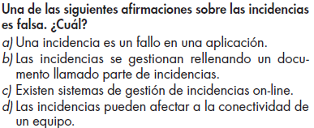
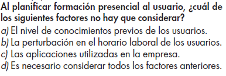
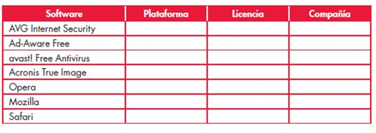
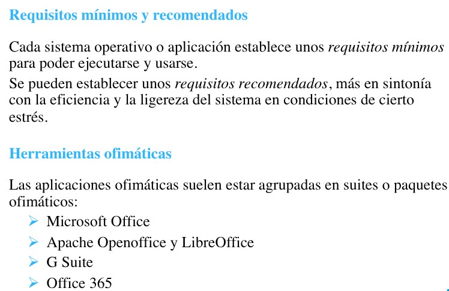

Antes de instalar o desplegar software en un parque de ordenadores, se deben auditar:
* **Requisitos de Hardware:**
  * **Arquitectura de procesador:** 32 bits (x86) vs 64 bits (x64 / AMD64) vs ARM (aarch64).
  * **Memoria RAM mínima y recomendada:** Cantidad mínima para arrancar vs cantidad óptima para trabajar con fluidez.
  * **Espacio en disco:** Espacio requerido para la instalación inicial más el crecimiento previsto de los ficheros de datos temporales.
  * **Tarjeta gráfica y resolución de pantalla:** Aceleración por hardware (DirectX, OpenGL, Vulkan) requerida en herramientas de CAD o diseño 3D.
* **Requisitos de Software:**
  * Versión y arquitectura del sistema operativo admitido (Windows 10/11, Ubuntu 22.04/24.04 LTS).
  * Entornos de ejecución y dependencias (*frameworks*): .NET Framework / .NET Core, Java Runtime Environment (JRE), Python, bibliotecas Visual C++ Redistributable.

---

<h2 id="herramientas-ofimaticas"><u>5. Herramientas Ofimáticas Corporativas</u></h2>

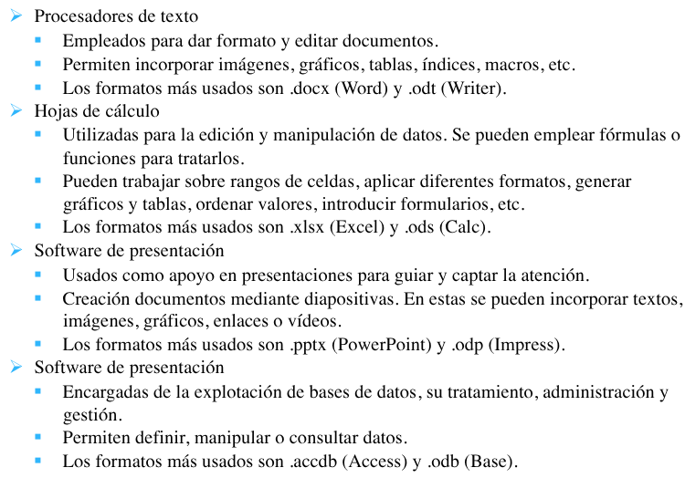
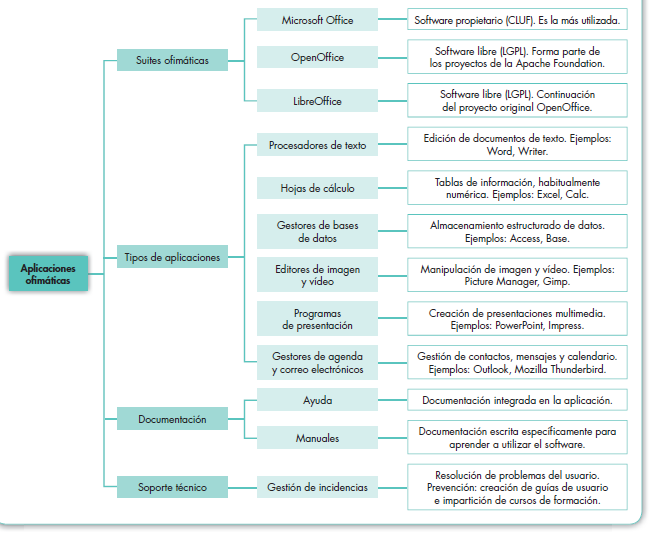

Las herramientas ofimáticas constituyen el núcleo del trabajo administrativo en cualquier organización:

| Tipo de Aplicación | Microsoft 365 (Propietario) | LibreOffice (Libre / GPL) | Formato Estándar Abierto | Formato Propietario |
| :--- | :--- | :--- | :---: | :---: |
| **Procesador de textos** | Microsoft Word | LibreOffice Writer | `.odt` (OpenDocument Text) | `.docx` / `.doc` |
| **Hoja de cálculo** | Microsoft Excel | LibreOffice Calc | `.ods` (OpenDocument Spreadsheet) | `.xlsx` / `.xls` |
| **Presentaciones** | Microsoft PowerPoint | LibreOffice Impress | `.odp` (OpenDocument Presentation) | `.pptx` / `.ppt` |
| **Base de datos de escritorio** | Microsoft Access | LibreOffice Base | `.odb` | `.accdb` / `.mdb` |
| **Gestión de correo y agenda** | Microsoft Outlook | Mozilla Thunderbird | Estándar MBOX / EML | `.pst` / `.ost` |

---

<h2 id="herramientas-internet"><u>6. Herramientas de Internet y Transferencia de Archivos</u></h2>

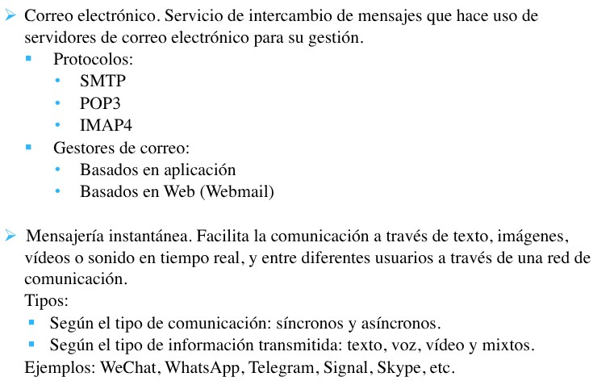

### 6.1 Clientes de Correo Electrónico: Mozilla Thunderbird

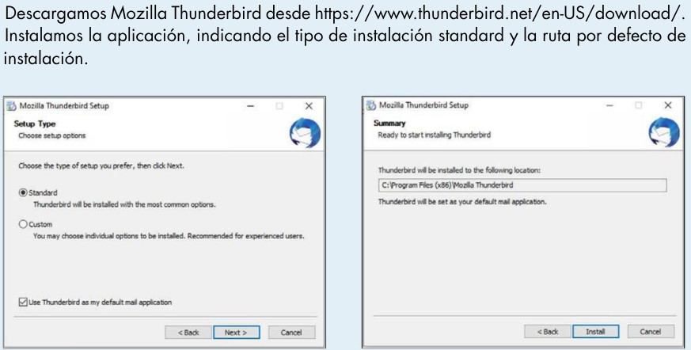
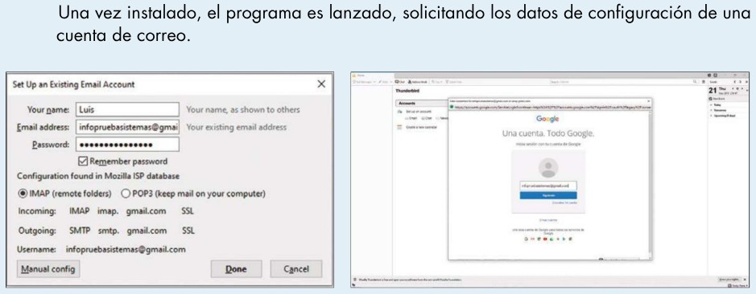
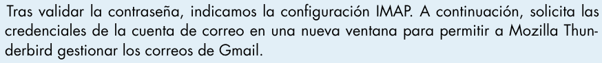
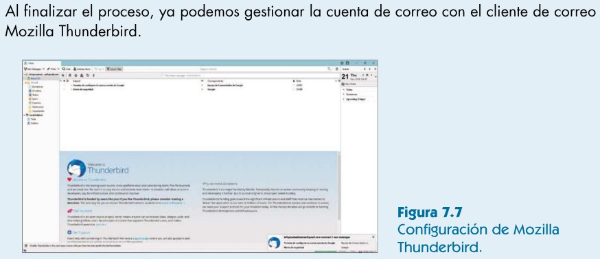
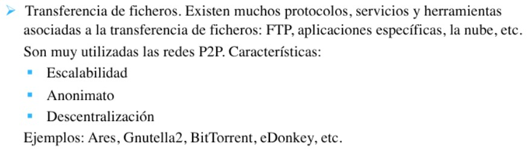

Mozilla Thunderbird es un cliente de correo electrónico, calendario y libreta de direcciones de código abierto y gratuito:
* **Protocolo IMAP (*Internet Message Access Protocol* - Puerto 993 con SSL/TLS):** Mantiene los correos sincronizados en el servidor, permitiendo acceder a los mismos mensajes y carpetas desde múltiples dispositivos simultáneamente.
* **Protocolo POP3 (*Post Office Protocol* - Puerto 995 con SSL/TLS):** Descarga los mensajes al almacenamiento local del equipo y habitualmente los borra del servidor remoto.
* **Protocolo SMTP (*Simple Mail Transfer Protocol* - Puerto 465 o 587 con STARTTLS):** Utilizado exclusivamente para el envío saliente de mensajes hacia el servidor de correo.
* **Autenticación OAuth2:** Protocolo seguro de autorización que permite a Thunderbird conectarse a cuentas corporativas o personales (Gmail, Microsoft 365) mediante tokens cifrados sin necesidad de almacenar la contraseña maestra en texto plano.

---

### 6.2 Transferencia de Archivos y Protocolo BitTorrent

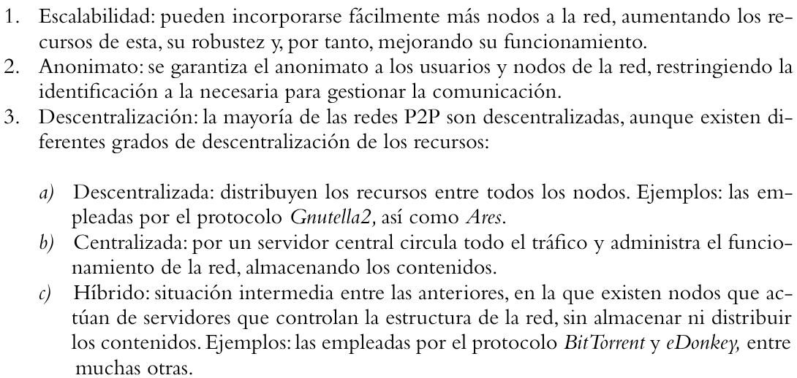
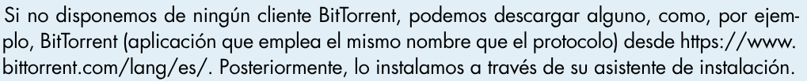
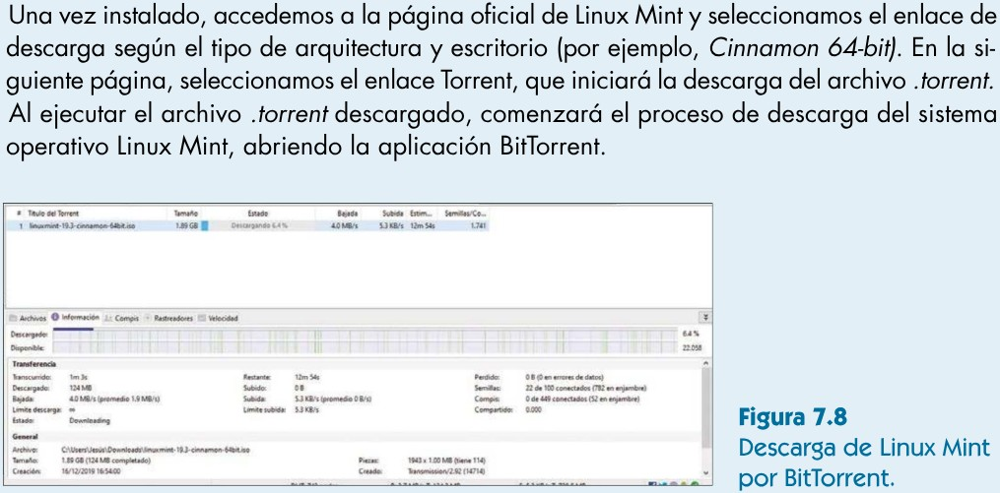
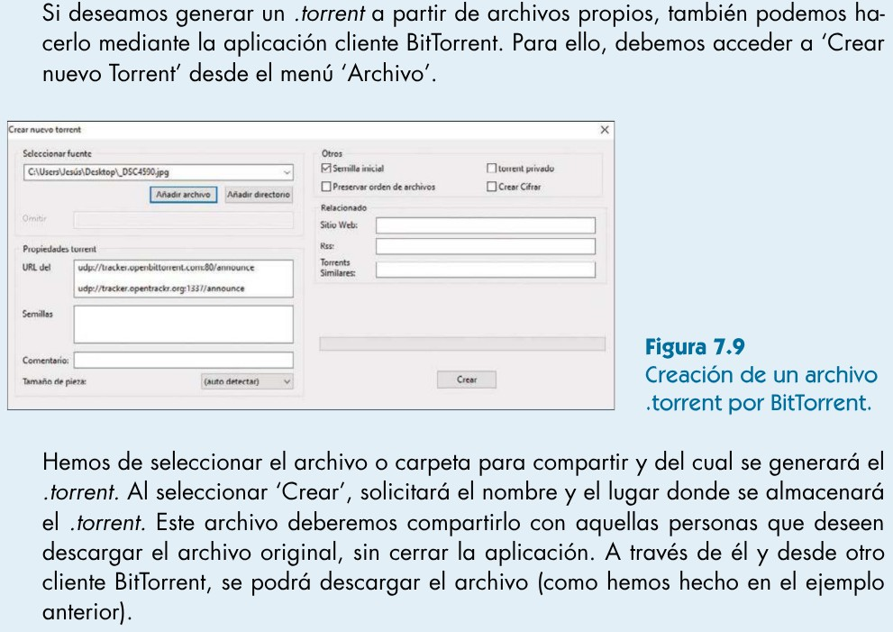
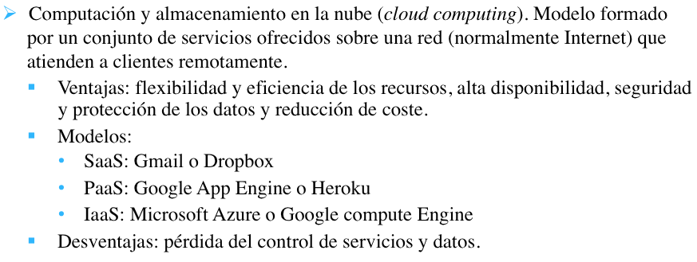

* **Protocolos Cliente-Servidor Tradicionales (FTP / SFTP / HTTP):** Todos los usuarios descargan el fichero desde un servidor centralizado. A mayor número de clientes concurrentes, mayor congestión del ancho de banda del servidor.
* **Protocolo BitTorrent (P2P - *Peer-to-Peer*):**
  * Divide los archivos grandes en pequeños fragmentos (piezas de 512 KB a 4 MB) con hashes criptográficos independientes para verificar su integridad.
  * Cada cliente que descarga un fragmento se convierte simultáneamente en emisor de ese fragmento para los demás participantes del enjambre (*swarm*).
  * **Conceptos Clave:**
    * **Tracker:** Servidor que mantiene la lista de direcciones IP de los clientes conectados al enjambre.
    * **Seeds / Semillas:** Clientes que disponen del fichero completo (100%) y lo comparten desinteresadamente.
    * **Leechers / Pares:** Clientes que están descargando y compartiendo los fragmentos que ya han recibido.
    * **Enlace Magnet (*Magnet link*):** Identificador criptográfico basado en el hash del contenido que permite descargar sin necesidad de alojar un archivo `.torrent` físico.

---

<h2 id="cloud-computing"><u>7. Computación en la Nube (Cloud Computing: IaaS, PaaS, SaaS)</u></h2>

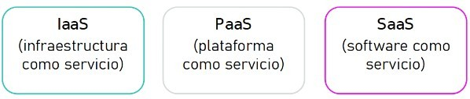
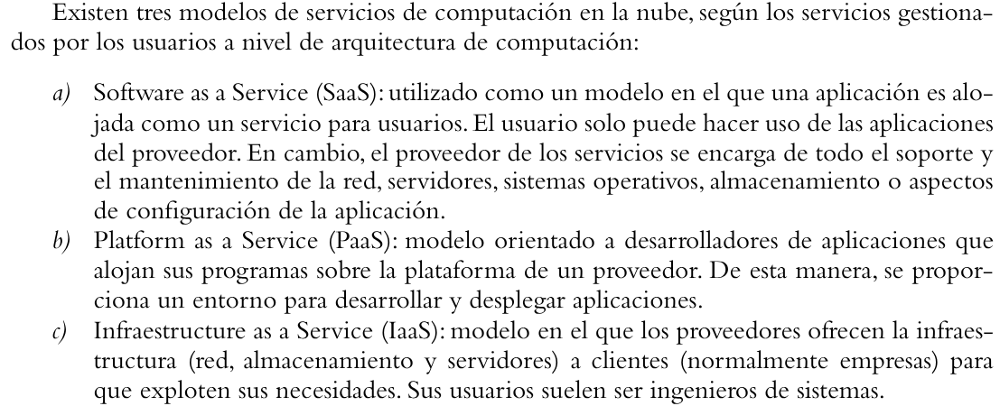
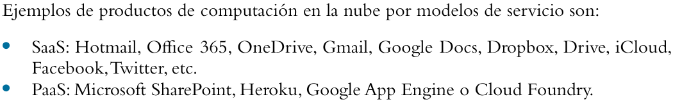

El **Cloud Computing** es el modelo que permite el acceso bajo demanda a través de la red a un conjunto compartido de recursos informáticos configurables (redes, servidores, almacenamiento, aplicaciones y servicios), que pueden ser aprovisionados rápidamente con un esfuerzo de gestión mínimo.

### 7.1 Modelos de Servicio en la Nube

```mermaid
flowchart TD
    subgraph IaaS["IaaS (Infraestructura como Servicio)"]
        direction TB
        I1["El proveedor gestiona: Hardware, Virtualización, Redes y Centro de Datos"]
        I2["El cliente gestiona: Sistema Operativo, Parches, Middleware y Aplicaciones"]
        I3["Ejemplos: AWS EC2, Microsoft Azure VMs, Google Compute Engine, Proxmox en la nube"]
    end
    subgraph PaaS["PaaS (Plataforma como Servicio)"]
        direction TB
        P1["El proveedor gestiona: Hardware, SO, Bases de Datos, Middleware y Runtime"]
        P2["El cliente gestiona: Únicamente su código fuente y los datos de su aplicación"]
        P3["Ejemplos: Heroku, Google App Engine, AWS Elastic Beanstalk, Firebase"]
    end
    subgraph SaaS["SaaS (Software como Servicio)"]
        direction TB
        S1["El proveedor gestiona: La totalidad de la infraestructura, plataforma y software"]
        S2["El cliente gestiona: Únicamente su suscripción, usuarios y configuraciones de uso"]
        S3["Ejemplos: Google Workspace, Microsoft 365, Dropbox, Salesforce, Trello"]
    end
```

| Capa / Responsabilidad | Modelo On-Premise (Local) | IaaS (Infraestructura) | PaaS (Plataforma) | SaaS (Software) |
| :--- | :---: | :---: | :---: | :---: |
| **Aplicaciones** | Cliente | Cliente | Cliente | **Proveedor** |
| **Datos** | Cliente | Cliente | Cliente | **Proveedor** |
| **Runtime (Entorno de ejecución)** | Cliente | Cliente | **Proveedor** | **Proveedor** |
| **Middleware** | Cliente | Cliente | **Proveedor** | **Proveedor** |
| **Sistema Operativo** | Cliente | Cliente | **Proveedor** | **Proveedor** |
| **Virtualización / Hipervisor** | Cliente | **Proveedor** | **Proveedor** | **Proveedor** |
| **Servidores físicos** | Cliente | **Proveedor** | **Proveedor** | **Proveedor** |
| **Almacenamiento masivo** | Cliente | **Proveedor** | **Proveedor** | **Proveedor** |
| **Redes y centro de datos** | Cliente | **Proveedor** | **Proveedor** | **Proveedor** |

---

<h2 id="copias-clonacion"><u>8. Copias de Seguridad y Clonación de Sistemas (Clonezilla)</u></h2>

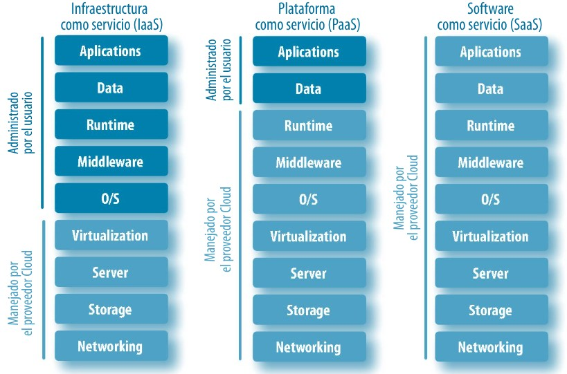
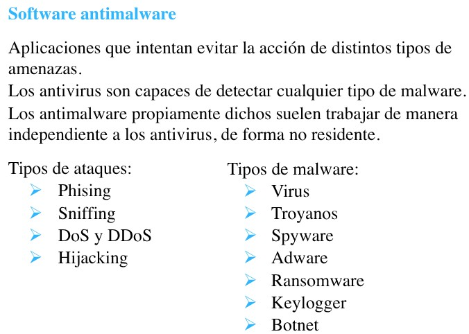
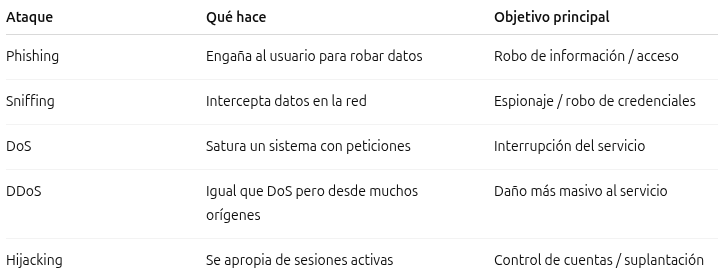
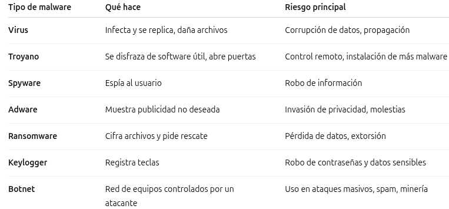
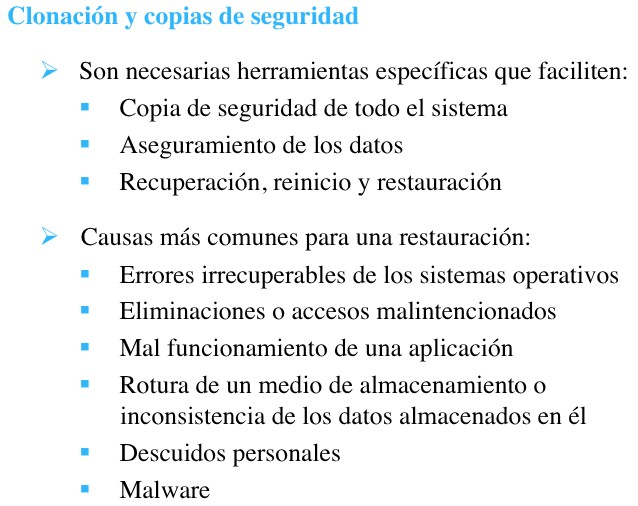
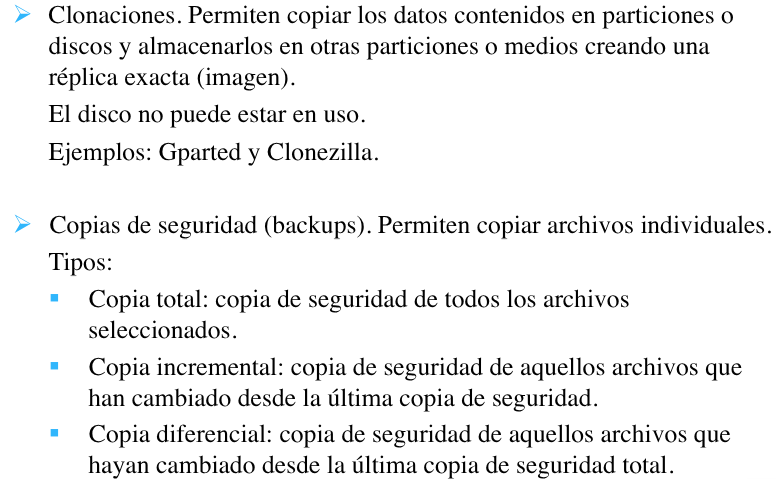
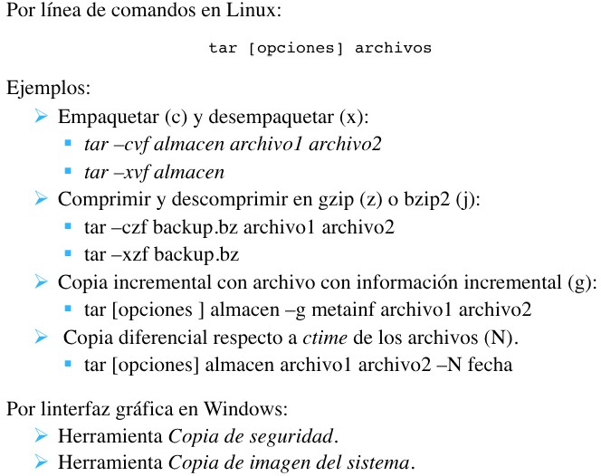
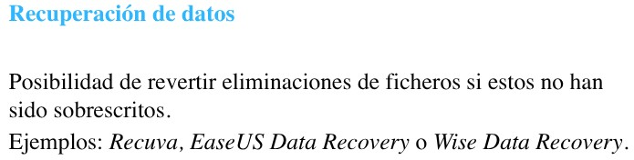
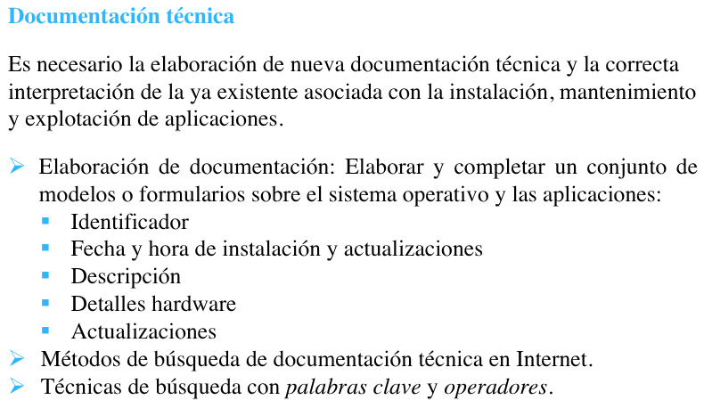

### 8.1 Copia de Seguridad (*Backup*) vs Clonación de Disco
* **Copia de Seguridad de Archivos:** Guarda copias periódicas de ficheros de usuario, bases de datos o carpetas seleccionadas. Ocupa poco espacio y permite recuperar versiones individuales de documentos borrados o modificados.
* **Clonación de Imagen de Disco:** Captura una réplica sector por sector (o bloque a bloque ocupado) de la totalidad del disco duro, incluyendo el gestor de arranque (MBR/GPT), particiones del sistema, sistema operativo, controladores, programas instalados y configuraciones. Permite recuperar un equipo inutilizado (*bare-metal restore*) en minutos.

---

### 8.2 Herramienta de Clonación Clonezilla
Clonezilla es una distribución de Linux en Live-CD/USB diseñada para clonación masiva y creación de imágenes de disco:
* **Soporte de Sistemas de Ficheros:** Utiliza herramientas especializadas según el formato: **Partclone** (para ext2/3/4, NTFS, FAT, HFS+, XFS), que clona únicamente los bloques que contienen datos reales, ahorrando espacio y tiempo. Para sistemas de ficheros no soportados, utiliza `dd` para clonar sector por sector de forma exacta.
* **Modos de Trabajo:**
  * **`device-image`:** Guarda o restaura una imagen del disco completo en un medio de almacenamiento secundario (disco duro externo USB, servidor Samba o recurso NFS en red local).
  * **`device-device`:** Clona directamente un disco físico de origen sobre otro disco físico de destino conectado a la misma máquina.

---

<h2 id="actividades-practicas"><u>9. Actividades Prácticas y Ejercicios Guiados</u></h2>

### Actividad 1: Identificación y Clasificación de Símbolos y Licencias
Identifica los siguientes símbolos legales y determina el tipo de licencia bajo el que se distribuyen las aplicaciones:
* Símbolos: Copyright (©), Dominio Público, Copyleft (🄯).
* Aplicaciones: Microsoft Office, LibreOffice, Adobe Photoshop, Notepad++, GIMP.

<details>
<summary><b>Ver Solución</b></summary>

1. **Significado de los símbolos:**
   * **Símbolo de Copyright (©):** Indica obra protegida con derechos exclusivos de autor. El titular reserva todos los permisos de uso, copia y distribución.
   * **Símbolo de Dominio Público:** Indica que la obra no tiene restricciones de propiedad intelectual y puede ser usada, modificada o comercializada libremente por cualquiera.
   * **Símbolo de Copyleft (🄯):** Variación de copyright que garantiza el acceso libre al código e impone que cualquier obra derivada conserve obligatoriamente la misma licencia libre (e.g. GPL).
2. **Clasificación de licencias de las aplicaciones:**
   * **Microsoft Office:** Software Propietario / Comercial (EULA privativa con pago de licencia o suscripción).
   * **LibreOffice:** Software Libre con Copyleft débil/medio (**Mozilla Public License v2.0 - MPLv2** y LGPLv3).
   * **Adobe Photoshop:** Software Propietario / Comercial (licencia de suscripción en Adobe Creative Cloud).
   * **Notepad++:** Software Libre con Copyleft fuerte (**GNU General Public License v3 - GPLv3**).
   * **GIMP:** Software Libre con Copyleft fuerte (**GNU General Public License v3 - GPLv3**).
</details>

---

### Actividad 2: Elaboración de un Modelo de Parte de Incidencias
Diseña una plantilla estructurada de parte de incidencias para el departamento de soporte informático de un centro educativo o empresa.

<details>
<summary><b>Ver Solución</b></summary>

```text
================================================================================
                         PARTE DE INCIDENCIA TÉCNICA
================================================================================
Nº de Incidencia: INC-2026-0042        Fecha/Hora Apertura: 2026-10-20 09:15
Técnico Asignado: Ginés Asensio        Estado: [X] Asignada  [ ] En curso  [ ] Resuelta

1. DATOS DEL USUARIO Y EQUIPO
--------------------------------------------------------------------------------
Usuario / Docente: Ana Martínez         Departamento: Ciclos Formativos (Informática)
Ubicación / Aula: Aula 204 (Puesto 12)  Teléfono / Extensión: 4212
Nombre de Host: PC-AULA204-12           Dirección IP: 192.168.10.112
Sistema Operativo: Ubuntu 24.04 LTS     Dirección MAC: 00:1A:2B:3C:4D:5E

2. CLASIFICACIÓN DE LA INCIDENCIA
--------------------------------------------------------------------------------
Tipo:      [ ] Hardware     [X] Software     [ ] Red/Conectividad   [ ] Seguridad
Prioridad: [ ] Crítica      [ ] Alta         [X] Media              [ ] Baja

3. DESCRIPCIÓN DEL SÍNTOMA OBSERVADO
--------------------------------------------------------------------------------
El usuario reporta que al abrir LibreOffice Writer la aplicación se cierra de
forma inmediata arrojando un mensaje de error de 'violación de segmento (core dumped)'.
El problema persiste tras reiniciar la estación.

4. DIAGNÓSTICO Y ACCIONES REALIZADAS
--------------------------------------------------------------------------------
- Comprobación de espacio en disco: OK (df -h muestra 45 GB libres).
- Ejecución desde terminal: se identifica conflicto en el perfil de usuario (~/.config/libreoffice).
- Renombrado del directorio de configuración corrupto:
  mv ~/.config/libreoffice ~/.config/libreoffice.old
- Relanzamiento de la aplicación: LibreOffice recrea el perfil limpio correctamente.

5. RESOLUCIÓN Y CIERRE
--------------------------------------------------------------------------------
Fecha y Hora de Cierre: 2026-10-20 10:05
Tiempo de Intervención: 50 minutos
Conformidad del Usuario (Firma): _______________________
================================================================================
```
</details>

---

### Actividad 3: Configuración de Cuenta en Mozilla Thunderbird
Describe los pasos técnicos para vincular una cuenta de correo corporativa en Mozilla Thunderbird mediante protocolos seguros.

<details>
<summary><b>Ver Solución</b></summary>

1. Abrir Mozilla Thunderbird y acceder a **Ajustes de la cuenta > Añadir cuenta de correo**.
2. Introducir el Nombre completo, dirección de correo electrónico y contraseña.
3. Seleccionar **Configuración manual** e indicar los parámetros del servidor:
   * **Servidor de correo entrante (IMAP):**
     * Nombre del servidor: `imap.servidor.com` (o `imap.gmail.com`)
     * Puerto: `993`
     * Seguridad de la conexión: **SSL/TLS**
     * Método de autenticación: **OAuth2** (o Contraseña normal con cifrado)
   * **Servidor de correo saliente (SMTP):**
     * Nombre del servidor: `smtp.servidor.com` (o `smtp.gmail.com`)
     * Puerto: `465` (SSL/TLS) o `587` (STARTTLS)
     * Seguridad de la conexión: **SSL/TLS**
     * Método de autenticación: **OAuth2**
4. Pulsar en **Probar configuración** y tras validar los certificados, hacer clic en **Hecho**.
</details>

---

<h2 id="recursos"><u>10. Videografía y Recursos Complementarios</u></h2>

* **Richard Stallman y el origen del Software Libre:** [https://www.youtube.com/watch?v=8SdPLG-_wtA](https://www.youtube.com/watch?v=8SdPLG-_wtA)
* **Diferencias entre Software Libre y Open Source:** [https://www.genbeta.com/a-fondo/cual-es-la-diferencia-entre-el-software-libre-y-el-open-source](https://www.genbeta.com/a-fondo/cual-es-la-diferencia-entre-el-software-libre-y-el-open-source)
* **Gestión de incidencias y herramientas de Ticketing:** [https://www.youtube.com/watch?v=IpOeHLqtdO8](https://www.youtube.com/watch?v=IpOeHLqtdO8)
* **Diferencias entre Help Desk (CAU) y Service Desk:** [https://www.youtube.com/watch?v=66H0FFv3wUM](https://www.youtube.com/watch?v=66H0FFv3wUM)
* **¿Qué es IaaS, PaaS y SaaS en Cloud Computing?:** [https://www.youtube.com/watch?v=VR8aXePkQ5M](https://www.youtube.com/watch?v=VR8aXePkQ5M)
* **Cómo crear un pendrive booteable con Clonezilla:** [https://www.youtube.com/watch?v=A52PloXVzPc](https://www.youtube.com/watch?v=A52PloXVzPc)
* **Cómo hacer una imagen completa de disco con Clonezilla:** [https://www.youtube.com/watch?v=lway89rHXdw](https://www.youtube.com/watch?v=lway89rHXdw)
* **Restaurar una imagen de disco con Clonezilla:** [https://www.youtube.com/watch?v=yvD-x9NtLGQ](https://www.youtube.com/watch?v=yvD-x9NtLGQ)
* **Crear imagen del sistema en Windows 11:** [https://www.youtube.com/watch?v=OZBjuqU8crs](https://www.youtube.com/watch?v=OZBjuqU8crs)
* **Copias de seguridad y restauración en Ubuntu:** [https://www.youtube.com/watch?v=_9ZMUyW-vIc](https://www.youtube.com/watch?v=_9ZMUyW-vIc)

